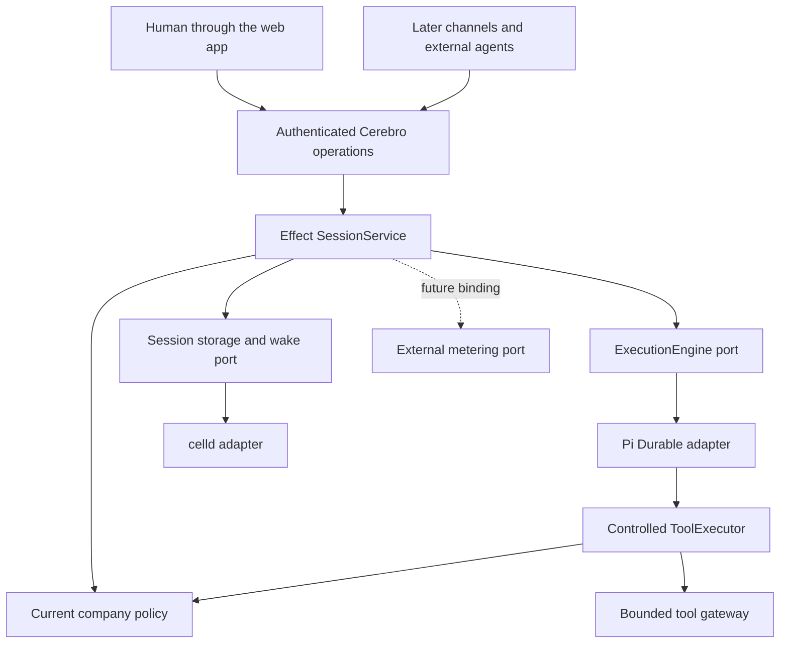

# Cerebro direction, decisions, and roadmap

Revised on 2026-10-09. This document records the agreed direction. The browser wire changed after the first-slice integration; the [chat simplification design](../superpowers/specs/2026-10-09-chat-simplification-design.md) explains that change. The [first-slice execution plan](2026-10-05-cerebro-slice-1-plan.md) defines the remote-agent packets and acceptance gates. The [proposed architecture record](adr-0001-replaceable-application-boundaries.md) defines the dependency rules. The runtime integration remains unqualified. These documents do not describe a completed migration.

## Product goal

Cerebro gives companies one controlled place to use their data and direct work by humans, agents, and automations.

Company identity, permissions, knowledge, approvals, and execution records remain under company control. Model providers supply inference. They do not own Cerebro's company rules or product history.

Chat is the first interaction. Other channels, agents, and native tools can use the same operations later. Changing a model, engine, or host must not require a new company-policy implementation.

## Selected direction

| Decision | Scope |
| --- | --- |
| Retain celld | Keep the existing self-hosted deployment. Qualify the selected Pi integration on the actual host before implementation fan-out. |
| Use Pi Durable | Replace OpenCode with one durable agent loop per company-scoped conversation. Keep private Pi state inside its adapter. |
| Deliver domain frames to the browser | The Durable Object emits Cerebro observation frames. The API forwards them. The web app applies them to one projection. No AG-UI or TanStack layer and no second model or tool loop. |
| Use Effect TS | Write new Cerebro orchestration and adapters as Effect services with typed failures, Layers, cancellation, and scoped resources. |
| Preserve company authority | Keep current authorization, pinned agent grants, connector controls, approval binding, and durable tool receipts. |
| Define external metering ports only | The first slice has no active reservation or spend enforcement through that port. A future external provider owns pricing, balances, holds, and settlement. |
| Keep components replaceable | Select concrete adapters through Effect Layers. Keep host, engine, and UI SDK types out of application contracts. |
| Execute remotely and integrate locally | Remote agents work on separate branches after a contract freeze. The local coordinator merges, wires, and verifies the complete application. |
| Defer native Python execution | The first slice uses Pi Durable on celld. A native worker is a separate task once its product need is clear. |

Keep one supported implementation per boundary. A generic plugin framework and runtime fallback selectors are outside this slice.

## Component responsibilities

These are responsibilities. They do not require a process or package for each box.

The session service accepts durable commands and exposes authorized observations. Pi owns the agent loop, private transcript, inbox, retries, compaction, and engine recovery. Cerebro owns permissions, approval decisions, stable operation identities, canonical product history, and recovery of its handoff to Pi.

Effect controls composition, failures, cancellation, and resource lifetime inside Cerebro. Effect fibers alone do not survive a host crash. The engine and host adapters provide persistence and wake-up.

The web app consumes Cerebro observation frames directly. A client that needs another protocol gets one mapper at the API edge over the same frames. Cerebro permissions remain server rules. Protocol compatibility does not supply authorization.

## State ownership

| State | Authority |
| --- | --- |
| Company identities, memberships, grants, agent definitions, and connector configuration | Existing company services and PostgreSQL. |
| Admission receipts, product run state, approvals, tool intent, outcomes, and canonical history | Cerebro records in the session store. |
| Private transcript, model context, inbox, and engine checkpoints | The selected Pi integration. |
| Remote tool outcome | Provider evidence and Cerebro dispatch and reconciliation receipts. |
| Browser and channel messages | Authorized projections. They do not admit work or decide that a run completed. |
| Files and large artifacts | Existing artifact storage. |
| Future pricing, balances, reservations, and settlement | An external metering provider behind the port. |
| Historical usage and budget records | Preserved company records. They do not become an active internal reservation system in this slice. |

A future host change preserves application contracts but needs qualified persistence, wake-up, fencing, and restore. A future engine change also needs an explicit conversion or retirement decision for private checkpoints.

## Existing foundation retained

| Component | Responsibility |
| --- | --- |
| Hono and oRPC | Authenticated API entry and operation contracts. |
| Better Auth and enterprise identity | Human sessions, SSO, provisioning, and deactivation. Company resource policy remains separate. |
| PostgreSQL and Drizzle | Company records, identity, policy, memory metadata, and audit views. |
| Durable Object SQLite | Local durable execution records and supported private engine storage. |
| Existing runtime and artifact object storage | Self-hosted persistence, backups, and artifacts. |
| Current channel services | Inbox deduplication, projections, replies, and audience checks. |
| Registered tool gateway | Bounded arguments and outputs, controlled destinations, credential isolation, and durable receipts. |
| Memory services | Controlled access to company knowledge and content dependencies. |

The implementation plan changes only the callers required by the new session boundary. It does not rewrite identity, memory, or all database access.

## First-slice behavior

The first slice delivers authenticated human chat with incremental text, citations, tool progress, action approval, durable Stop, protected history, reconnect, and recovery.

A submission has a stable event ID and an input digest. A matching retry returns the same durable receipt. A changed intent with the same ID conflicts.

Approval binds one effect intent. Execution rechecks current authority after the wait and before dispatch. A duplicate approval cannot repeat a completed write.

An uncertain non-idempotent tool outcome blocks repeat execution until provider evidence resolves it. A local timeout or cancellation does not prove that a remote effect did not occur.

Reconnect loads canonical state and attaches to the existing run. Snapshot and subscription ordering must not miss completion. Provisional text can be replaced by canonical output. Exact replay of every lost text chunk is outside this slice.

The server rechecks authentication and content access during observation. An explicit stream denial clears protected client state and stops automatic reconnect. Delayed frames from old access cannot restore revoked content.

The cutover fences old OpenCode admission, alarms, turns, tool dispatch, and delivery before snapshots and queue retirement. New conversations use new engine identities. Old work cannot resume under Pi.

## Delivery sequence

| Stage | Owner and result |
| --- | --- |
| S1-0 | One qualification owner proves compatible pins, celld execution, durable handoff, approval wait, cancellation, observation, and an AI SDK-free candidate dependency graph. The coordinator freezes contracts. |
| S1-A | Remote runtime owner builds the Pi, storage, and wake adapters against frozen Effect ports. |
| S1-B | Remote authority owner preserves permissions, approvals, and controlled tool execution. |
| S1-C | Remote UI owner builds TanStack state and the AG-UI adapter. Both were removed on 2026-10-09. |
| S1-D | Remote infrastructure owner prepares deployment, counted fixtures, crash triggers, and restore checks. |
| S1-F | Local coordinator merges the packets, wires services, removes legacy paths, and verifies one complete application PR. |

A through D run in parallel after S1-0. Shared contracts, manifests, lockfiles, API composition, and final acceptance have one coordinator owner.

The [execution plan](2026-10-05-cerebro-slice-1-plan.md) contains exact file scopes, commands, remote prompts, ten integrated acceptance scenarios, and initial performance budgets.

## Later stages

| Stage | Product outcome |
| --- | --- |
| Stage 2 | Distinct internal and external agent identity, delegation, argument-derived resource grants, a qualified production write connector, and capability administration. |
| Stage 3 | Slack through the selected channel adapter, with the same session commands, policy, approvals, receipts, and audience checks. |
| Stage 4 | A selected company workflow that requires native Node or Python tools, browser review, or multiple agents. |
| External metering | A selected vendor binds the port and proves reservation, denial, idempotency, settlement, release, outage, and reconciliation behavior. |

Agent authentication, Chat SDK, and additional tool workers remain candidates for their respective stages. The first slice does not adopt every proposed package.

## Qualification limits

The selected Pi host wrapper, published package pins, durable approval wait, run-specific cancellation, and client attachment still need executable proof on celld.

A failed qualification keeps the implementation step open. Contract fakes and successful typechecks cannot qualify host persistence or recovery.

The plan requires fixture counters, crash evidence, clean dependency resolution, browser checks, and a separate live model and controlled MCP read. Performance budgets are acceptance targets, not production capacity guarantees.
