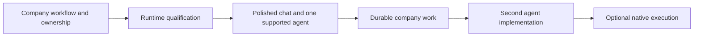

# Cerebro direction, decisions, and roadmap

Working summary dated 2026-10-02. The roadmap below is a proposal, not an approved implementation plan.

This document combines the conversations "Assess agent architecture and UX" and "Plan company Cerebro MVP" with the repository and research discussed there. The separate side chat is not available through the chat tools. Its transcript is still needed. No decisions from that unavailable chat are assumed here.

## The product goal

Cerebro is a company platform where people, agents, and deterministic automations use shared resources under company rules.

The user's phrase "operating system for AI-native companies" describes the product's role. Companies need shared identity, permissions, knowledge, tools, durable work, approvals, budgets, and an audit record. Chat is one way to use those capabilities. Events and schedules are other ways.

A good default agent remains useful for the first release. The product must also support other agent implementations. Company work must remain accessible when an agent, model, conversation, or execution process changes.

For example, an agent can prepare a purchase request, another agent can review it, and a person can approve it. All three act on the same request. The request and approval cannot exist only in one agent's private context. This is an illustration of the goal, not the selected launch workflow. An existing business system can remain the authority for the request.

## Explicit requirements and preferences

| Requirement or preference | Consequence for the roadmap |
| --- | --- |
| Build a company platform that supports AI-native work. | Define shared company resources and work before selecting the final agent runtime. |
| Deliver a familiar, responsive chat experience. | Treat interaction, streaming, recovery, and clear tool activity as acceptance criteria. |
| Use AI SDK v7. | The current v6 dependency is an unmet requirement. Qualify and migrate the dependent packages together. |
| Reuse existing agent and chat library behavior. | Use supported loops, streams, and harness adapters when they fit. Keep company policy in Cerebro. |
| Start with usable defaults. Full plug-and-play support is not required. | Deliver one supported implementation first. Avoid a general plugin marketplace or large runtime framework. |
| Allow future Pi, native AI SDK, and fx implementations. | Keep the chat and company contracts independent of one engine. Preserve engine-specific recovery state. |
| Prefer ordinary agent execution inside celld. | Test compatible implementations there before introducing another execution host. |
| Avoid a container for every conversation. | Share physical hosts. Add native execution only when a task requires it. |
| Keep the platform self-hostable. | Retain a repeatable local deployment and replaceable external integrations. |
| Understand the design visually before changing it. | Review concrete flows and tradeoffs before a migration. |
| Evaluate Effect TS for more reliable application code. | Assess a bounded lifecycle or service integration. A full rewrite is not an agreed decision. |

Pi is the preferred candidate discussed in this conversation. Its exact package, integration, and execution location remain open. Rivet and camelRun are research candidates. Neither has been selected for adoption.

## Earlier foundation that still applies

The [original architecture record](/Users/jhonsfran/repos/cerebro/docs/superpowers/plans/2026-09-28-cerebro-architecture.md) establishes these choices. The current product direction extends that foundation.

| Foundation | Current meaning |
| --- | --- |
| celld and Durable Objects | The current deployment and durable session model. An alternative requires evidence that it improves the intended workload. |
| Normal API Worker | Hono runs as a celld Worker. Node compatibility flags do not make it a Node process. |
| Docker Compose and native celld deployment | The supported local deployment path. Alchemy is outside the initial path. |
| PostgreSQL and Drizzle | Shared identities, agent definitions, policy, memory, accounting, and audit views. A separate PostgREST server was not selected. |
| Durable Object SQLite and Drizzle | Cerebro's local execution records. Libraries own their private tables and state through supported adapters. |
| MinIO | Self-hosted object storage for runtime durability and application artifacts. R2 is a possible deployment adapter, not a requirement. |
| Internal principals and explicit delegation | Humans, services, and agents have stable identities. Login providers do not define the domain's identity model. |
| Better Auth and enterprise identity | SSO, provisioning, deactivation, and current application permissions remain distinct concerns. Entra integration needs real-provider qualification. |
| Budget and entitlement ports | Unprice is the intended external adapter. Company-wide reservations must work across concurrent sessions. |
| Decision port | Jev is the intended adapter for ambiguous requests. Deterministic policy still decides access, approvals, and spending. |
| Scoped memory and connectors | Retrieved facts and summaries retain provenance and current access restrictions. Credentials stay in trusted adapters. |

The repository currently has a local budget authority and full-text memory. The [Session 7 record](/Users/jhonsfran/repos/cerebro/docs/implementation/session-7.md) says that production Unprice, Jev, and semantic retrieval adapters remain incomplete. A configured PostgreSQL vector extension does not prove semantic retrieval is implemented.

## The concepts we separated

| Concept | Responsibility |
| --- | --- |
| Agent definition | Versioned instructions, model selection, allowed tools, and configuration. One definition can serve many conversations. |
| Conversation | Participants and the user-visible history. It is separate from a login session. |
| Run | One admitted request or scheduled execution with its own identity and status. |
| Harness | The code that manages model calls, tool calls, context, and stopping behavior. |
| Durable Object or actor | A logical owner of durable state and lifecycle. It is not necessarily a process or container. |
| Execution host | The process or service that runs harness code. One host can run many independent sessions. |
| Tool environment | The restricted environment for a tool call or generated code. It can differ from the harness host. |
| Business workflow | Shared work that can span conversations, people, agents, and long waits. |
| Transcript | Common presentation history. It is not a complete engine checkpoint or business database. |
| Engine checkpoint | Private recovery state tagged with the engine, format, and version. |

A shared celld host already runs independent logical cells. A shared Node host could also run independent Pi sessions. In the second arrangement, Pi executes in Node. celld coordinates it through requests and durable records.

Hundreds of saved conversations do not imply hundreds of active model loops. Idle state can leave memory. Concurrent active work requires a capacity test. The current [Compose configuration](/Users/jhonsfran/repos/cerebro/compose.yaml) permits 16 resident cells. Other Durable Objects also use those cells. That limit is not a measured conversation capacity.

## Research findings and corrections

### Cerebro already uses library behavior

OpenCode currently owns the model and tool loop. `AIChatAgent` and `useAgentChat` provide chat persistence, transport, and replay. Cerebro adds policy, durable operations, approvals, cancellation, accounting, and event translation.

The maintenance problem is the amount of engine-specific lifecycle and translation code around those libraries. It is inaccurate to say that the entire model loop was built from scratch. See [OpenCode integration](/Users/jhonsfran/repos/cerebro/packages/runtime/src/opencode-adapter.ts) and [chat ownership](/Users/jhonsfran/repos/cerebro/docs/implementation/chat-primitives.md).

### AI SDK supplies the harness integrations

AI SDK v7 has `HarnessAgent`, `@ai-sdk/harness-pi`, and `@ai-sdk/harness-fx`. The fx integration uses ACP. Use these supported integrations before writing equivalent stream adapters. The harness packages are experimental, so pin and qualify their behavior. [Pi adapter](https://ai-sdk.dev/providers/ai-sdk-harnesses/pi), [fx adapter](https://ai-sdk.dev/providers/ai-sdk-harnesses/fx).

A common SDK interface does not guarantee that every implementation runs inside a Worker. Cerebro still needs a small lifecycle integration for durable admission, cancellation, resume, and recovery. A Pi checkpoint cannot be treated as an fx checkpoint.

### Pi inside celld remains a compatibility question

The official full Pi adapter runs Pi in the host Node process. Its sandbox supplies files and shell execution. A host can serve multiple conversations. This does not require a container per conversation. [Official execution model](https://ai-sdk.dev/providers/ai-sdk-harnesses/pi).

The inspected adapter's separate-filesystem path calls `syncBuiltinESMExports()`, which the inspected workerd version does not implement. `nodejs_compat` alone does not resolve that mismatch. [Pi filesystem adapter](https://github.com/vercel/ai/blob/eee1954ddd8ccf5e6c9a8582a826fba8b256653b/packages/harness-pi/src/pi-workspace-vfs.ts#L366), [workerd implementation](https://github.com/cloudflare/workerd/blob/10e79b8b3ebd1161d308a78ee65585e818b44f59/src/node/module.ts#L110).

Lower-level Pi core and native AI SDK execution are separate candidates for an embedded loop. A shared-filesystem variant could avoid that adapter path. None of these alternatives has passed a Pi prompt, controlled tool, restart, and recovery test in this repository.

just-bash supplies a virtual JavaScript shell with selected commands. It is useful for bounded file and shell tasks. It does not supply unrestricted Linux execution. The initial integration also needs durable files. A session identifier alone is not a durable filesystem or Pi checkpoint.

Cloudflare's preview worker-shell example connects a just-bash worker to a Durable Object filesystem. It is a useful example of execution without a container. It does not prove a Pi integration or compatibility with Cerebro's celld loader. [Inspected example](https://github.com/cloudflare/computer/blob/60d900254c0b214bd15d0ef95002c7f979cd59f9/examples/worker-shell/README.md).

### Current camelAI differs from its old architecture article

camelAI moved agent execution from its former chat Durable Object to camelRun in September. Its old agent-in-a-DO article now describes a historical implementation. The authors report memory pressure, deployment interruptions, and recovery complexity. Their experience is evidence about their deployment, not a benchmark of self-hosted celld. [Updated article](https://camelai.com/blog/our-coding-agent-runs-in-a-cloudflare-durable-object-not-a-vm), [migration rationale](https://camelai.com/blog/should-you-build-on-cloudflare).

Current camelAI keeps company and workspace rules in the application. The runtime owns active agent history. The browser gets scoped read access. Application routes handle writes, and tool calls check current company access. Shared project files differ from private agent scratch files. Deterministic automations use company tools without a model loop. [Inspected runtime integration](https://github.com/qaml-ai/camelAI/blob/07d9663ba4063bfa32573f0904b44718d966deac/workers/main/src/agent-runtime/thread-runtime.ts).

camelRun uses PostgreSQL for ownership and configuration, and object storage for durable logs and files. Its default mode uses one Node process per awake agent. An inline mode hosts multiple agents in one process. Generated JavaScript runs through restricted QuickJS tool capabilities. Completed messages are durable. Streaming deltas are transient. [Runtime source](https://github.com/qaml-ai/run/tree/2c11f1ff3984fe1372ddc01f702db97cadc3b770).

The useful lesson is explicit ownership and recovery behavior. Copying the same hosting design is a separate decision.

### Rivet separates durable actors from optional computers

Rivet's control plane places and routes actors. Application worker processes execute their code and can host many actors. An actor can represent a conversation, workflow, or resource. Actions run concurrently by default. Queues and transactions supply ordering when required. [Architecture](https://rivet.dev/docs/architecture/), [action concurrency](https://rivet.dev/actors/docs/actions/).

agentOS adds a virtual filesystem, processes, execution, and policy. A shared native sidecar hosts many virtual environments. Completed session events and durable files survive sleep. Active processes and streaming deltas do not. The current agentOS integration needs a native host. Base Actor support for Workers does not establish agentOS support in Workers. [agentOS architecture](https://rivet.dev/agentos/docs/architecture/), [persistence](https://rivet.dev/agentos/docs/architecture/sessions-persistence/).

Rivet is evidence that durable logical ownership can coexist with shared physical execution. It has not been selected or benchmarked against Cerebro.

### Web chat and channel integration have different needs

The shadcn chatbot template provides useful composer, message, scrolling, and tool UI patterns. Adapt those patterns to the current React application. Adopting its entire Next.js backend is not required. [Inspected template](https://github.com/shadcn-ui/chatbot-template/tree/55c9330d6251052c111cf93cc429efb387609b89).

Direct AI SDK v7 integration is the proposed rich browser transport. Chat SDK is a candidate for external channels such as Slack. Its inspected Web adapter handled text but omitted some structured task and plan parts. Recheck that behavior before selecting it as the rich browser transport. [Inspected Web adapter](https://github.com/vercel/chat/blob/4b458b4c345ee61056fa4d4d6877593dc2a38107/packages/adapter-web/src/adapter.ts#L460).

The chat needs immediate send feedback, streaming Markdown, usable drafts, keyboard controls, and stable scroll behavior. Tool activity, citations, and approvals belong to the relevant turn. Stop must send a durable command. Reconnect must recover the existing run without another paid request.

### Durability requires more than a database

Persist intent before external execution. Use stable operation IDs and provider idempotency where available. Store results afterward. If the provider succeeds before the result is saved, record an unknown outcome and reconcile it. A workflow engine or SQL ledger alone cannot guarantee exactly-once remote effects.

Shared company limits need one budget authority across sessions. Reserve before paid work. Settle actual usage after completion or cancellation. An audit export can be eventually consistent. Authorization and budget admission must use current authoritative state.

SQLite and object storage are complementary. SQLite holds transactional records. Object storage holds large files and logs. Engine files, shared workspaces, transcripts, and business records need distinct owners. Filesystem ownership and exact schemas remain design work.

A restricted Dynamic Worker isolates its JavaScript adapter. A remote MCP server still executes the remote tool. Sandbox permissions also do not define company authorization. Keep current resource grants, delegation, approvals, and budgets in the company boundary.

Effect TS can improve typed failures, cancellation, and resource lifetime inside a process. Persistent recovery still requires durable records and a defined restart protocol. Effect does not make a Node-dependent library Worker-compatible.

### Performance must be measured at each stage

An earlier implementation buffered model output until accounting completed. The later chat change added early streaming. It also removed a repeated history-fetch loop. The current design therefore cannot be assessed only through the older buffered-response measurements. [Chat verification](/Users/jhonsfran/repos/cerebro/docs/implementation/chat-primitives.md).

The chat record reports one real-model run with first text at 18.1 seconds and completion at 19.4 seconds. Those observations do not isolate model delay, runtime delay, or rendering delay. They do not establish production capacity. Measure admission, provider first token, client first text, tool duration, completion, reconnect, memory, and concurrent work separately.

## Proposed responsibility boundaries

| Owner | State or behavior |
| --- | --- |
| Company services | Current identities, grants, integrations, shared resources, budgets, and business records. External systems can own business records. |
| Conversation or execution coordinator | Request deduplication, run status, durable cancellation, approval references, and recovery coordination. |
| Selected agent implementation | Model context, compaction, engine behavior, and private checkpoint state. |
| Tool broker | Current authority, scoped credentials, execution limits, stable operation identity, and dispatch receipts. |
| Durable workflow | Shared progress and waits that span agents, conversations, or human actions. |
| User interface | Presentation, input, provisional streaming output, and recovery feedback. |

The exact transcript authority is open. Embedded execution could retain a session-owned transcript. A remote runtime could own it with a product projection. Each record needs one authority. Avoid two stores that both claim to own the same state.

Keep per-conversation execution separate from shared company resources. Shared records and workflows need their own explicit ownership. This does not require one Durable Object for the whole company or one mutable agent session for all users.

The earlier pilot deferred facet-based sessions because they couple child placement and lifecycle to a parent. Revisit them only when the shared ownership is useful for a specific resource.

## Choices that remain open

| Choice | Evidence needed |
| --- | --- |
| First supported engine and host | Native celld execution of a real turn, a controlled tool, cancellation, restart, and recovery. Compare the official full Pi adapter only on a compatible host. |
| Whether to adopt Rivet or camelRun | A demonstrated requirement that the current celld design does not meet, plus deployment, cost, compatibility, and operational comparisons. |
| Transcript and checkpoint ownership | A restart trace that shows which component reconstructs the conversation and the engine. |
| Shared workspace and private scratch storage | Required file operations, tenant scope, durability, retention, and simultaneous write behavior. |
| Workflow implementation | One business flow with a human wait, a duplicate event, a crash, and a shared record. |
| Effect TS scope | A bounded integration that reduces failure and cancellation complexity without adding unnecessary adapters. |
| Launch workflow and pilot limits | A real company use case, expected users, workload, access rules, and measured latency and cost targets. |
| Live external integrations | Real-provider checks for the selected model, MCP source, identity provider, channel, budget authority, and decision adapter. |

## Proposed roadmap

This is a dependency order, not a schedule. UX prototypes can begin during runtime qualification. Native execution can move earlier if the launch workflow requires it.

| Phase | Reviewable result | Exit condition |
| --- | --- | --- |
| 0. Consolidate direction and baseline | Side-chat decisions merged, one launch workflow, explicit state owners, and current latency and resource measurements. | Trace how a person and an agent act on the same company record. Identify what survives a chat or runtime change. |
| 1. Qualify the runtime | One small SDK v7 integration with a candidate engine and the existing policy and tool controls. | A real turn, controlled tool, approval, Stop, reconnect, crash recovery, and accounting work on the target host. No repeated uncertain effects. |
| 2. Deliver the chat | Reviewed UX prototype followed by one complete default agent experience. | Send feedback, streamed content, drafts, scroll behavior, tools, citations, approvals, errors, reload, and revocation work together. |
| 3. Deliver company work | One business workflow through shared resources, controlled actions, and a durable human approval. | A duplicate event or process restart preserves progress. Different conversations can inspect the same work under current permissions. |
| 4. Prove replacement | A second agent implementation through the same product contracts. | Company policy, chat, accounting, tools, and business records continue to work. Private checkpoints remain correctly typed. |
| 5. Add native execution when needed | A bounded execution backend for repository work, native tools, or preview servers. | Workspace changes and artifacts survive the job. Measured cost and latency justify the backend for its required tasks. |

Pilot qualification belongs to every phase. Preserve restore, revocation, duplicate-request, accounting, and unknown-outcome checks during the migration. Run capacity and live-provider checks before claiming production readiness.

## What we can retain and what needs to change

Retain the principal model, company policy, budget authority, controlled tool boundary, durable receipts, scoped memory, and self-hosted deployment. Those are company-platform capabilities.

Reassess engine-specific translation, private state handling, chat interactions, and ownership of shared work. The SDK v7 migration is required. Pi hosting and a replacement infrastructure platform still require qualification.

The first planning step is to merge the side-chat transcript and select one company workflow. That establishes what the runtime and UI must prove.

Model the Domain separates company work, agent definitions, conversations, runs, and tool operations. Sequence Work into Verifiable Units makes each roadmap phase end with observable behavior before the next dependency begins.
