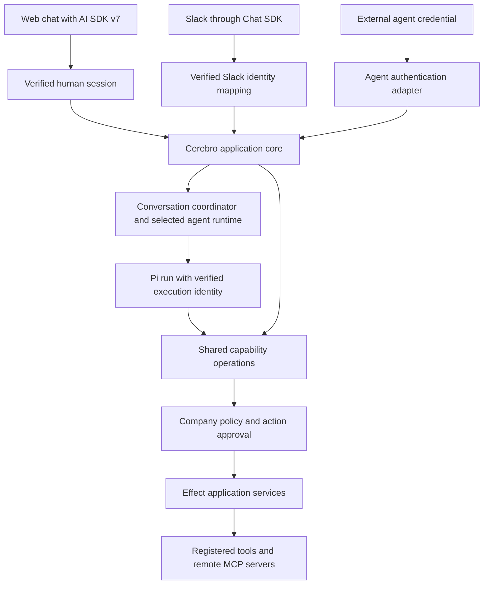

# Cerebro human and agent design handoff

Date: 2026-10-02.

Status: Design proposal for evaluation. This document does not approve a migration or claim package compatibility.

## Purpose and scope

Cerebro needs one application core that supports humans, internal agents, and external agents from the start. Different credentials must resolve to the same company identity and authorization model.

The user requested this delivery order:

1. Deliver a usable web chat MVP with AI SDK v7.
2. Add Slack through Chat SDK after the web MVP passes its acceptance checks.

The goal is a familiar, responsive chat experience with company-controlled agents, tools, data access, and approvals. The design must avoid duplicate business APIs and duplicate policy engines.

This handoff covers identity, capability invocation, chat, channel integration, and their execution boundaries. It does not select a complete infrastructure migration.

The [existing direction and roadmap](/Users/jhonsfran/repos/cerebro/docs/architecture/2026-10-02-direction-and-roadmap.md) records the broader project. That document leaves Rivet adoption open. This proposal treats Rivet plus Pi as a candidate arrangement, not a settled replacement for celld.

## Requirements and proposed choices

| Item | Status |
| --- | --- |
| Support humans and agents in the domain model. | Product requirement. |
| Company administrators control agent definitions and access. | Product requirement. |
| Start with specific agents that use Pi, prompts, and skills. | Requested product direction. Exact runtime integration needs evaluation. |
| Use AI SDK v7 rather than v6. | Explicit requirement. |
| Include Chat SDK. Deliver web chat before Slack. | Explicit requirement and delivery order. |
| Share company policy, tools, approvals, and audit behavior across callers. | Proposed design. |
| Use oRPC contracts and Effect services. | Preferred direction. Exact versions and integration need evaluation. |
| Use `@orpc-agent/core` for capability invocation and action approvals. | Candidate reuse. Do not assume it fits the existing approval model. |
| Use `@better-auth/agent-auth` for external-agent registration and grants. | Candidate authentication adapter. Full registration UI is outside the web MVP. |
| Replace celld with Rivet. | Open infrastructure decision. |

## Shared application core

These boxes describe responsibilities. They do not require separate deployments or a wrapper package for each box.

All callers use the same application operations. The web client, Slack handler, and agent tools must not implement separate business behavior.

Authentication differs at entry. Authorization remains a company concern. Capability discovery can hide unavailable operations, but execution must still enforce current permissions.

## Identity and delegation

The domain already defines `Principal`, `Delegation`, and `ExecutionContext` in [identity.ts](/Users/jhonsfran/repos/cerebro/packages/contracts/src/identity.ts). `Principal.kind` supports `human`, `service`, and `agent`.

The proposed request identity contains the authenticated principal and its company. A delegated call also identifies the represented principal and the delegation. Run IDs and operation IDs belong to the operation context and audit record.

An agent keeps its own identity when it acts for an employee. It must not become an unrestricted employee session.

For delegated work, access is the intersection of the agent's grants, the represented employee's current permissions, the delegation scope, and company resource policy. Autonomous agents use explicit company-controlled permissions without an implied employee delegation.

Adapters derive identity from verified credentials and trusted records. Model output and request arguments cannot supply authoritative principal IDs or company membership.

Internal Pi runs receive a verified execution identity when Cerebro admits the run. They do not need external-agent discovery and registration for each conversation.

External Agent Auth sessions resolve to the same Cerebro identity. Grant revocation and membership changes must affect later execution, including execution after an approval wait.

## Package responsibilities

| Component | Proposed responsibility | Boundary |
| --- | --- | --- |
| Better Auth | Human sessions and organization membership. | Does not define Cerebro resource permissions by itself. |
| `@better-auth/agent-auth` | External-agent registration, credential verification, delegation grants, and discovery. | Does not replace company policy or per-action approval. |
| oRPC | Shared operation contracts, API entry, and procedure middleware. | No separate business implementation for agent callers. |
| Effect | Application service composition, typed errors, cancellation, and resource lifetime. | Does not make an operation durable after process failure. |
| `@orpc-agent/core` | Candidate capability invocation, policy hooks, action approval, and audit integration. | Reuse Cerebro policy. Replace overlapping invocation behavior rather than add another independent engine. |
| AI SDK v7 | Web chat message types, client hooks, and stream protocol. Supported harness integration where suitable. | Does not own company permissions or durable run admission. |
| Chat SDK | Channel events, threads, messages, and Slack presentation. Evaluate its Web adapter separately. | Does not become the authority for company identity or business approvals. |
| Pi | Default agent loop, model context, skills, and engine recovery state. | Tool calls pass through company controls. |
| Selected durable runtime | Conversation execution lifecycle and recovery. Rivet is a candidate. | An actor is not a tool sandbox or an authorization principal. |

oRPC Agent expects the application to authenticate the caller and construct its `Actor`. Its procedure call preserves application middleware. An oRPC Agent `Actor` is an authorization principal, distinct from a Rivet Actor. [Execution pipeline](https://orpc-agent.dev/architecture/execution-pipeline)

Agent Auth verifies credentials and grants before its default `onExecute` handler. Custom capability locations need grant and constraint enforcement in their handlers. Its current documentation marks the implementation as unstable. [Agent Auth](https://better-auth.com/docs/plugins/agent-auth)

The proposed adapter routes authenticated Agent Auth execution into the shared capability path. It must not call unrestricted services or proxy the entire administrative API.

## One capability registry and one action-approval authority

Define each operation once. Keep its input schema, resource authorization rule, side-effect classification, and exposure metadata with that definition.

Derive agent tool descriptions and external discovery descriptions from those definitions. Expose only approved operations. Do not generate unrestricted agent access from every API endpoint.

Separate the meaning of these two approvals:

- A grant approval allows an agent to request a capability under specified constraints.
- An action approval permits one operation with its recorded arguments and resources.

Use one authority for each action approval. If oRPC Agent fits the existing model, connect its coordinator to that authority. Do not retain a second independent approval state machine.

Web and Slack present the same approval record. The server verifies the approver and current permissions. A message button is a reference to the record, not proof of approval authority.

After a wait, execution must check current permissions again. An approved operation needs stable identity and duplicate handling. Approval consumption alone does not guarantee that a remote tool runs exactly once.

## MVP 1: Web chat

Deliver one supported agent implementation and one complete chat experience before Slack.

The proposed scope includes:

- Better Auth login and company-scoped conversations.
- Minimal administrator-managed agent definitions with a prompt, approved skills, and allowed tools.
- AI SDK v7 chat hooks and stream types in the existing React application.
- Immediate send feedback, incremental text, Markdown, usable tool status, and source references when available.
- Durable history, visible run status, stop, reconnect, and failure recovery.
- In-chat action approvals where a configured tool requires approval.
- At least one configured MCP integration with company and resource access controls.
- Audit records that identify the human, agent, delegation, run, and operation where applicable.
- Existing budget admission and accounting controls around paid work.

The current AI SDK documentation is v7 and includes UI hooks and supported harness abstractions. This does not prove compatibility with the repository or the selected Pi host. [AI SDK](https://ai-sdk.dev/docs/introduction)

The preferred web path is direct AI SDK UI integration with Cerebro's conversation service. Chat SDK is the selected channel library for the subsequent Slack phase.

The Chat SDK Web adapter is an optional consolidation path. Use it only if it preserves structured tool events, approvals, cancellation, authentication, and reconnect behavior. Its documented AI SDK UI protocol support does not prove those end-to-end properties. [Web adapter](https://chat-sdk.dev/adapters/official/web)

The reviewer must compare the official AI SDK Pi harness adapter with the selected runtime's Pi integration. Choose one owner of the Pi session and loop. Do not start a second Pi loop to obtain a browser stream.

### Web MVP acceptance conditions

1. An employee creates a conversation with the configured default agent and receives incremental output.
2. A permitted MCP call succeeds. A forbidden resource call fails under the same agent definition.
3. A configured write pauses for approval. An authorized employee approves it through the web UI.
4. Duplicate sends and reconnects do not start another paid run for the same operation.
5. Stop reaches the execution coordinator and settles the run to a defined state.
6. Reload restores history and current status. A host restart either resumes supported work or records an explicit recoverable or failed state.
7. Revocation during an approval wait prevents execution.
8. A second company's identity cannot read the conversation, results, or approval record.
9. The browser displays tool failures and incomplete work without losing the employee's draft.
10. The implementation records admission time, provider first token, browser first text, completion, and reconnect time. Set pilot targets from measurements.

An illustrative proof uses one read capability and one approval-controlled write. The real company pilot workflow still needs selection.

## MVP 2: Slack integration

Add Chat SDK with `@chat-adapter/slack`. Mentions and replies in subscribed threads are the initial entry points. Defer extra channels and slash commands unless the pilot requires them.

Chat SDK supplies a shared thread, message, and channel model. Its Slack adapter supplies Slack-specific integration. [Threads and messages](https://chat-sdk.dev/docs/threads-messages-channels), [Slack adapter](https://chat-sdk.dev/adapters/official/slack)

Bind the verified Slack installation to a Cerebro company. Map each Slack user to a current Cerebro principal through a trusted account-link or provisioning process. Do not use a claimed email address as sufficient proof.

Map each Slack thread to a company-scoped Cerebro conversation. Treat that mapping as a channel binding. Do not copy an existing private web conversation into a public channel without an explicit access rule.

Slack handlers admit work through the same conversation service. Replies and approval cards project the same run and approval state used by web chat.

Slack delivery requires audience checks as well as requester checks. A requester may have access to data that other channel members cannot read. The MVP must withhold those results from the channel or direct the requester to an authorized private view.

Webhook acknowledgement must not wait for an entire model run. Persist admitted work before execution and handle Slack retries with stable event identity.

### Slack acceptance conditions

1. A verified mention starts a run in the bound conversation. Replies continue that conversation.
2. Webhook retries do not create duplicate runs or duplicate approved writes.
3. Slack and web enforce the same resource permissions and company budgets.
4. Approval interactions verify the Slack user against the shared approval record.
5. Revoked users and removed installations cannot admit or approve work.
6. Replies remain in the intended thread and follow Slack rate limits.
7. Delivery failures remain visible and can retry without a second model invocation.
8. A result that exceeds the channel audience's access stays out of the channel.

## State ownership and deployment

The proposed ownership is:

| State | Authority |
| --- | --- |
| Company identities, resource grants, integrations, and agent definitions | Cerebro company services and their database. |
| Conversation history and product-visible run status | One selected conversation authority. Exact storage needs evaluation. |
| Pi checkpoint and private engine state | The selected Pi integration. |
| Action approvals | One Cerebro approval authority, with a compatible coordinator if adopted. |
| Channel subscriptions, deduplication, and transport locks | Chat SDK state adapter. |
| Tool side effects | External system plus Cerebro operation receipts and reconciliation state. |
| Large artifacts | Configured object storage. |

A display projection is not another authoritative transcript. Chat SDK thread state must not become a second run ledger or Pi checkpoint.

Evaluate the PostgreSQL Chat SDK state adapter before adding Redis. Its documented implementation uses `pg`, so confirm compatibility with the selected host. [PostgreSQL adapter](https://chat-sdk.dev/adapters/official/postgres)

If Rivet is selected, the application host executes the Pi session inside the conversation actor. Many logical actors can share a host. Tools can execute in trusted application code, remote MCP servers, or a separate sandbox. [Rivet architecture](https://rivet.dev/docs/architecture/)

Do not require a container for each conversation. Add a sandbox only for tools that require isolated execution. Neither an actor nor Effect provides an operating-system security boundary.

## Evidence in the current repository

These observations come from read-only inspection during this conversation. They are not test results:

- [identity.ts](/Users/jhonsfran/repos/cerebro/packages/contracts/src/identity.ts) already models humans, services, agents, and explicit delegation.
- [policy.ts](/Users/jhonsfran/repos/cerebro/packages/authorization/src/policy.ts) checks current grants, directory state, organization scope, delegation expiry, and revocation.
- [authorization-gate.ts](/Users/jhonsfran/repos/cerebro/packages/policy/src/authorization-gate.ts) already coordinates authorization, entitlements, budgets, and operation records.
- [context.ts](/Users/jhonsfran/repos/cerebro/packages/api/src/context.ts) currently exposes a human session and database. Agent identity integration needs evaluation.
- [approvals.ts](/Users/jhonsfran/repos/cerebro/packages/api/src/routers/approvals.ts) routes approval and cancellation requests through the channel service.
- [pnpm-lock.yaml](/Users/jhonsfran/repos/cerebro/pnpm-lock.yaml) resolves Better Auth 1.7.6 and oRPC 1.15.4. The earlier inspection found AI SDK 6.0.296. Neither `@better-auth/agent-auth` nor `@orpc-agent/*` appeared in that lockfile.

Recheck the current checkout before evaluation. Another session may have changed the repository after this document was written.

## Tradeoffs and deferred work

| Approach | Assessment |
| --- | --- |
| Shared operations with narrow identity and channel adapters | Recommended. Keeps business behavior and company policy in one place. |
| Separate human and agent business APIs | Repeats permissions, approvals, and operation behavior. |
| Adopt every proposed package at once | Adds compatibility and recovery questions before the web flow is proven. |
| Build a custom authentication and agent invocation framework | Adds maintenance and security responsibilities already addressed by candidate libraries. |

Defer the plugin marketplace, multiple supported runtimes, arbitrary employee code, general workflow builder, email approvals, and extra chat channels.

Keep agent identity, delegation, API access, and extension boundaries in the initial design. A full external-agent self-registration product can follow the first chat release. Validate one external caller against the shared operations before declaring that boundary complete.

## Questions for the evaluating session

The evaluator should return a recommendation and evidence for these decisions:

1. Which existing checks and records can remain authoritative? Which overlapping mechanisms would each new library replace?
2. Does `@orpc-agent/core` fit Cerebro's policy, action approvals, audit requirements, and operation recovery? A thin adapter is acceptable. A second independent policy system is not the proposed design.
3. Does the selected Agent Auth release work with Better Auth 1.7.6, or require a coordinated upgrade? Verify grants, constraints, revocation, and delegated identity mapping.
4. Are the selected oRPC, Effect, and experimental integration versions compatible? Verify actual published package types and peer dependencies.
5. Which Pi integration owns the session and emits AI SDK v7-compatible events? Verify cancellation, approvals, and recovery rather than only text streaming.
6. Does Rivet improve a demonstrated requirement over the current celld deployment? Compare compatibility, deployment work, latency, cost, and recovery.
7. Can Chat SDK's Web adapter meet the rich chat criteria? If not, retain direct AI SDK web transport and use Chat SDK for Slack.
8. Which component owns history, run status, engine checkpoints, and approval records? Show a restart trace without competing authorities.
9. Can Chat SDK use the current database without Redis? Verify state-adapter behavior on the selected host.
10. How will Slack account mapping and channel audience authorization work for the company pilot?

The requested evaluation output is a short verdict, accepted and rejected choices with reasons, a revised responsibility diagram, and a web-first implementation sequence. Package adoption must remain conditional on compatibility and behavior evidence.

## Design principles applied

The [Laziness Protocol](/Users/jhonsfran/.agents/skills/principle-laziness-protocol/SKILL.md) led to one capability registry and one action-approval authority.

[Boundary Discipline](/Users/jhonsfran/.agents/skills/principle-boundary-discipline/SKILL.md) led to verified credential adapters that produce Cerebro identities. Application policy stays independent of authentication and channel libraries.
