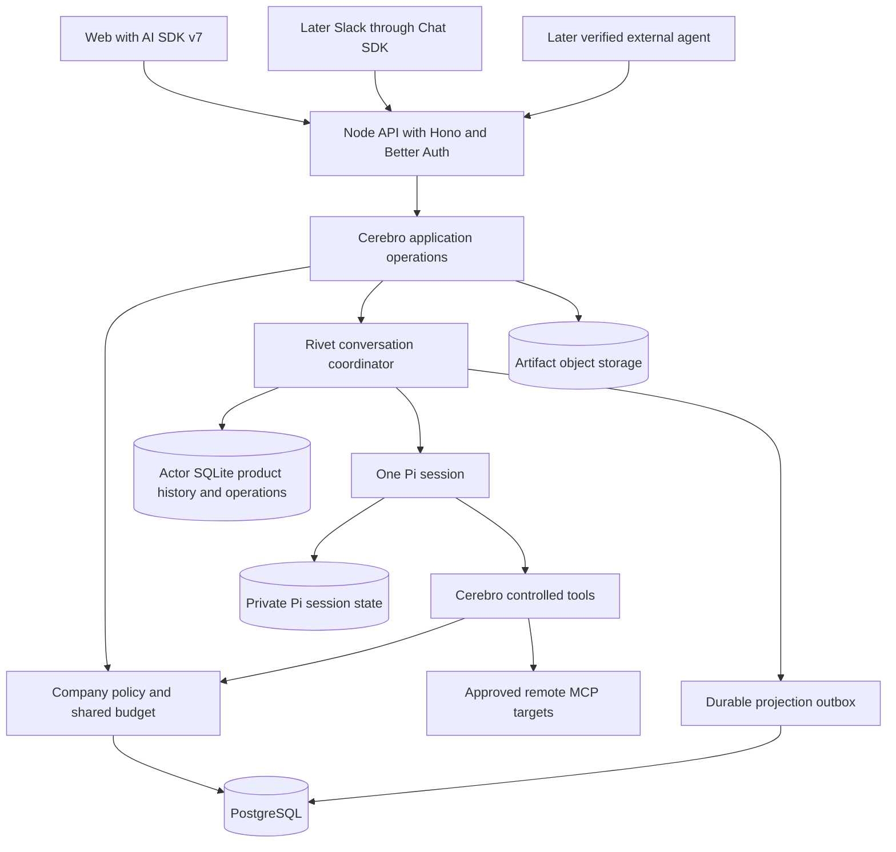

# Replace celld and OpenCode with Rivet and Pi

Evaluation dated 2026-10-02. This is an implementation proposal. No replacement runtime has passed qualification yet.

## Goal and verdict

Cerebro needs reliable company-controlled agent work on a self-hosted runtime. Major infrastructure components must remain replaceable through small application contracts.

The user requires one change that replaces celld and OpenCode together. Both integrations must be deleted. Backward compatibility is outside the scope.

Recommend self-hosted Rivet Actors with a Node worker and one Pi loop per company-scoped conversation. Include AI SDK v7 in that change. Preserve company policy, budgets, approvals, receipts, memory, and audit behavior.

The existing handoff has sound responsibility boundaries. Its proposed package list is too broad for the first change. Runtime replacement, external-agent authentication, capability invocation, and Slack need separate acceptance stages.

Rivet is a plausible target, not a proven reliability improvement. Source inspection supports the proposal. This evaluation ran no application or runtime tests.

## Findings that change the plan

| Observed fact | Consequence |
| --- | --- |
| [SessionAgent](/Users/jhonsfran/repos/cerebro/packages/runtime/src/session-agent.ts:102) extends `AIChatAgent` and runs `OpenCodeWorkerd`. | Replace the engine, host, and chat transport together. Pi is not the current implementation. |
| [LedgerStore](/Users/jhonsfran/repos/cerebro/packages/runtime/src/storage/ledger-store.ts:3) and [operation-journal.ts](/Users/jhonsfran/repos/cerebro/packages/runtime/src/operation-journal.ts:18) use synchronous Durable Object SQLite. | Port critical transitions to asynchronous actor SQLite transactions. This is more than a driver rename. |
| [runtime-gateways.ts](/Users/jhonsfran/repos/cerebro/apps/server/src/runtime-gateways.ts:65) and [channel-dispatcher.ts](/Users/jhonsfran/repos/cerebro/apps/server/src/channel-dispatcher.ts:17) also use Durable Objects. | Replace gateway receipts and background dispatch. A conversation actor alone does not complete the migration. |
| [SessionService](/Users/jhonsfran/repos/cerebro/packages/contracts/src/session.ts:102) already describes durable conversation commands and reads. | Reuse this boundary. Do not create a generic runtime provider framework. |
| [channels/service.ts](/Users/jhonsfran/repos/cerebro/packages/channels/src/service.ts:83) contains product application behavior. | Keep one owner during migration. Extract only the operations needed by another caller later. |
| [security.ts](/Users/jhonsfran/repos/cerebro/packages/channels/src/security.ts:59) builds a human execution context. | Distinct internal-agent identity and delegation remain Stage 2 work. Pinned agent grants constrain the current human context. |
| [registry.ts](/Users/jhonsfran/repos/cerebro/packages/tools/src/registry.ts:92) permits real MCP reads and fixture-only writes. | Stage 1 proves existing approval behavior with a fixture. A production write requires a qualified connector in Stage 2. |
| Current [stream tests](/Users/jhonsfran/repos/cerebro/tests/integration/model-stream.test.ts:186) require early tokens and delayed successful completion. | Preserve provisional output before EOF. Publish successful completion only after durable usage accounting. |

Historical celld failures explain the migration concern. They do not prove that every corrected runtime path still fails. The new implementation must pass its own failure tests.

## Recommended architecture

These are responsibilities. They do not require a deployment or package for every box. The proposed [architecture record](/Users/jhonsfran/repos/cerebro/docs/architecture/adr-0001-replaceable-application-boundaries.md) defines the dependency rules.

| State | Authority |
| --- | --- |
| Company records, principals, grants, agent definitions, shared budgets, and memory metadata | Existing company services and PostgreSQL. |
| Conversation history, admission receipts, run status, approval decisions, operation intent, and projection outbox | Cerebro records in actor SQLite. |
| Model context, compaction state, and private Pi session records | The selected Pi integration. |
| Remote effect outcome | Provider evidence plus Cerebro dispatch and reconciliation receipts. |
| Browser messages and channel history | Rebuildable projections. They cannot admit or complete a run. |
| Files and large artifacts | Existing artifact storage. |

Pi messages and product history have different purposes. The browser reads the product history. Pi restores its private context. Neither copy independently determines approvals, usage, or run completion.

Use actor SQLite for critical state. Rivet documents asynchronous callback transactions. Its in-memory state saves are batched. Prove persistence acknowledgements before using either mechanism for admission. [SQLite](https://rivet.dev/actors/docs/sqlite/), [state persistence](https://rivet.dev/actors/docs/state/).

Rivet actions can overlap. Use transactional command transitions and one active Pi turn per conversation. Stop must remain available during a long turn. Keep network calls outside database transactions.

## Package choices

| Choice | Recommendation |
| --- | --- |
| Rivet Actors | Adopt as the replacement target. Qualify self-host storage, scheduling, restart, and restore. |
| Pi | Prefer the native `@rivet-dev/pi` integration if its published API supports Cerebro's storage and dispatch controls. Select one loop owner before parallel implementation. [Pi configuration](https://rivet.dev/agents/docs/pi/). |
| AI SDK v7 | Adopt for browser message types and transport in Stage 1. Do not start another Pi loop to obtain a stream. |
| Pi file and shell tools | Disable for Stage 1. Expose only registered Cerebro tools. Keep model and connector credentials out of agent-visible arguments. [Sandbox behavior](https://rivet.dev/agents/docs/sandboxes/). |
| Hono, Better Auth, oRPC, PostgreSQL, and Drizzle | Retain existing roles. Keep direct database queries where no replaceable boundary is needed. |
| Effect | Defer a broad rewrite. Evaluate a bounded cancellation or resource-lifetime problem after the replacement works. |
| `@orpc-agent/core` | Defer adoption. Its invocation and approval pipeline overlaps existing broker behavior. Adopt only if it replaces that behavior through the same authority. |
| `@better-auth/agent-auth` | Evaluate in Stage 2 for external credentials and grants. Internal Pi runs do not need external self-registration. |
| Chat SDK | Adopt for the subsequent Slack stage. Prefer its PostgreSQL state adapter before adding Redis. |
| Chat SDK Web adapter | Defer. Direct AI SDK transport must first prove rich tool events, approvals, durable stop, and reconnect. |
| agentOS, sandboxed code, and Rivet Workflows | Defer until a selected company task needs their behavior. |

The official AI SDK Pi adapter executes in Node and has experimental APIs. It is an alternative loop owner, not an additional loop beside native Rivet Pi. [Pi adapter](https://ai-sdk.dev/providers/ai-sdk-harnesses/pi).

Rivet's native Pi integration was announced on October 1, 2026. Its published types, package pins, and interoperability remain unverified here. The documentation reserves the actor's `db` configuration for Pi. Table access and Cerebro migrations therefore need an executable proof. [Pi announcement](https://rivet.dev/changelog/2026-10-01-introducing-pi-1-0-for-rivet/), [Pi configuration](https://rivet.dev/agents/docs/pi/).

oRPC Agent preserves procedure middleware, but has its own invocation and approval pipeline. This does not prove compatibility with Cerebro's receipts. [Execution pipeline](https://orpc-agent.dev/architecture/execution-pipeline).

Agent Auth supplies registration and capability authorization. Compatibility with this checkout's Better Auth 1.7.6 still needs published-package checks. The handoff's earlier instability claim was not confirmed in the current page. [Agent Auth](https://better-auth.com/docs/plugins/agent-auth).

Chat SDK's PostgreSQL adapter uses `pg`. Its Web adapter has separate transport and history behavior. Neither becomes Cerebro's run ledger. [PostgreSQL adapter](https://chat-sdk.dev/adapters/official/postgres), [Web adapter](https://chat-sdk.dev/adapters/official/web).

## Stage 1 replaces the complete runtime in one change

The delivered change has one execution path. It contains Rivet, Pi, and AI SDK v7. It contains no celld, OpenCode, Worker Loader, Cloudflare Agents chat, old-engine readers, or runtime fallback selectors.

Intermediate builds can fail on the migration branch while callers change together. The integrated change must pass all gates before merge or deployment.

### First resolve the shared runtime contract

The coordinator owns this serial step before agents edit shared code.

1. Record exact published versions, peer dependencies, Node support, native binaries, and the Rivet image digest. The current lockfile has no Rivet or Pi pin.
2. Run a small self-hosted Rivet plus Pi proof with a deterministic counted provider and controlled tools.
3. Prove interception of every paid model request, retry, and compaction call before dispatch. Prove tool interception and cancellation.
4. Prove Cerebro's separate SQLite tables can coexist with Pi's private storage through supported hooks.
5. Define actor keys, transaction boundaries, operation occurrence IDs, cancellation state, checkpoint ownership, and stream events.
6. Freeze those contracts before parallel edits. Reuse `SessionService`, `OperationJournal`, `AuthorizationPolicy`, `BudgetAuthority`, and `ToolExecutor` where they fit.

Prefer native Rivet Pi to reduce custom lifecycle code. If it cannot pass these checks, qualify direct Pi under a Cerebro Rivet actor. Select one implementation. Do not carry both into the delivered change.

An actor restart does not resume an interrupted JavaScript promise. A saved Pi message does not prove a model request can resume without another charge. Recovery must read durable operations before further execution.

### Agent assignments and throughput checkpoint

The main constraint is the shared persistence and execution contract. Extra agents cannot resolve it by editing more callers. Freeze the contract first.

Run at most three implementation agents beside the coordinator. Give each agent a separate worktree, Compose project, ports, and volumes. The coordinator integrates work and owns shared contract edits, package manifests, lockfiles, and the acceptance decision.

| Task | Exclusive ownership | Deliverable and check |
| --- | --- | --- |
| A. Self-host deployment | `compose*.yaml`, `deploy`, server Node entry and build configuration | Pinned Rivet control plane and Node worker, protected secrets, readiness, fresh start, backup, and restore. Delete celld build and deploy paths. |
| B. Durable conversation coordinator | `packages/runtime` actor, ledger, journal, storage, recovery, and outbox modules | Asynchronous transactional admission, one active turn, durable stop, approval decisions, receipts, and recovery without a client request. Delete the old session agent and engine records. |
| C. Pi execution and controlled tools | New Pi execution modules, `packages/tools`, server runtime composition, gateway, and dispatcher modules | One Pi loop, model accounting, trusted tool execution, stable occurrence IDs, current permissions, and bounded credentials. Delete OpenCode plugins and Worker execution adapters. |
| D. API and browser chat | Server chat routes and protocol, `apps/web`, runtime-facing API adapters | AI SDK v7 stream, authenticated history, approval and stop commands, reconnect, draft retention, and visible failure states. Delete `useAgent` and `useAgentChat`. |
| E. Independent acceptance | Runtime, integration, policy-runtime, native-channel, and live tests | Counted provider effects, crash boundaries, tenant denial, revocation, accounting, capacity observations, restore proof, and dependency deletion report. |

B and C use explicit file ownership within `packages/runtime`. B owns the actor and state machine. C owns the Pi execution module. A owns the server entry. C owns service composition. D owns chat routing. File allocation is fixed before work starts.

Run A, B, and C in the first wave. Run D and E in the next available slots. D can prepare against fixed events before backend integration. E can prepare fixture assertions before the target runtime starts.

Each task brief includes the frozen contract, allowed files, prerequisite artifacts, its check command, and its deletion list. Agents report `PASS`, `ISSUES`, or `BLOCKED` with artifacts. The coordinator reruns integrated checks.

### Deletion inventory

Delete or replace these implementation families in the same change.

- OpenCode adapters, reply parsing, HTTP plugin wiring, plugins, synthetic continuation, session fields, provider defaults, dependency patches, and direct or transitive packages.
- `AIChatAgent`, Agents browser hooks, Durable Object namespaces and alarms, `cloudflare:workers`, `getAgentByName`, service bindings, Worker Loader, and Durable Objects database drivers.
- celld images, bootstrap deploy commands, entrypoints, environment settings, runtime volumes in active Compose files, and runtime MinIO if Rivet no longer needs it.
- celld and OpenCode test hosts, live commands, diagnostics, SSR probes, and backup assumptions. Replace implementation-specific tests while preserving domain assertions.

Removing code does not authorize deleting existing volumes or company records. Use separately named Rivet stores. Preserve the old runtime stores offline.

Old conversations and checkpoints have no compatibility reader in the replacement. The current [dispatcher](/Users/jhonsfran/repos/cerebro/packages/channels/src/drain.ts:116) reads pending inbox rows and ready replies from PostgreSQL. An old pending row can already have executed under OpenCode. A new empty Pi ledger cannot infer that result.

Define this cutover barrier before parallel implementation.

1. Stop old admission, scheduling, projection, and reply delivery. Record unresolved reservations, admitted work, and uncertain effects.
2. Snapshot the old stores after workers stop. Keep the records for offline inspection. Do not automatically release uncertain reservations.
3. Apply a one-time PostgreSQL cutover that retires old conversation bindings and quarantines their inbox, projection, and reply work.
4. Start new scheduling only after the cutover commits. Prove every dispatcher query excludes retired work. Do not replay old pending events under Pi.
5. Show old conversations as retired with a clear start-new-conversation action. Disable submission, approval, resume, and reply delivery for those bindings.

Start new conversations with new actor identities. The cutover must not reinterpret an old session ID as a new actor key. This retires old work without a compatibility runtime or data deletion.

### Required acceptance matrix

| Check | Required evidence |
| --- | --- |
| Browser turn | Authenticated incremental text through the actual Pi loop. One final run. Every admitted model request has exactly one settled or explicitly uncertain receipt. Provider request counts match those records. |
| Duplicate admission | Concurrent identical events return one receipt and one model admission. Changed input with the same ID conflicts. |
| Durability | Worker and control-plane kills after acknowledgement preserve admitted runs, approvals, cursors, and operation intent. |
| Tool controls | Allowed read succeeds. Existing tool, connector, memory-resource, and target restrictions deny forbidden calls without provider execution. Argument-derived MCP resource rules belong to Stage 2. |
| Approval | Fixture write waits. Duplicate approval does not repeat it. Revocation during the wait prevents execution. |
| Effect recovery | Idempotent retry reuses one operation identity. An uncertain non-idempotent write stops at `unknown-outcome`. |
| Model accounting | Known usage settles once. Unknown dispatch retains its reservation. Retries and compaction cannot bypass admission. |
| Stop | Active model and tool calls receive cancellation. The durable state survives restart. Another queued run remains intact. |
| Reconnect | Disconnect and reload recover committed history and the existing run without another model call. |
| Access changes | Sign-out and current resource revocation block later delivery and cached-history access. Another company cannot read or act. |
| Completion | Provisional tokens precede provider EOF. Success waits for durable model receipts and accounting. |
| Background recovery | Recovery and outbox retries progress without an actor-facing poll or new message. Audit and usage projections remain unique. |
| Resource lifetime | Repeated load and idle cycles release sessions, tasks, subscriptions, timers, and connections. Record memory and active work. |
| Restore | A clean target deployment restores actor identity, history, approvals, receipts, company records, and artifacts. |
| Cutover | Retained old pending events, projections, and ready replies cause no Pi invocation or delivery. Unresolved receipts and reservations remain preserved. Retired conversation controls cannot resume old work. |
| Real providers | One configured live Pi model and one real controlled MCP read pass separately from fixtures. |
| Removal | Fresh install, build, active config, test assets, and dependency graph contain no old runtime or engine integration. |

Keep current policy, identity, memory, channels, contracts, and accounting assertions. Rewrite tests that require old SDK internals. Remove `test:opencode` and replace it with a Pi live acceptance command.

Run target runtime checks, applicable native integration suites, `pnpm check-types`, `pnpm check`, and `pnpm build`. Set exact replacement script names during the contract step.

Record admission, first provider token, first browser text, completion, reconnect, recovery, memory, and concurrent turns. Proposed qualification limits are recovery within 30 seconds and replay readiness within 5 seconds under fixtures. Fix limits before measurement. Record real-provider latency separately. These limits are proposals, not measured capacity or production guarantees.

Stop integration if required dispatch hooks are absent, acknowledged state disappears, uncertain writes repeat, or web streaming requires another Pi loop. An incomplete gate leaves Stage 1 incomplete. It does not reintroduce an old runtime fallback.

### Self-host tradeoff

Start with one persistent single-node control plane and one Node worker. Many idle conversations can share that worker. A per-conversation container is unnecessary.

Single-node filesystem storage reduces initial deployment scope. It requires downtime for a safe filesystem backup. PostgreSQL-backed control-plane storage is a later topology choice. Keep its database distinct from Cerebro company data. [Self-host control plane](https://rivet.dev/actors/self-host/control-plane/), [backup and restore](https://rivet.dev/docs/deploy/self-host/control-plane/backups/).

The benefit is a native execution host and a supported actor lifecycle. The cost is a new control plane, asynchronous persistence conversion, and fresh qualification. There is no measured cost or latency advantage yet.

## Stage 2 completes company-controlled web work

Begin after Stage 1 passes. The coordinator owns shared schemas and the application operations currently in `packages/channels`.

| Parallel task | Deliverable | Exit condition |
| --- | --- | --- |
| Identity and invocation | An agent principal linked to its definition, explicit delegation, verified caller adapters, and shared operations. | Human, internal Pi, and one external caller use the same company operation. Current grants and revocation apply after approval waits. |
| Real company connector | One selected read and approval-controlled write, argument-derived resource rules, provider duplicate handling, and reconciliation. | A real write executes once after authorized approval. Forbidden resources fail. Unknown outcomes remain explicit. |
| Web experience | Tools, citations, approval details, Markdown, drafts, scrolling, keyboard use, failure feedback, stop, and recovery. | The chosen employee task works in the browser under current permissions. |

The identity agent owns `packages/auth`, `packages/authorization`, API identity adapters, and the identity repository. The connector agent owns `packages/tools` and the selected connector adapter. The web agent owns `apps/web`. The coordinator owns contracts, database schemas, shared application operations, manifests, lockfiles, and server composition. Agents request interface changes through that owner.

Select the pilot company task before connector implementation. Extend existing registry metadata for approved operations. Exposing every administrative API as an agent tool is outside the plan.

Evaluate Agent Auth and oRPC Agent against the complete shared path. Pin compatible releases and test constraints, delegation, revocation, and approval recovery. Add a package only when it replaces behavior or supplies a required adapter.

## Stage 3 adds Slack through the same operations

The current Slack adapter supports linked direct messages. Mentions and shared threads need new participant and audience rules.

One channel agent owns Chat SDK, Slack identity mapping, event deduplication, subscriptions, and delivery. It reuses Stage 2 operations, approvals, and company budgets.

Require verified installation and user mapping, fast webhook acknowledgement, duplicate-event handling, audience authorization, and delivery retry without another model call. Prove web and Slack inspect the same approval record.

## Stage 4 introduces shared work only when needed

Select one business record that more than one conversation can inspect and change. Keep that record outside private Pi context.

Use a durable workflow only if the task needs shared progress or long waits beyond a conversation. Qualify duplicate events, human waits, process failure, and remote-effect reconciliation. Sandbox execution and a second engine remain separate later choices.

## Documentation cleanup follows verified replacement

Keep a small active documentation set.

- `docs/architecture/README.md` describes the implemented architecture, state owners, dependency rules, and current evidence.
- Short ADRs record major accepted choices and their tradeoffs. They do not restate the roadmap.
- One active delivery plan contains unfinished work. Completed plans leave the active tree.
- `AGENTS.md` links to the architecture and commands. It does not repeat the whole design.
- Operations documents describe the current deploy and restore procedures.

During Stage 1, update operational instructions and mark old runtime plans superseded. After acceptance, extract unique decisions from the September architecture, delivery, and celld-slice plans. Then delete those stale plans and the overlapping October direction and handoff proposals.

Keep useful historical failure evidence as dated evidence. Fix links before deleting documents. Git preserves deleted planning history. A fixture result, old receipt, or proposal must not appear as current production proof.

This evaluation leaves existing documents intact. The architecture ADR remains proposed. Accept the runtime choice only with the Stage 1 receipt.

## Principles that changed these recommendations

Laziness Protocol led to reuse of the existing domain contracts and a small active documentation set. Boundary Discipline keeps SDK and credential types inside adapters. Separate Before Serializing Shared State led to owned files and isolated worktrees.

Sequence Work into Verifiable Units led to qualification before parallel integration. Outcome-Oriented Execution and Migrate Callers Then Delete Legacy APIs led to one replacement change with both old integrations removed.
