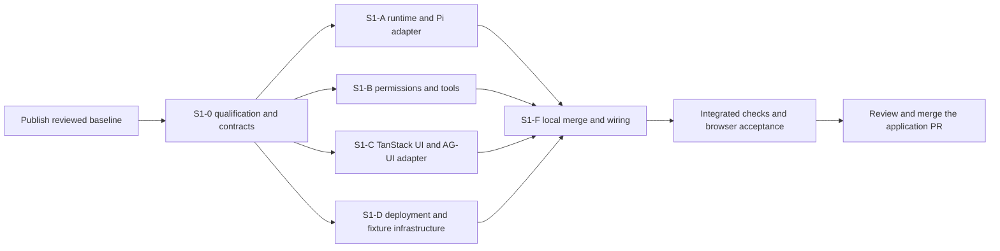
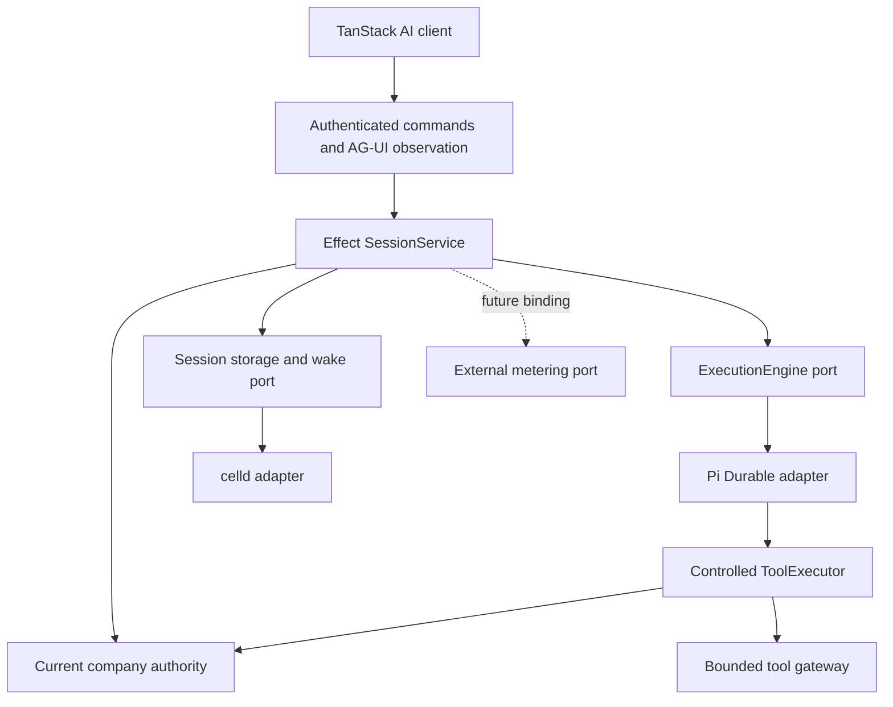

# Deliver the first Cerebro runtime slice

> The S1-C packet described below delivered TanStack state and an AG-UI adapter. Both were removed on 2026-10-09; see the [chat simplification design](../superpowers/specs/2026-10-09-chat-simplification-design.md). Plan dated 2026-10-05. The target remains proposed until qualification passes. **Goal.** Replace OpenCode and AI SDK with Pi Durable and TanStack AI on retained celld. **Architecture.** Cerebro owns company permissions, approvals, tool receipts, and product history through Effect services. Adapters isolate the engine, host, and UI protocol. **Tech stack.** Effect TS, Pi Durable, TanStack AI, AG-UI, celld, Hono, Better Auth, oRPC, PostgreSQL, and existing object storage. **Execution.** One qualification and contract step, four remote branch packets, then local merge, wiring, and acceptance in S1-F. **Planning assumption.** Native Python execution is outside this slice. The Python wording needs clarification before adding a Python worker. No runtime has passed this plan's qualification yet.

Operator amendment on 2026-10-06: select the official PiHarness and reuse its native durable inbox, steering, Stop and Lifecycle recovery through a thin Effect adapter. Remove the separate Cerebro execution queue. Native active Stop withdraws queued inputs; replacing a message stops the session before submitting the new input. The original active-cancel-preserves-queued-follow-up requirement is superseded and its executed FAIL remains recorded. Cerebro keeps trusted command intents, mode/input conflict checks, permissions, approvals, tool receipts and product projection. Replacement interruption/retry repair is a deferred qualification TODO. The earlier operator instruction also permits coordinator preparation with deferred checks; no failed or unrun check becomes PASS. This amendment changes the plan and contracts only; S1-A through S1-D are not executed by S1-0.

Recovery clarification on 2026-10-07: retain celld and, under the operator's latest-version direction, request release 0.6.1 by immutable image digest after S1-0 qualification. The local functional recovery probe allows ninety seconds without HTTP because celld's default cold-alarm discovery scan runs every sixty seconds. It requires saved answers before observation and settled results afterward. This corrects the earlier forty-five-second functional deadline; the recorded FAIL remains historical. The separate S1-F sixty-second performance budget below is unchanged and unqualified. No application host upgrade, custom scheduler, later packet, merge or deployment occurs in S1-0.

## How to read this

Coordinator review on 2026-10-06: import corrected S1-0 at `46a44e199b3bf43173602ea609f40a0b6958f201` and freeze its shared contracts for implementation preparation. Dependency commit `8ee8135ffc89e0789538ec32957d12d1b552711f` applies the reviewed pins and AG-UI metadata. [The coordinator baseline record](2026-10-06-cerebro-slice-1-coordinator-baseline.md) records passing contract, type and build checks, the existing lint failures, and remaining peer and qualification work. No implementation owner starts in this preparation.

One box is one unit of work. Every box names the evidence that checks it. Check a box only when its evidence exists. Record the command, result, artifact path, and tested commit.

Use the operator-controlled stack workflow from Poteto Mode's `playbooks/autopilot-stack.md`, adapted to remote Codex branches and local integration. This plan overrides automatic merge, cloud wake chains, and fixed model defaults. Remote agents return reviewed branches. The local coordinator integrates them. S1-F is the single delivered application PR.

Tests alone are not sufficient verification. A PR is verified only when its unit, live, and perf boxes are all checked.

Paths in task packets are relative to the checkout root. New paths are marked as proposed. Each remote packet includes this plan, the frozen contract document, and the contract commit SHA. Agents need no earlier chat context.

## Program checklist

### Arm the program

- [x] Publish the reviewed plan and the intended source baseline to a remote branch. Record its SHA. Review the existing local changes before choosing that baseline.
- [x] Record the current trunk SHA and run the existing baseline checks. Capture failures by file and cause. Do not classify all later failures as pre-existing.
- [x] Read the repository instructions at the baseline. Use `git show origin/main:AGENTS.md` if the remote default branch is `main`. Resolve the actual default branch first.
- [x] Run S1-0 before implementation fan-out. Record the selected package pins, host integration, contracts, and qualification artifacts. Qualification remains partial under the operator amendment; failed and unrun cases retain their recorded status.
- [ ] Use the configured Codex model for each owner. A `/goal` requires a separate explicit operator request. This plan does not create a goal or automation.
- [ ] For work longer than 30 minutes, request a status message from each active owner at each 30-minute review. Include the branch, head SHA, last passing check, next check, and blocker.
- [ ] On an operator hold, stop remote writes and record every branch head.

### Spawn owners

- [ ] Start one remote qualification owner for S1-0. The local coordinator reviews its proof and publishes the frozen contract commit.
- [ ] Start S1-A, S1-B, S1-C, and S1-D from that same contract commit. Use separate branches and separate test state.
- [ ] Enforce the ownership table below. Shared contracts, manifests, lockfiles, API composition, and final integration tests have one coordinator owner.
- [ ] Give each packet a concrete branch name and the handoff prompt below. Do not ask an agent to execute the entire plan.
- [ ] Keep partial packets off the deployment branch. Only the integrated S1-F change is eligible for application acceptance.



### PR mechanics for every branch

- [ ] Use the `codex/` branch prefix. Use `codex/cerebro-slice-1` as the coordinator integration branch.
- [ ] Open packet PRs against the integration branch when remote review is available. Owners must not merge them. Return the exact head SHA even when a PR is unavailable.
- [ ] Run the packet checks before each handoff. Include the diff, changed paths, dependency requests, evidence, and blocked checks.
- [ ] Review the diff for obsolete code, unnecessary wrappers, and comments that repeat the code. Keep hooks enabled.
- [ ] Triage review findings against the changed code. Apply accepted fixes before the coordinator imports the branch.
- [ ] Ask the coordinator to change a frozen contract through one shared commit. Rebase all affected branches onto that commit. Do not add local copies of a port.
- [ ] Keep dependency edits with the coordinator. Submit the exact package and version needed. The coordinator publishes one dependency commit for all affected branches.

### Verdict and merge for every branch

- [ ] Review each packet against its file scope and frozen contracts. Rerun its checks at the returned SHA.
- [ ] Merge S1-B, S1-A, S1-C, and S1-D locally into the integration branch. This is a merge order, not an implementation dependency.
- [ ] Check imported files for conflicts after each merge. Complete composition and legacy deletion in S1-F before running application acceptance.
- [ ] Run an independent review of permission enforcement, durable tool outcomes, cancellation, protocol translation, and dependency removal.
- [ ] Accept only evidence from the final integrated SHA. A packet pass does not prove the assembled application.
- [ ] Deliver the final application PR after the S1-F gates pass. The operator reviews the changed interaction before the application PR merges.

### Boot recipe for integrated live checks

- [ ] Check out the tested head in a clean checkout. Run `rtk proxy pnpm install --frozen-lockfile`.
- [ ] Use an isolated Compose project, API port, web port, fixture port, and volumes for each concurrent test run.
- [ ] Run `rtk proxy pnpm test:boot` to build, bootstrap, and prove readiness. Use S1-D's checked-in fixture boot recipe for interactive browser checks.
- [ ] Seed a human user, a company, an agent, a permitted read tool, and a fixture write tool. Use fixture credentials. Give no remote agent production credentials.
- [ ] Drive browser scenarios through the browser automation available in Codex. Save screenshots and a short interaction video. Collect provider counters through read-only fixture diagnostics.
- [ ] Save artifacts under `artifacts/slice-1/<head-sha>/<scenario>/`. Record the fixture and host image digests with each result.
- [ ] If the remote environment lacks Docker or browser control, report the affected check as blocked. The coordinator runs it locally before acceptance.

### Fix the scope before S1-0

- [ ] Deliver authenticated human chat, incremental text, tool progress, citations, approval, durable stop, protected history, reconnect, and recovery on celld.
- [ ] Keep one Pi Durable loop per company-scoped conversation. TanStack AI handles browser state and transport. Do not run TanStack `chat()`, AI SDK `streamText()`, or another agent loop to obtain a UI stream.
- [ ] Write new Cerebro orchestration and adapters with Effect services, Layers, typed failures, and scoped resources. Keep vendor promises and streams inside adapters.
- [ ] Preserve current company permissions, pinned agent restrictions, connector restrictions, content dependencies, approval binding, and remote effect receipts.
- [ ] Define an external metering port only. Leave the port unbound in this slice. Record that spend control is not active through that port.
- [ ] Remove local reservation, pricing, balance, and settlement behavior from the active replacement path. Keep historical records and migrations.
- [ ] Keep existing identity, memory, company data, artifact storage, and channel behavior. Change only the callers required by the new session boundary.
- [ ] Defer native Python and Node tool workers, browser reviewers, external-agent credentials, new production write connectors, Slack migration, and multi-agent workflows.

### Qualify the selected integration and freeze contracts in S1-0

**Owner.** One remote qualification agent, reviewed by the local coordinator.

**Branch.** `codex/cerebro-slice-1-contracts`.

**Files.** The coordinator owns all manifests and lockfiles. Proposed contract modules are `packages/contracts/src/session-service.ts`, `execution.ts`, `authority-service.ts`, `tool-service.ts`, `receipt-service.ts`, `failures.ts`, and `metering.ts`. Reuse data types in `identity.ts`, `events.ts`, `session.ts`, `tools.ts`, and `policy.ts`. Create the proposed `docs/architecture/2026-10-05-cerebro-slice-1-contracts.md` and `tests/pi-durable-qualification/` fixture.

- [ ] Record published versions, package exports, peer dependencies, transitive dependencies, licenses, and the celld image digest. Pin one stable Effect major and compatible Pi and TanStack packages. A GitHub main branch is not a package pin.
- [ ] Run an isolated clean install of the target wrapper, provider, and UI packages. Require zero resolved `ai` or `@ai-sdk/*` packages before selecting that integration. Keep this proof separate from the still-unmigrated application graph.
- [ ] Qualify the official `PiHarness` plus `Lifecycle` integration on retained celld first. Use a plain Durable Object and Cerebro-controlled models and tools. Its published hooks reduce custom storage and alarm code. [Cloudflare Pi integration](https://developers.cloudflare.com/agents/harnesses/pi/).
- [ ] Prove the supported package entry points exist in the installed version. Prove the bundle runs on celld, with no Node-only import in the worker path.
- [ ] Prove private Pi tables and Cerebro tables coexist without migration collisions. Run Pi's storage conformance checks where the selected adapter exposes them.
- [ ] Prove durable submission, changed-input conflict, idle eviction, process kill, alarm-only recovery, snapshot subscription, run-specific abort, and one active turn per conversation.
- [ ] Prove snapshot and subscription handoff without a missed committed update. Complete a run during attachment and overflow the observer buffer. Freeze durable domain revision, stream epoch, update ordering, and canonical resnapshot rules.
- [ ] Freeze the acknowledgement point and durable handoff between Cerebro admission, Pi submission, wake registration, Pi completion, and Cerebro projection. Inject a crash between each commit. Recovery must reuse the same request and run identities and repair missing projections without repeating completed effects.
- [ ] Prove a controlled provider handles ordinary requests, retries, and compaction. Recheck current model permission before physical dispatch. Keep credentials in server configuration.
- [ ] Prove a tool can wait for Cerebro approval across eviction. A denied or revoked approval must cause zero tool dispatches. An uncertain write must block continuation that would repeat its effect.
- [ ] Prove Effect interruption reaches the Pi context and tool abort signal. Closing an observer must leave durable work running. Qualify native follow-ups and steering, queued-operation withdrawal, and active Stop withdrawing pending inputs. Test Stop then submission as the replacement sequence; retain interrupted replacement as NOT_RUN until qualified.
- [ ] Qualify the selected public TanStack connection API for page-load attachment to an active run, continued observation after approval from another browser, and reconnect. None of these paths may submit new work. Freeze the actual hydrate, attach, and detach methods before S1-C starts.
- [ ] If the wrapper fails a supported-hook, dependency-removal, or celld compatibility check, qualify a direct Pi storage and wake adapter under the same ports. Select one implementation before fan-out. Do not maintain both.
- [ ] For a direct adapter, require Pi storage conformance, transaction rollback, serialization of unrelated operations, durable flush before acknowledgement, and persisted wake registration. Repeat the actual celld crash and eviction checks. Memory storage alone cannot qualify it.
- [ ] Stop S1-0 if neither candidate passes. Return the failed case and evidence. Do not change the selected host or add a native worker without revising the plan.
- [ ] Create `test:pi-durable:qualification` for the isolated proof and run it. Save the result, request counters, restart timeline, image digest, and lockfile at the tested SHA.
- [ ] Add typed contract fakes and run `rtk proxy pnpm test:contracts`. Record every method, event schema, failure, and invariant in the frozen contract document.
- [ ] Freeze complete Effect signatures for authority evaluation and enforcement, tool execution and reconciliation, and receipt claim, read, dispatch, outcome, completion, and uncertainty. Define the success values and typed failures. Policy denial is decision data. Authority enforcement converts denial to a typed failure before dispatch. Unavailable authority must fail closed.
- [ ] Freeze approval run identity and connector-registration fingerprint fields. Current Approval data does not contain both. Bind the fingerprint to the configured connector version and destination. Define matching tests before A and B start.
- [ ] Freeze access denial before and after response headers. Before headers, map denial to HTTP. During a stream, send a validated denial notice and close. The client clears protected state, stops automatic reconnect, and rejects frames from the old access generation.
- [ ] Publish the coordinator-owned `packages/ag-ui/package.json`, `tsconfig.json`, exports, and selected dependencies before S1-C starts. Add the dependency edges needed by its checks without changing the active old chat path yet.
- [ ] Align the proposed architecture record with these frozen decisions. Keep its status proposed until integrated acceptance passes.
- [ ] Publish the contract commit only after its focused tests pass. Keep the existing path temporarily buildable at this preparation step. Delete the old Promise session interface during S1-F.

Freeze the following contracts before any packet changes a caller.

| Contract | Required content |
| --- | --- |
| `SessionService` | Effect operations for `submit` (follow-up, steer or replace), `approve`, `cancel`, and `inspect`. An Effect `Stream` for `stream`. Reuse existing command and receipt meanings. |
| Typed failures | Denied, invalid input, conflict, unavailable, not found, and unknown outcome. One HTTP conversion. Unknown remote outcome is not successful cancellation. |
| `ExecutionEngine` | Open one pinned conversation, submit a stable request ID, inspect, observe, approve continuation, withdraw a queued operation or stop the active session with affected states, and release resources. Pi types remain inside its adapter. |
| Host and storage boundary | Atomic Cerebro transitions, durable engine handoff and wake registration, acknowledgement point, and stable conversation identity. SQLite handles, DO stubs, alarms, and lifecycle types remain private to celld adapters. |
| Commands and identity | Existing company, conversation, agent, run, operation, principal, and delegation identities. Trusted execution context, canonical input digest, deadlines, and cancellation. |
| Observation | Versioned snapshots and updates. Durable domain revision, stream epoch, stable identities, ordered attachment, and overflow resnapshot. Provisional text, canonical output, terminal run state, and content dependencies. |
| Connection lifecycle | Public TanStack hydrate, attach, and detach methods. Page load, approval by another observer, and reconnect observe existing work. Connection cleanup cannot submit or cancel a run. |
| Access denial | HTTP denial before headers. Explicit in-stream denial afterward. Client access generation, cache invalidation, rejected delayed frames, and stopped reconnect. |
| Authority service | Effect `evaluate` and `require` operations. Current actor, represented principal, delegation, pinned agent, model, tool, and connector checks. Denial is never permission to dispatch. |
| Tool executor | Effect `execute(call, capability, options)` and `reconcile(operationId, context, options)`. Reconciliation reads provider evidence and cannot execute the effect. |
| Tool receipt store | Effect `claim`, `read`, `dispatch`, `recordOutcome`, `complete`, and `unknown` operations. Atomic claim and dispatch, full-intent comparison, immutable outcomes, and persistence after caller interruption. No reserve, release, or monetary states. |
| Approval binding | Company, run, operation, tool version, connector-registration fingerprint, effect kind, argument digest, actor, represented principal, delegation, policy, and expiry. |
| External metering | `reserve`, `settle`, `release`, and `lookup` as Effect operations. Company and operation IDs, stable idempotency keys, opaque provider handles, and raw usage evidence. No local price or balance. |
| Port selection | Effect Layers select the engine, host, authorization, tool execution, and future meter. No generic provider registry or runtime fallback flag. |

Use a new Effect session service module during the preparation step so existing callers can still compile. Domain data stays in the existing contract files. S1-F migrates callers and removes the superseded service interface. This is a branch transition, not a second supported runtime.

**Throughput checkpoint.** S1-0 is the shared constraint. More implementation agents cannot settle incompatible lifecycle or approval semantics. After the freeze, A, B, C, and D have separate files. Each can finish against contract fakes. Final application composition remains serial.

### Build the runtime and Pi adapter in S1-A

**Owner.** Remote runtime agent.

**Branch.** `codex/cerebro-slice-1-runtime`.

**Exclusive existing files.** `packages/runtime/src/session-agent.ts`, `session-service.ts`, `runtime-ports.ts`, `ledger.ts`, `ledger-records.ts`, `operation-journal.ts`, `recovery.ts`, `outbox.ts`, `event-handler.ts`, `pinned-agent.ts`, `fixture-tool.ts`, `tool-call-identity.ts`, and `storage/*`.

**Proposed files.** `packages/runtime/src/pi-harness.ts`, `pi-provider.ts`, `pi-tools.ts`, `pi-projection.ts`, `celld-session-store.ts`, and `tests/runtime/pi-session.test.ts`.

**Delete after replacement.** `packages/runtime/src/opencode-adapter.ts`, `opencode-reply.ts`, and `model-http-plugin.ts`. The coordinator removes their imports and exports during final wiring.

- [ ] Implement the frozen `SessionService` as the sole public conversation coordinator. Use Effect Layers for the selected engine and host.
- [ ] Replace `AIChatAgent` with the selected plain DO host adapter. Keep its SDK lifecycle and SQLite details out of application operations.
- [ ] Open one Pi Durable conversation for each Cerebro conversation. Configure only registered Cerebro tools and pinned models. Disable built-in file, shell, and unrestricted fetch tools.
- [ ] Map Pi task identities to stable Cerebro tool operation IDs. Call S1-B's controlled executor. Do not execute connectors directly from the Pi registry.
- [ ] Persist admission, input digest, run mapping, approvals, tool receipts, canonical output, and projection outbox in Cerebro tables. Let Pi own its transcript, inbox, retries, and private checkpoints.
- [ ] Implement the frozen durable handoff and acknowledgement point. Recover incomplete submission and projection transitions with the same identities. Do not submit again merely because the product projection is missing.
- [ ] Add an explicit bridge between Effect scopes and Pi cancellation. Use a host-owned runtime for background work. An HTTP request scope must not own the durable turn.
- [ ] Apply current authority before provider dispatch and controlled tool dispatch. Preserve content dependencies when a result becomes history.
- [ ] Persist terminal success only after canonical output and required tool outcomes commit. External meter settlement is not a completion condition in this slice.
- [ ] Implement native queued-operation withdrawal and session Stop, and reuse official PiHarness startup recovery. Project every affected operation. Implement replacement through ordered Stop then submit and the existing command journal; do not add an execution queue. Keep network calls outside database transactions.
- [ ] Emit a canonical snapshot followed by live domain updates. Replace provisional text when canonical output arrives. Expose no Pi transcript as authorized product history.
- [ ] Implement an atomic snapshot attachment or subscribe and buffer before reading the snapshot. Compare domain revisions and stream epochs. On overflow, issue a fresh canonical snapshot instead of continuing with a gap.
- [ ] Separate active tool receipts from old budget journal states. Preserve historical data without replaying it as new operations.
- [ ] Keep unknown non-idempotent effects blocked until provider evidence resolves them. Pi's interrupted-tool result must not cause a fresh occurrence to repeat the same unresolved intent.
- [ ] Run `rtk proxy node --test tests/runtime/pi-session.test.ts` against the contract fakes. Prove deduplication, conflict, queued-run stop isolation, approval wait, terminal persistence, and unknown-write blocking.
- [ ] Run `rtk proxy pnpm exec turbo run check-types --filter=@cerebro/runtime`. Return the diff and measured adapter timing. Report any host-only check that requires S1-D integration.

**Packet acceptance.** One selected Pi loop uses the frozen ports. Runtime tests assert domain results and provider counters. The implementation contains no active OpenCode or AI SDK import.

### Build permissions and controlled tools in S1-B

**Owner.** Remote authority and tools agent.

**Branch.** `codex/cerebro-slice-1-authority-tools`.

**Exclusive existing files.** `packages/authorization/src/policy.ts`, `packages/tools/src/broker.ts`, `capability.ts`, `registry.ts`, `dynamic-worker.ts`, `mcp-gateway.ts`, `mcp-transport.ts`, and `bounded-json.ts`.

**Proposed files.** `packages/policy/src/agent-authority.ts` and `tests/policy/agent-authority.test.ts`.

**Tests.** `tests/identity/authorization.test.ts` and `tests/policy/tool-boundary.test.ts`.

**Delete after replacement.** `packages/tools/src/opencode-plugin.ts`. Do not delete the controlled dynamic-worker gateway solely because OpenCode used Worker Loader.

- [ ] Implement authorization and broker orchestration as Effect services. Wrap repository and MCP promises at their adapters. Keep pure grant and argument checks as pure functions.
- [ ] Extract the pinned agent restrictions from server composition into `agent-authority.ts`. The coordinator replaces the old composition code with this service.
- [ ] Require the intersection of current human or delegated authority, pinned agent grants, enabled tools, and current connector grants.
- [ ] Preserve company and session ownership checks. Reject client-supplied identity, grants, history, capability signatures, and arbitrary connector destinations.
- [ ] Preserve exact approval binding to the company, run, operation, actor, represented principal, delegation, tool version, connector version, arguments, policy, and expiry.
- [ ] Recheck authority after an approval wait and immediately before dispatch. Recheck authority before returning a stored receipt with protected content.
- [ ] Preserve bounded arguments and output, credential isolation, capability audience, signed claims, allowed destinations, and current gateway journal behavior.
- [ ] Use one durable receipt for one effect intent. Return a stored result for a matching duplicate. Reject a changed digest. Mark an interrupted uncertain write as unknown.
- [ ] Leave new argument-derived resource policies and new production write connectors for Stage 2. Do not widen the current permissions while changing the runtime.
- [ ] Run `rtk proxy bun test tests/identity/authorization.test.ts`.
- [ ] Run `rtk proxy node --test tests/policy/tool-boundary.test.ts tests/policy/agent-authority.test.ts`.
- [ ] Run `rtk proxy pnpm exec turbo run check-types --filter=@cerebro/authorization --filter=@cerebro/tools --filter=@cerebro/policy`. This builds dependency declarations in a clean checkout. Return allowed and denied counter evidence plus dispatch timing.

**Packet acceptance.** Allowed reads work. Denied tools, connectors, companies, expired approvals, changed arguments, and revoked grants cause zero remote effects. Duplicate approval causes one fixture write.

### Build the TanStack UI and AG-UI adapter in S1-C

**Owner.** Remote protocol and browser agent.

**Branch.** `codex/cerebro-slice-1-tanstack-ui`.

**Exclusive existing files.** `apps/web/src/features/product/chat.ts`, `conversation.tsx`, and `tests/channels/ui.test.ts`.

**Proposed files.** `apps/web/src/features/product/chat-connection.ts`, `packages/ag-ui/src/protocol.ts`, `projection.ts`, `client.ts`, and `tests/ag-ui/adapter.test.ts`.

**Inputs.** Existing `apps/web/src/features/product/api.ts`, `types.ts`, and the frozen domain observation contract. The coordinator owns their changes and all server routes.

- [ ] Replace `useAgent`, `useAgentChat`, and AI SDK message types with TanStack AI's client connection adapter and React state.
- [ ] Translate validated domain observations to AG-UI only inside `packages/ag-ui`. Keep TanStack and AG-UI types out of session, policy, tool, and storage contracts.
- [ ] Use the documented custom stream or fetcher connection to consume the external Pi backend. Keep Effect Stream conversion to an async iterable or response inside the adapter. [TanStack connection adapters](https://tanstack.com/ai/latest/docs/chat/connection-adapters).
- [ ] Map text and tool events to standard protocol events where their meanings match. Use schema-checked Cerebro custom events for approvals, canonical history replacement, citations, stop state, and unknown outcomes.
- [ ] Send submit, approval, and stop through Cerebro commands with stable operation IDs. A TanStack tool approval callback must not resume a separate client-side tool loop.
- [ ] Hydrate and attach through the frozen ordered connection lifecycle. Support page load with an active run and approval from another observer. Reconnect without a submit, prompt, or resume command.
- [ ] Handle snapshot and subscription ordering so there is no unobserved gap. Deduplicate by stable domain identities and replace partial output with canonical output.
- [ ] Preserve pending-message IDs, user drafts, citations, tool progress, approval controls, execution history, and visible failure states.
- [ ] Treat connection close as observer cleanup. Send explicit durable cancel for the Stop control. Disable controls for retired conversations.
- [ ] Clear company and session caches after logout, revoked access, or company switch. Do not display a cached history after the server denies it.
- [ ] Distinguish explicit stream denial from normal EOF. Clear protected state and stop automatic reconnect after denial. Reject delayed frames from an earlier access generation.
- [ ] Avoid a persisted chunk log and TanStack `StreamDurability` in this slice. Reconnect promises canonical state, not byte-exact replay of provisional text.
- [ ] Run `rtk proxy bun test tests/channels/ui.test.ts tests/ag-ui/adapter.test.ts`.
- [ ] Run `rtk proxy pnpm exec turbo run check-types --filter=web`. Record text projection timing and save fixture screenshots for approval, stop, reconnect, and denied history.

**Packet acceptance.** The UI consumes a fake domain stream through the same adapter used by the real backend. It shows early text and one canonical result. Browser events cannot bypass Cerebro commands.

### Prepare deployment and deterministic infrastructure in S1-D

**Owner.** Remote deployment and test infrastructure agent.

**Branch.** `codex/cerebro-slice-1-deploy-fixtures`.

**Exclusive existing files.** `compose.yaml`, `compose.production.yaml`, `deploy/Dockerfile`, `bootstrap.mjs`, `entrypoint.mjs`, `patch-dependencies.mjs`, `backup.mjs`, `secrets.mjs`, `seed-fixture.ts`, `probe-ssr.mjs`, and `artifact-probe.mjs` under `deploy/`.

**Test infrastructure.** `tests/runtime/Dockerfile`, `compose.yaml`, `bootstrap.mjs`, `environment.ts`, and `scripts/patch-dependencies.mjs`. Create proposed `tests/slice-1/provider.mjs`, `boot.mjs`, `probe.mjs`, `README.md`, `scenarios.json`, and `compose-validation.env`. Coordinate fixture paths with S1-0 without editing its proof files.

- [ ] Retain celld, PostgreSQL, runtime object storage, artifact object storage, and web deployment. Start no new production Python or Node service.
- [ ] Use the host image selected in S1-0. Do not combine an unqualified celld upgrade with this migration.
- [ ] Remove OpenCode build steps and patches. Keep independent Better Auth and other required worker compatibility patches.
- [ ] Preserve server-only secrets, readiness checks, private bindings, backup, and restore. Include both Cerebro records and private Pi state in the restore proof.
- [ ] Build a deterministic provider that emits delayed text, tool requests, retries, and compaction cases. Record physical model and tool calls by stable fixture identity.
- [ ] Add crash triggers before and after admission, approval, tool dispatch, result persistence, and projection. Expose read-only counters and committed state.
- [ ] Add seeded cases for cross-company denial, access revocation, changed approval input, queued-run cancellation, and retired OpenCode work.
- [ ] Make `boot.mjs` start an isolated fixture stack and report the API and web URLs. Make `probe.mjs` measure the scenarios listed in `scenarios.json`.
- [ ] Support `rtk proxy node tests/slice-1/boot.mjs --project cerebro-s1-local --api-port 28765 --web-port 4001 --fixture-port 28090`.
- [ ] Support `rtk proxy node tests/slice-1/probe.mjs --base-url http://localhost:28765 --scenario performance --output artifacts/slice-1/performance.json`.
- [ ] Create a nonsecret Compose validation environment. Set `CEREBRO_PRODUCTION_SECRETS_DIR=/tmp/cerebro-validation-secrets`, a fixture PostgreSQL URL with `sslmode=verify-full`, and API and web URLs under `.invalid`. Use it for configuration parsing only.
- [ ] Run `rtk proxy docker compose config --quiet` and `rtk proxy docker compose --env-file tests/slice-1/compose-validation.env -f compose.yaml -f compose.production.yaml config --quiet`. Do not deploy the validation values.
- [ ] Run `rtk proxy pnpm test:boot` after the local coordinator wires the new server. Before that, return fixture boot, compose validation, and backup artifact evidence.
- [ ] Document cleanup that removes only this packet's fixture containers and disposable volumes. Preserve existing company and runtime volumes.

**Packet acceptance.** Infrastructure is reproducible and isolated. The fixture can count effects and stop processes. It does not claim Pi application acceptance before final wiring.

### Use this remote handoff prompt

Replace the packet name and SHA with actual values before dispatch.

```text
Execute only packet S1-A, S1-B, S1-C, or S1-D from
docs/architecture/2026-10-05-cerebro-slice-1-plan.md.
Read AGENTS.md and docs/architecture/2026-10-05-cerebro-slice-1-contracts.md.
Start from the coordinator's recorded contract commit.
Use your packet's codex/ branch and exclusive file scope.
Use the frozen Effect ports and contract fakes.
Do not edit shared contracts, manifests, lockfiles, or server composition.
Request dependency or contract changes from the coordinator.
Keep celld. Replace OpenCode and AI SDK only within your packet.
External metering is an unbound port. Do not implement local budgets.
Do not add a Python service or a second agent loop.
Run the packet checks and save the evidence.
Return the branch, exact head SHA, changed paths, checks, artifacts,
dependency requests, and blocked checks.
Do not merge or deploy.
```

## Integrate and verify the application locally (S1-F)

**Depends on.** S1-0 and the reviewed S1-A, S1-B, S1-C, and S1-D branch heads.

**Files.**

- [ ] Own `apps/server/src/index.ts`, `chat-routing.ts`, `chat-session.ts`, `chat-protocol.ts`, `deployed-session-agent.ts`, `runtime-composition.ts`, `runtime-services.ts`, `runtime-configuration.ts`, `runtime-gateways.ts`, `channel-services.ts`, `channel-dispatcher.ts`, `env.server.ts`, and `apps/server/tsdown.config.ts`.
- [ ] Own `packages/api/src/routers/conversations.ts`, `approvals.ts`, `agents.ts`, required channel service call sites, and `apps/web/src/features/product/api.ts`, `types.ts`, and `configuration.ts`.
- [ ] Own all package manifests, exports, workspace configuration, `pnpm-lock.yaml`, isolated fixture manifests and lockfiles, root scripts, and shared contract edits.
- [ ] Own `tests/integration/*`, `tests/live/chat-stream.test.ts`, policy and channel test runners, native host acceptance tests, and the cutover tests.
- [ ] Remove active local-budget and paid-work modules, callers, configuration, and tests. Preserve historical PostgreSQL migrations, usage rows, audit rows, and authorized usage export.
- [ ] Migrate or retire obsolete OpenCode fixture installs. Preserve company execution and audit records.

**Build.**

- [ ] Merge the reviewed packet heads locally. Install the frozen dependency graph and resolve composition once.
- [ ] Assemble Effect Layers for session coordination, Pi execution, celld storage and wake-up, authorization, controlled tools, content checks, and AG-UI translation.
- [ ] Run Effect programs at the Hono, oRPC, DO, and SDK boundaries. Keep vendor promises inside adapters. Keep React view rendering and pure validators as ordinary functions.
- [ ] Migrate `SessionService` consumers to the new Effect service. Remove the old Promise session interface and old exports. Keep the wire data contract stable.
- [ ] Authenticate commands, history, and observation through existing company operations. Protect direct DO and SDK routes so they cannot bypass this path.
- [ ] Recheck active authentication and content grants before delivery. Set the idle check interval to 250 ms for the initial fixture. Measure the full commit-to-client denial time against the one-second budget. Send the frozen denial notice before stream close.
- [ ] Wire a read-only observation endpoint and distinct durable submit, approve, and cancel commands. Convert Effect streams to the selected TanStack connection format at the transport boundary.
- [ ] Keep current channel inbox deduplication, projections, and replies. Bind them to the new session service. Do not migrate Slack to Chat SDK in this slice.
- [ ] Remove `local-budget.ts`, active `createCurrentBudget`, `createPaidWork`, local pricing, balance seeds, and reserve or settlement completion checks.
- [ ] Remove unused paid decision and Unprice execution paths from active gates. Do not rewrite unused Jev decision behavior into Effect.
- [ ] Replace old budget tests in `tests/policy/run.mjs` with an explicit active test list. Keep permission and tool-boundary tests. Preserve historical usage export access tests.
- [ ] Define the external metering port and fake contract examples only. A disabled port must not report a successful reservation or settlement. Do not make fake billing calls on real turns.
- [ ] Delete OpenCode plugins, reply parsing, model HTTP plugin, synthetic continuation, bootstrap defaults, imports, dependency patches, live scripts, and diagnostics.
- [ ] Remove `ai`, every resolved `@ai-sdk/*` package, `@cloudflare/ai-chat`, and OpenCode packages from every active install graph. Retain non-chat `agents` entry points only if S1-0 selected them and the graph remains clean.
- [ ] Keep celld, DO namespaces and SQLite drivers required by the selected host, gateway journals, the channel dispatcher, and the controlled tool gateway.
- [ ] Create a one-time cutover command that fences old admission, scheduling, activation, alarms, active turns, tool dispatch, and reply delivery before the snapshot. Confirm that no old worker can dispatch further effects.
- [ ] Snapshot unresolved work after the execution fence. Commit conversation retirement and queue quarantine before enabling Pi. Preserve the retirement fence during restore of old stores.
- [ ] Quarantine old pending inbox, projection, and ready-reply rows before enabling Pi delivery. Give new conversations new engine identities. Prove that retired work cannot execute or send a reply.
- [ ] Preserve old stores for offline inspection. Retired conversations show a start-new-conversation action. Do not convert old checkpoints, auto-release unknown reservations, or delete customer data.
- [ ] Replace `test:opencode` with `test:pi:live`. Publish the new scripts below and the S1-D boot recipe. Record complete commands in the final evidence report.

**You see.**

- [ ] An authorized user sends a message and sees incremental text, tool progress, citations, approval controls, durable stop, and one final result.
- [ ] A browser reload restores protected canonical history and the existing run. No extra model request occurs because of observation or reconnect.
- [ ] Denied actions show a clear failure. Their provider counters remain zero.
- [ ] Existing old conversations are retired. Their pending work does not enter Pi.
- [ ] Fresh install and build use TanStack AI and the selected Pi integration. The active dependency graph contains no AI SDK or OpenCode packages.

**Verify, unit.** Tests alone are not sufficient verification. A PR is verified only when its unit, live, and perf boxes are all checked.

- [ ] Run `rtk proxy pnpm test:contracts`, `rtk proxy pnpm test:identity`, `rtk proxy pnpm test:policy`, `rtk proxy pnpm test:memory`, and `rtk proxy pnpm test:channels`.
- [ ] Run `rtk proxy pnpm test:pi-durable:qualification`, `rtk proxy pnpm test:runtime`, `rtk proxy pnpm test:policy:runtime`, and `rtk proxy pnpm test:channels:native` against the selected celld and Pi implementation.
- [ ] Run `rtk proxy pnpm test:boot`, `rtk proxy pnpm test:chat`, and `rtk proxy pnpm test:integration`. Keep existing domain assertions while replacing old SDK-specific assertions.
- [ ] Run `rtk proxy pnpm check-types`, `rtk proxy pnpm check`, and `rtk proxy pnpm build`. Record any baseline lint exception by exact file and rule. Require no new failures in the changed code.
- [ ] Run a clean frozen install and `rtk proxy pnpm list --recursive --depth Infinity --json`. Check all resolved package names, not optional peer declarations.
- [ ] Run `rtk proxy pnpm why -r ai @ai-sdk/react @ai-sdk/provider @ai-sdk/provider-utils`. Inspect every remaining isolated test install graph. Require zero active AI SDK or OpenCode resolutions.
- [ ] Scan active source, config, scripts, and bundles for legacy imports and entry points. Use a reviewed historical-doc allowlist. A text scan alone does not prove dependency removal.
- [ ] Run `rtk proxy pnpm test:pi:live` with one configured live model and one real controlled MCP read. Keep this credentialed check local and separate from deterministic fixtures.

**Verify, live.** Tests alone are not sufficient verification. A PR is verified only when its unit, live, and perf boxes are all checked. The upstream template says Ten lanes on `grok-4.6-fast-xhigh` at the PR head. This Codex plan uses the configured model override.

The ten lanes below are acceptance scenarios. Run them in separate environments when parallel. Run them sequentially when resources require it.

- [ ] Lane 1. Regression lane against trunk. Send the same delayed fixture turn at trunk and head. Record missing trunk features instead of inventing results. Save `artifacts/slice-1/lane-1-stream.png`. Pass when head shows text before provider EOF, one canonical answer, citations, and no UI-owned model loop.
- [ ] Lane 2. Submit the same event concurrently, then reuse its ID with changed text. Save `artifacts/slice-1/lane-2-admission.json`. Pass when duplicates return one durable receipt, changed text conflicts, and the counter records one logical run.
- [ ] Lane 3. Request allowed and forbidden reads, cross-company history, and an unauthorized direct DO call. Save `artifacts/slice-1/lane-3-permissions.png`. Pass when the allowed read succeeds and each denied action has zero unauthorized reads or effects.
- [ ] Lane 4. Pause a fixture write for approval. Reload, approve twice, then test changed arguments and revocation during a wait. Save `artifacts/slice-1/lane-4-approval.png`. Pass when the valid intent executes once and invalid or revoked intents never dispatch.
- [ ] Lane 5. Kill the host after non-idempotent dispatch before its receipt commits. Save `artifacts/slice-1/lane-5-unknown-write.json`. Pass when the run reports unknown outcome, blocks repeat intent, and provider evidence can reconcile without another write.
- [ ] Lane 6. Cancel queued B while A runs, then test active Stop with another queued input. Stop before submitting a replacement. Restart the host after replacement acceptance. Close a different observer without pressing Stop. Save `artifacts/slice-1/lane-6-stop.png`. Pass when queued withdrawal preserves A, active Stop withdraws pending inputs, the accepted replacement remains eligible after restart, and observer close does not cancel durable work. Interrupted replacement before acceptance has its own crash qualification.
- [ ] Lane 7. Disconnect during partial text, reconnect, complete a run during attachment, then reload. Test observer overflow and approval from another browser. Save `artifacts/slice-1/lane-7-reconnect.png`. Pass when canonical state reconciles without missed completion, duplicate output, stale epochs, or another model request caused by observation.
- [ ] Lane 8. Revoke company or content access during text delivery and while idle. Inject a delayed frame from the old access generation. Sign out and revisit history. Save `artifacts/slice-1/lane-8-revocation.png`. Pass when the client receives denial and stops delivery within one second of committed revocation, clears protected caches, drops stale frames, and stops automatic reconnect.
- [ ] Lane 9. Kill and evict the host after acknowledgement. Leave the browser closed. Restore into an isolated clean stack. Save `artifacts/slice-1/lane-9-recovery-restore.json`. Pass when alarms recover pending work, acknowledgements and approvals survive, receipts remain consistent, and restored history is authorized.
- [ ] Lane 10. Seed old pending inbox and reply work, a due alarm, an active turn, and an approved but undispatched write. Run cutover, restore the retained stores, then start a new conversation. Save `artifacts/slice-1/lane-10-cutover.json`. Pass when old work produces zero model calls, tool effects, or replies, the retirement fence survives restore, new work succeeds, historical records remain, and the clean install graph has no AI SDK.

For CLI-only scenarios, save counter and state artifacts plus a terminal capture. For browser scenarios, save screenshots. Every artifact includes the tested SHA and fixture identity. A screenshot alone does not prove dispatch count or durability.

**Verify, perf.** Tests alone are not sufficient verification. A PR is verified only when its unit, live, and perf boxes are all checked.

- [ ] Metric. Measure admission acknowledgement, provider-first-token to browser-first-text delay, canonical-history readiness, alarm recovery, ten concurrent conversations, observer count, and memory after idle. Measure permission and projection adapter time separately.
- [ ] Probe. Run S1-D's identical delayed fixture at the recorded trunk SHA and head. Alternate five trunk and five head runs after warm-up. Run 100 attach and detach cycles and ten concurrent turns. Save host configuration and all samples.
- [ ] Baseline. Record trunk metrics before measuring head. Label recovery failures and unavailable metrics explicitly. Previous migration experiments are not the baseline for this implementation.
- [ ] Rule. Under the deterministic fixture, require p95 admission within two seconds, first-text adapter delay within 500 ms, canonical-history readiness within five seconds, and alarm recovery within 60 seconds. Require zero live observers after detach. All ten accepted concurrent turns must reach a recorded terminal state within 90 seconds. Record memory without claiming a capacity guarantee. These are initial acceptance budgets, fixed before the probe. Compare ratios only for the same scenario.

**Review gate.** The operator reviews the changed interaction before the application PR merges.

- [ ] Save browser screenshots for early text, approval, durable stop, reconnect, and revoked history.
- [ ] Save a 30 to 60 second video of a message, approval, Stop, and reconnect under `artifacts/slice-1/review.mp4`.
- [ ] Give the operator the screenshots, video, final diff, acceptance report, and tested SHA. Keep S1-F merge-ready until that review completes.

**Merge.**

- [ ] Obtain the coordinator's clean verdict at the final head SHA. Complete independent permission and recovery review.
- [ ] Resolve material PR and security review findings. Link evidence for rejected findings.
- [ ] Rebase onto current trunk. Rerun checks affected by changed source or dependencies. Do not reuse evidence from a different implementation.
- [ ] Merge the single integrated application PR locally through the operator's chosen process. Deployment and customer-data cutover require a separate explicit operation.

## Close the program

- [ ] Check all required boxes with their evidence. Keep blocked checks visible and leave S1-F incomplete until they pass.
- [ ] Update the architecture record with the qualified host and engine choice, Effect boundaries, external metering scope, reconnect semantics, and cutover behavior.
- [ ] Publish the final head SHA, packet SHAs, pin list, commands, results, screenshots, video, and remaining limits in the execution record.
- [ ] Retain the next-stage boundaries in Appendix E. Do not carry partial native Python or external-agent implementation into this slice.

## Appendix A. Prototype evidence

This revision is a plan. It does not report a successful celld plus Pi Durable prototype.

Previous migration experiments do not qualify this engine, host adapter, or UI. S1-0 must establish its own evidence.

The current checkout uses AIChatAgent, OpenCode, AI SDK, celld, company policy, controlled tools, and durable gateway receipts. Source inspection identified the caller and ownership boundaries used by this plan.

The current [Cloudflare Pi documentation](https://developers.cloudflare.com/agents/harnesses/pi/) provides a beta host wrapper with storage and wake-up support. It states that approvals need application handling and that observation starts from a snapshot. Its availability does not prove compatibility with this checkout's celld or published package pins.

The [celld Pi example](https://github.com/denoland/celld/blob/main/examples/pi/index.js) uses an earlier integration. It is useful evidence of a direction, not this plan's acceptance fixture.

S1-0 must still prove the selected pins, celld execution, durable approval wait, cancellation isolation, controlled providers and tools, and recovery. It must return measured evidence before fan-out.

## Appendix B. Alternatives rejected

The selected boundaries keep the host, engine, and UI adapter replaceable. Effect is Cerebro's composition model. It does not replace Pi's durable storage or celld's wake-up.



| Alternative | Decision |
| --- | --- |
| Replace the host in this slice | Defer. The current direction retains celld. A host change remains possible through the session, storage, and engine boundaries. |
| AI SDK v7 plus a Pi adapter | Reject for this slice. The requested result removes AI SDK and uses TanStack AI. |
| TanStack server agent loop beside Pi | Reject. Two loop owners split tool, approval, and recovery authority. |
| A custom Pi SQLite and alarm adapter first | Qualify only after the official wrapper fails a concrete requirement. It adds storage and lifecycle maintenance. |
| A generic runtime plugin framework | Reject. A deep SessionService and Effect Layers provide the required replacement boundaries. |
| A durable UI chunk log | Defer. Canonical snapshot reconciliation meets the first slice's reconnect requirement with less state. |
| Internal budget reservations | Reject. The user requires external metering ports only in this iteration. |
| Native Python or Node execution now | Defer under the planning assumption. A controlled ToolExecutor can gain a separate worker adapter without changing browser or permission contracts. |
| A broad Effect rewrite of identity, memory, and databases | Reject. Convert the changed orchestration and its required boundaries. Keep established services behind adapters. |

## Appendix C. Risks

| Risk | Owner and response |
| --- | --- |
| Pi Durable and its host wrapper have changing APIs | S1-0 freezes published pins and supported hooks. S1-A isolates vendor types. |
| Retained celld may lack required lifecycle behavior | S1-0 runs actual host failure tests. Stop qualification if neither selected adapter passes. |
| Approval can require a durable wait that the engine cannot express | S1-0 proves wait and continuation before S1-B implementation. Do not emulate approval with an unrestricted tool callback. |
| Abort can wait on a tool that ignores cancellation | S1-A and S1-B enforce deadlines and bridge signals. Durable cancellation can remain pending until the host confirms the stopped run. |
| Pi can retry a model call after a crash | Record physical request counts and recovery behavior. This slice has no external spend enforcement and makes no exactly-once billing claim. |
| An interrupted tool can be requested again under a new task ID | S1-A and S1-B block unresolved effect intent until reconciliation. Ordinary operation-ID deduplication alone is insufficient. |
| Optional peers or isolated fixtures retain AI SDK | S1-F inspects fresh resolved graphs and all active fixture installs. Optional peer text is not proof of installation. |
| A runtime swap cannot read private Pi checkpoints | Preserve Cerebro history and receipts. A future engine change needs a separate checkpoint conversion or retirement decision. |
| Remote agents lack Docker, browser control, or provider access | Record blocked checks. Contract tests remain useful. Local integration owns the real host and credentialed checks. |
| Old pending channel work survives a runtime change | S1-F quiesces and quarantines old work before enabling Pi. Retaining celld does not remove this requirement. |
| Existing lint failures obscure new failures | Record the baseline by file and rule. Require clean changed code and all applicable functional checks. |

## Appendix D. Links and reading list

Read these primary sources during S1-0. Pin source revisions in the qualification record when source behavior determines a contract.

- [Pi Durable announcement](https://earendil.com/posts/pi-durable/).
- [Pi Durable storage and recovery](https://github.com/earendil-works/pi/blob/main/packages/durable/README.md).
- [Pi Durable package and exports](https://github.com/earendil-works/pi/blob/main/packages/durable/package.json).
- [Cloudflare PiHarness integration](https://developers.cloudflare.com/agents/harnesses/pi/).
- [celld worker runtime](https://celld.dev/docs/services/workers/).
- [celld containers and native execution limits](https://celld.dev/docs/services/containers/).
- [TanStack AI connection adapters](https://tanstack.com/ai/latest/docs/chat/connection-adapters).
- [TanStack custom events](https://tanstack.com/ai/latest/docs/protocol/custom-events).
- [TanStack tool approvals](https://tanstack.com/ai/latest/docs/tools/tool-approval).
- [AG-UI introduction](https://docs.ag-ui.com/introduction).
- [Replaceable application boundaries](adr-0001-replaceable-application-boundaries.md).

Poteto Mode, writing-plans, technical-writing, swarm, and the boundary and verification principles guide this plan. Remote agents use repository instructions and the self-contained task packet. Personal skill paths are optional reading, not remote execution dependencies.

## Appendix E. Remaining stages

| Stage | Outcome after S1-F |
| --- | --- |
| Stage 2 | Distinct internal and external agent identity, delegation, argument-derived resource grants, one qualified production write connector, and visible capability administration. |
| Stage 3 | Slack through the selected channel adapter, using the same session commands, company authority, receipts, and projections. |
| Stage 4 | A selected company workflow with controlled native Node or Python tools, browser review, or multiple agents. Add a worker adapter only when the task requires it. |
| External metering follow-up | Select a vendor that supports reservation semantics. Bind the port and qualify denial, idempotency, settlement, release, outage, and reconciliation through that vendor. No internal balance authority. |
| Future runtime replacement | Implement a new host Layer against the same application contracts. Qualify persistence, wake-up, fencing, cancellation, recovery, and a separate state cutover. |
