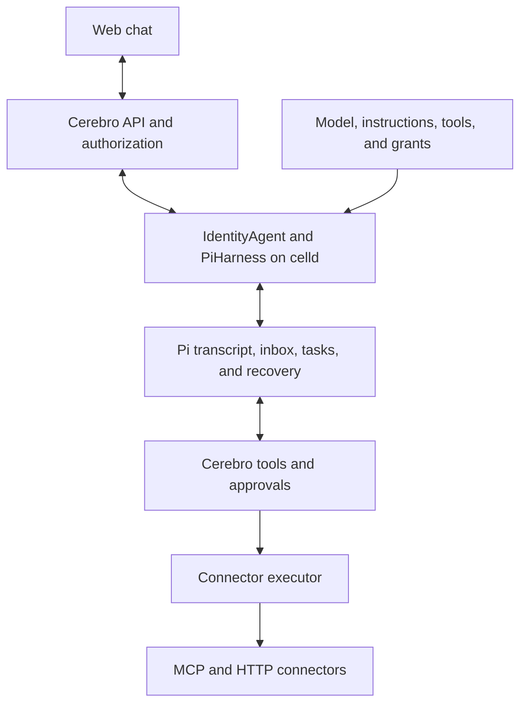

# How Cerebro fits together

Cerebro gives company users a chat interface to configured agents and controlled tools. Pi Durable owns execution. celld hosts the Worker and Durable Objects. Cerebro owns configuration, current permissions, approvals, credentials, and chat presentation.

## Execution ownership

Each organization identity has one IdentityAgent Durable Object, addressed by organization ID and owner principal ID. That object holds the identity's conversations across all product agents. One official PiHarness connects Pi to SQLite and Lifecycle wake-up jobs. Each product conversation maps to its own native Pi conversation. Pi controls inputs, busy-input queuing, generation, tool tasks, Stop, retries, and crash recovery. Cerebro composes the model, instructions, enabled tools, and grants. Current company authorization controls admission, model requests, tool calls, approval decisions, and reads.

## Forks and delegated work

A fork is an independent product conversation. PostgreSQL reserves its deterministic address and immutable parent, entry, and agent version. The runtime creates the native fork and its binding in one Pi commit. If the response is lost, the next destination read materializes or reuses that branch. Historical entries remain valid after parent compaction. The destination installs its own provider and tool bindings. It does not inherit pending inputs, children, approvals, or reminders.

A subagent is a fresh native conversation owned by its parent tool task. It shares the parent product chat's pinned configuration, controlled tools, approvals, and source ledger. The tool reuses its child and submission after a restart. Children cannot delegate or schedule work. Each chat permits three active children and 32 children in total. A child permits eight model rounds and has a durable ten-minute deadline. Parent Stop cancels foreground children. Detached background subagents are not exposed.

The activity panel projects native task ownership and bounded child transcripts. Child approvals use the parent route and native task identity. Read checks include historical child tool dependencies even when the displayed preview omits older entries.

History search uses a child with only `search_conversations`. It scans bound product chats and checks current source-chat access before returning evidence. The receiving agent must also have access to the evidence's memory sources and tools. Search records source, tool, and chat provenance before it exposes excerpts. Later reads and model requests recheck that provenance. Searches omit child transcripts, prior search-derived turns, and duplicated inherited fork entries.

Source and provenance copies are conservative. They include all recorded parent dependencies. Their SQL operations use Pi's mutation queue, but commit before Pi's physical storage transaction. A failed native fork can therefore leave extra dependency rows. Retry converges on one native branch and retains those rows.

## Reminders and context summaries

Native conversation documents hold reminder intent and occurrence state. Lifecycle jobs supply the physical wake. A job contains enough immutable input to recover creation interrupted before native admission. Startup reconstructs missing wakes. Each occurrence submits one stable operation ID through PiHarness. Recurrence advances automatically from the previous scheduled time and skips missed occurrences. Calendar recurrence preserves local time in its IANA timezone.

Future reminders survive Stop. Cancel prevents future occurrences. An already admitted input uses the normal Stop control. Every delivery checks current execution and content access. Revocation ends a reminder, while a transient failure retries the same occurrence. A chat permits 100 active reminders. Public snapshots show bounded instruction previews and recent terminal records. Full instructions remain in durable state and delivery input.

Automatic compaction uses Pi defaults. Manual compaction creates its native task, live status, and operation receipt in one commit. A durable command job keeps the identity recoverable before and after admission. Replaying an operation returns the same task. The chat shows active compaction, failures, and collapsed context summaries.

An identity shares storage and recovery across its conversations. Conversation state remains separate: each chat pins its agent version and has its own provider binding, tool extension set, approvals, source dependencies, observation, and notification jobs. Provider aliases bind each model request to its conversation configuration, including its permissions and limits. The internal Pi root is not a product conversation. Stop addresses one native conversation and its task-owned descendants.

Cerebro serializes its SQLite metadata operations through Pi's commit queue. Configuration and store initialization run on that queue. Later source-dependency, approval, and Slack-delivery operations use the same queue so their SQL does not become part of a sibling conversation's native transaction. Durability flushes happen after the queued operation completes.

The identity runtime starts fresh. New conversations use a new engine marker and Durable Object class. Previous runtime conversations are retired, and the old SessionAgent class cannot resume execution or dispatch tools. Accounts, agent definitions, connectors, and skills remain in company storage. Old transcripts and native tasks are not replayed into the new runtime.

## Tools and the external door

Tools come from connectors and live in the `connector_tool` catalog in PostgreSQL. Each row names its source. On every start, bootstrap replaces the rows `runtime.json` declares and the tools it discovers from configured MCP servers. Administrators add, refresh, and remove other MCP connectors in the product. Those rows have the source `admin:<id>`, and the administrator who adds a connector receives read and execute grants on its tools. A conversation reads the catalog when its execution configuration loads, so new conversations see catalog changes without a redeploy. See the [tool catalog plan](../superpowers/plans/2026-10-12-tool-catalog.md).

The `@earendil-works/pi-mcp` client provides remote discovery and calls through `McpClient.listTools`, `McpClient.callTool`, and `StreamableHttpTransport`. Cerebro maps discovered metadata into catalog entries, validates schemas with Zod, and creates native Pi tool registrations with its own controlled `execute` function. That function runs inside the identity DO. The MCP server executes the remote action. Registration keeps credentials out of model-visible metadata and applies current authority, approval, and durable dispatch checks before the remote call.

Pi is the authority for conversations it runs, not for tools. A later MCP endpoint for external agents will read the same catalog, accounts, and approvals without a Pi conversation. Keep tool, account, and approval code free of Pi types so that door stays open.

Skills are company playbooks that administrators write in the product. When a session's host starts, it reads the organization's skills and installs the `agents.skills` extension from `agents/harness/pi`. The model sees each skill's name and description, and loads the instructions with `activate_skill` when a task matches. Every agent in the organization sees every skill.

## State owners

| State | Authority | Storage |
| --- | --- | --- |
| Identities, memberships, grants, agent definitions, connectors, searchable memory, and audit | Company services | PostgreSQL |
| Connector credentials | Connector accounts, sealed with `account-key` | PostgreSQL |
| Tools agents can enable | Tool catalog (`connector_tool`) | PostgreSQL |
| Company skills | `skill` | PostgreSQL |
| Transcript, inbox, generation, tool tasks, and recovery | Pi Durable | Identity SQLite through PiHarness, scoped by native conversation |
| External dispatch markers and outcomes | Pi task memos | Identity SQLite, scoped by native task |
| Public-to-native conversation mapping | Pi session document | Identity SQLite |
| Owner, agent version, content access dependencies, and approvals | Cerebro | Conversation-scoped company metadata beside Pi state |
| Chat messages, partial text, and busy status | Pi current view | Derived on read, then held in browser memory |
| Slack delivery identity | Channel adapter | Conversation-scoped identity SQLite |
| Source documents and artifacts | Artifact storage | Artifact MinIO |
| celld durable state | celld | Separate runtime MinIO |

ChatSnapshot presents native Pi messages, queued inputs, tool execution state, and company approval data. Cerebro does not persist that snapshot. Pi decides when execution is active or complete. The browser uses native message order and entry identities. Tool identities include their transcript position because providers can reuse call IDs. Reset and compaction can change the current view. A separate permanent answer archive is not part of the chat contract.

## Send, Stop, and reconnect

Send authenticates the user, verifies current access, and calls Pi submit with the client's operation ID. Pi accepts the input durably and returns a receipt. The receipt confirms acceptance, not completion. Sending while busy uses Pi's inbox. The browser and API limit a message to 16,000 characters. An oversized draft stays editable and does not create pending work.

A retry keeps the same operation ID. Pi stores one input for that operation. The client matches receipts by operation ID. PiHarness's `accepted` field is advisory under concurrent retries. The browser retains unconfirmed sends and retries transient failures after a valid connection. Accepted inputs waiting in Pi's inbox remain visible as queued messages.

Stop calls native Pi abort for the selected conversation. It can stop active work and withdraw queued input in that conversation, without stopping sibling conversations. The UI does not promise an independent run for each message.

Observation sends complete authorized snapshots of the native conversation view. Reconnect starts with current messages, partial output, queued inputs, tool execution state, and approvals. Each snapshot checks read access for active tool requests as well as committed results. Invalid protocol data stops automatic reconnect. An interrupted connection can reconnect from a fresh snapshot. Closing the browser releases the observer without stopping accepted work.

## Tools and approvals

The model can request tools enabled for the agent. Each tool checks current authority and content access. A write waits for approval bound to its native task and call, arguments, tool and connector versions, actor, policy, and expiry.

An authorized person records allow or deny. A decision receipt contains only its approval ID and state. The waiting tool wakes when the decision is stored and rechecks authority only when the session sees a denial. After allow, it rechecks authority, validates the binding, and rechecks source access before dispatch. The connector executor supplies credentials, sends the request, and removes secrets from the result. Authority is checked once more after the call. A revocation during the call withholds a read's output and reports a write as an unknown outcome.

Source access controls transcript reads, new input, model requests, and allowed tool calls. Stop and Deny require current session ownership and agent authority. They remain available after source access is revoked.

## Recovery

Pi persists the transcript, inbox, generation, and tool tasks. PiHarness schedules host wake-up after eviction or restart. The host retains Pi's native idle wait with `ctx.waitUntil` while work runs. Cerebro has no second execution queue or copied-state repair job.

The host restores each conversation's provider and tool bindings before Pi resumes persisted work. The host reports background Pi failures with the session address and error category. A fatal storage failure closes Pi and resets the identity Durable Object, so all of that identity's conversations share this recovery scope. The next request or wake-up opens the native session from durable storage. Diagnostic logs exclude raw provider errors and tool arguments.

Before an external effect, the tool records a dispatch marker in a Pi task memo and flushes storage. Afterward it records the outcome. Recovery reuses a recorded result. Idempotent tools can retry. An at-most-once tool with a marker but no outcome reports an unknown result without another dispatch. A person checks uncertain effects in the target system.

## Code map

| Location | Responsibility |
| --- | --- |
| `packages/runtime/src/session-agent.ts` | Identity PiHarness, native conversation bindings, startup, and notification jobs |
| `packages/runtime/src/conversation-scope.ts` | Conversation authority, approvals, observation, and chat commands |
| `packages/runtime/src/conversation-compaction.ts` | Manual compaction validation, durable receipts, and recovery |
| `packages/runtime/src/conversation-provider.ts` | Conversation-specific provider aliases and physical model forwarding |
| `packages/runtime/src/pi-harness.ts` | Safe presentation of native entries and live state |
| `packages/runtime/src/pi-tools.ts` | Controlled tools, approval waits, and task memos |
| `packages/channels/src/conversations.ts` | Public conversation ownership, forks, commands, and delivery |
| `packages/contracts/src/session-service.ts` | Small chat requests, receipts, approvals, and snapshots |
| `apps/server/src/session` | Company configuration, access context, transport, and Slack delivery |
| `packages/channels/src/service.ts` | Setup, agent management, access changes, and chat operations |
| `packages/api/src` | Product routes and observation delivery |
| `apps/web/src/features/product` | Agent configuration and small chat UI |
| `packages/authorization`, `tools`, `memory`, `db`, `auth` | Policy, connectors, memory, records, and identity |

## Deployment

The server runs as one Worker on celld in Docker Compose. PostgreSQL holds company records. Runtime durability and artifacts use separate MinIO services. Local mode permits local HTTP endpoints. Production mode requires public HTTPS endpoints, verified PostgreSQL TLS, and externally managed secrets. Tests use isolated local stacks with a fake model and connectors.
