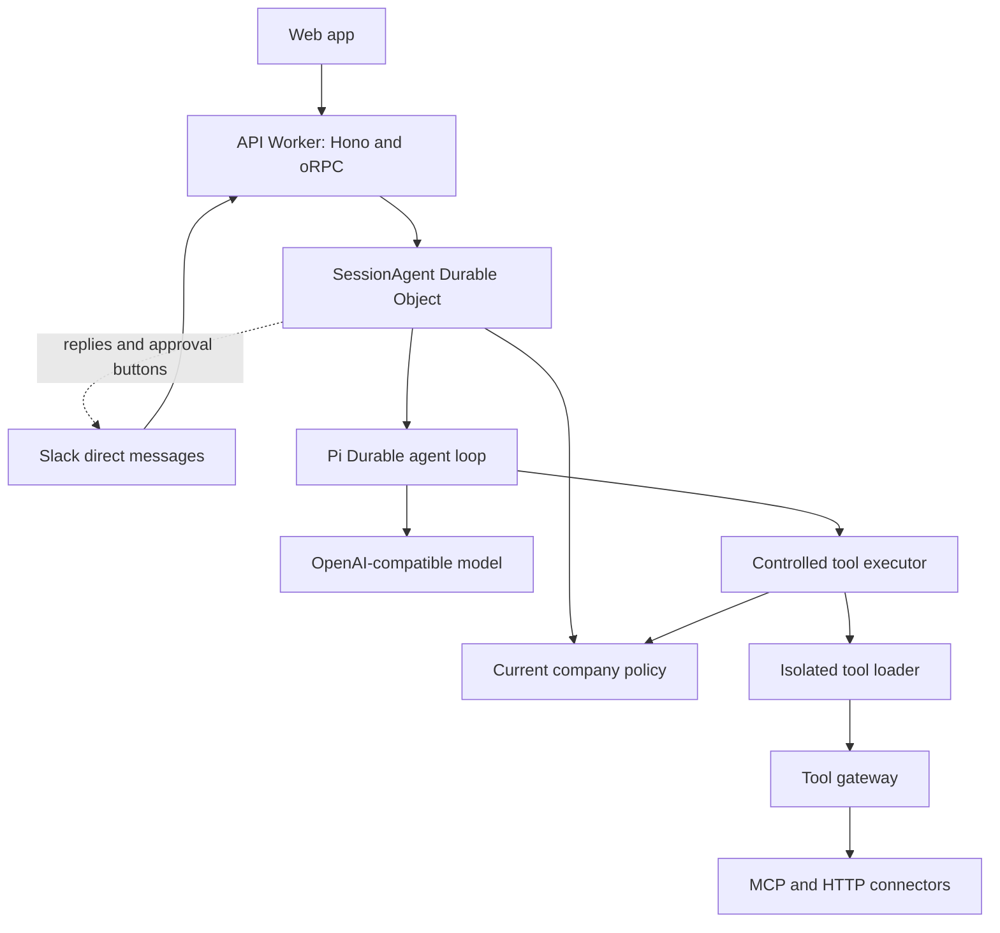

# How Cerebro fits together

Cerebro gives a company one controlled place where people and agents use company data and do work. The company keeps its identities, permissions, knowledge, approvals, and records. Model providers only supply inference.

Chat is the first way in. Slack direct messages use the same operations, and other channels and agents can use them later. [How to connect Slack](../operations/slack.md) explains the Slack app. Changing the model, the agent engine, or the host must not require a new implementation of company policy. The [architecture decision record](adr-0001-replaceable-application-boundaries.md) states that rule and the dependency rules that follow from it.

## The parts

Everything server-side runs as one Worker on celld, a self-hosted Workers runtime, inside Docker Compose. PostgreSQL holds company records. One MinIO store holds celld state and another holds source files and artifacts.

Each conversation is one `SessionAgent` Durable Object (`packages/runtime/src/session-agent.ts`) with one Pi Durable conversation inside it. Pi runs the agent loop: it calls the model, runs tools, queues and steers follow-up messages, and resumes work after a crash. Cerebro wraps that loop with company rules. Every model request and every tool call checks current permissions first, and a write waits for a person to approve it.

The browser and Slack never talk to Pi. The Durable Object emits Cerebro observation frames, the API checks access and forwards the bytes, and the web app applies the frames to one projection of the conversation. For a Slack conversation, the same Durable Object posts progress, answers, and approval buttons into the thread after each commit, once it has checked that the recipient is still linked and may still read the content.

## Where the code lives

| Folder | What it holds |
| --- | --- |
| `apps/server/src` | The API Worker. `index.ts` mounts the routes in `routes/`: `health.ts`, `auth.ts`, and `api.ts` for everything else. |
| `apps/server/src/session` | The conversation Durable Object: `agent.ts` composes it, `content.ts` prepares model input from company memory, `client.ts` calls it from the API, and `slack.ts` posts its Slack replies. |
| `apps/server/src` (other files) | `config.ts` parses `runtime.json`, `access.ts` checks current permissions in PostgreSQL, `channels.ts` wires the product API to them, and `gateways.ts` holds the tool gateway and audit sink entrypoints. |
| `apps/web` | The web app. |
| `packages/api` | The one API router (product, identity, and memory procedures) and the HTTP handler that serves it as `/rpc` and `/api`. |
| `packages/channels` | Product operations shared by web and Slack (`service.ts`), Slack events and buttons (`slack.ts`), and Slack replies (`slack-replies.ts`, `slack-api.ts`). |
| `packages/runtime` | The session host on Pi Durable: admission, approvals, tool memos, and recovery. |
| `packages/tools` | The tool registry, the isolated tool executor and gateway, and the MCP transport. |
| `packages/authorization` | Identity grants and the agent authority that every model request and tool call checks. |
| `packages/contracts` | Types and Effect services shared by the packages. |
| `packages/db`, `memory`, `auth`, `ui` | PostgreSQL schema and repositories, company memory, Better Auth, and shared UI components. |
| `tests` | Tests by area. `tests/support` holds the shared fakes and fixtures. |
| `deploy` | The scripts that build, start, back up, and cut over a stack. |

## Who owns which state

| State | Owner |
| --- | --- |
| Identities, memberships, grants, agent definitions, connectors, memory metadata, and audit | PostgreSQL |
| The transcript the model sees, the inbox of queued messages, and crash recovery | Pi, in the Durable Object's SQLite |
| Tool dispatch markers and recorded tool outcomes | Pi task memos |
| Product run state, approvals, and the canonical answer history | Cerebro's session store, in the same SQLite |
| The browser transcript and Slack replies | Projections. They never admit work or decide that a run finished. |
| What was posted to a Slack thread | The session's SQLite, so a retry edits a message instead of posting it again |
| Source documents and artifacts | Artifact MinIO |

No transaction spans these stores. Each fact has one owner, and everything else reads from it.

Cerebro still keeps its own copy of run state next to Pi's and rebuilds it from Pi events. That copy is the main remaining duplication. Removing it, so that Cerebro reads Pi's state directly, is the next simplification worth doing.

## What happens when you send a message

The web app gives each message a stable event ID. The session admits an event once. A retry with the same ID and text returns the original receipt, while the same ID with different text is rejected. If the session is unavailable, the request fails and the client retries; there is no server-side queue.

Pi answers with a model call. When the model asks for a tool, Cerebro checks that the agent and the person may use it. If the tool writes, Cerebro creates an approval and waits. After the approval, it checks permissions again, signs a short-lived capability for exactly this call, and hands the call to the isolated tool loader. The loader has no network access except the tool gateway. The gateway checks the signature and current policy, adds the connector credentials, calls the connector, and removes secrets from the result.

## Why a crash never repeats a write

A remote effect can succeed even when its response is lost, so a timeout does not prove that nothing happened. Cerebro handles that with Pi instead of a ledger of its own.

Before a tool's effect starts, the tool writes a dispatch marker into its Pi task memo and flushes storage. After the effect, it records the outcome. If celld dies in between, Pi replays the call on restart. The replay finds the marker without an outcome. An `idempotent` tool then runs again. An `at-most-once` tool is never dispatched again: the conversation shows it as an unknown outcome, the model tells the user to check the target system, and the run continues.

This replaced a receipt store, a gateway journal, and a reconciliation flow that asked providers for evidence. The trade-off is deliberate. Cerebro no longer settles an uncertain write by itself; a person checks the target system with the operation ID, which the gateway sends as `Idempotency-Key` and `X-Cerebro-Operation-Id`. For a proof of concept, one clear rule beats three components that had to agree with each other.

## Why access is checked again and again

Permissions change while a conversation is open. Cerebro checks current access on every command, before every model request and tool call, and every two seconds while a browser observes a conversation. A revoked grant stops the stream, clears protected content in the browser, and makes later reads fail, even for content that was visible a moment before.

## Deployment modes

There are two modes. `local` accepts HTTP and private hosts for models and connectors, so a model on your machine works. `production` requires public HTTPS endpoints, verified PostgreSQL TLS, and externally managed secrets. The application has no test mode. Tests run a normal local stack and add a fake model and connectors through `tests/slice-1/compose.test.yaml`.

## Later stages

| Stage | Outcome |
| --- | --- |
| Stage 2 | Distinct internal and external agent identity, delegation, argument-derived resource grants, a qualified production write connector, and capability administration |
| Stage 3 | Slack beyond direct messages: OAuth installation for several workspaces, streamed partial answers, and channel answers with audience checks |
| Stage 4 | A company workflow that requires native Node or Python tools, browser review, or multiple agents |
