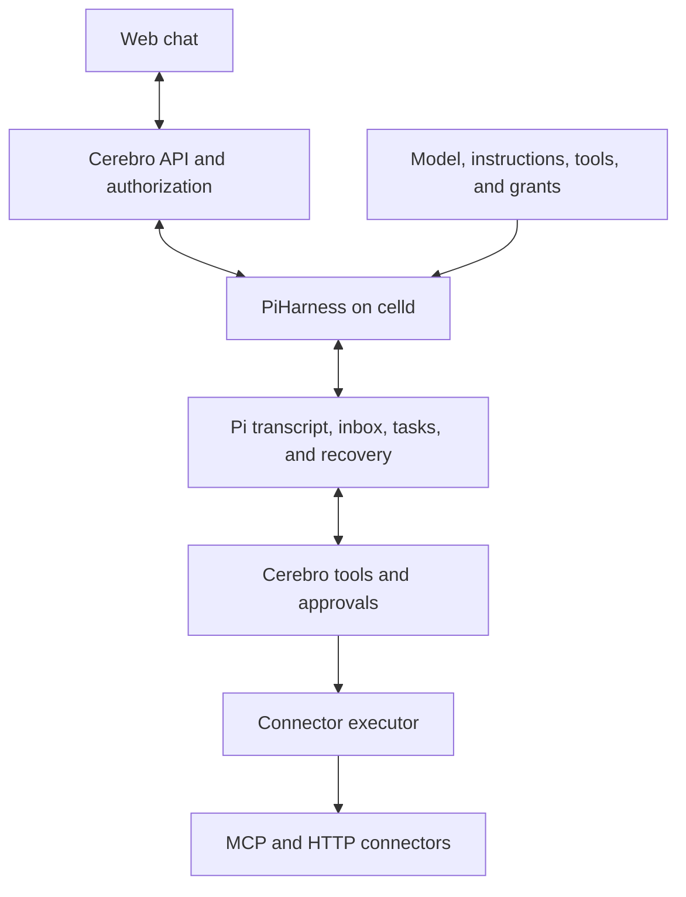

# How Cerebro fits together

Cerebro gives company users a chat interface to configured agents and controlled tools. Pi Durable owns execution. celld hosts the Worker and Durable Objects. Cerebro owns configuration, current permissions, approvals, credentials, and chat presentation.

## Execution ownership

Each conversation has one SessionAgent Durable Object and one native Pi conversation. The official PiHarness connects Pi to SQLite and Lifecycle wake-up jobs. Pi controls inputs, busy-input queuing, generation, tool tasks, Stop, retries, and crash recovery. Cerebro composes the model, instructions, enabled tools, and grants. Current company authorization controls admission, model requests, tool calls, approval decisions, and reads.

## Tools and the external door

Tools come from connectors and live in the `connector_tool` catalog in PostgreSQL. Each row names its source. On every start, bootstrap replaces the rows `runtime.json` declares and the tools it discovers from configured MCP servers. Administrators add, refresh, and remove other MCP connectors in the product. Those rows have the source `admin:<id>`, and the administrator who adds a connector receives read and execute grants on its tools. A session reads the catalog when its host starts, so new conversations see catalog changes without a redeploy. See the [tool catalog plan](../superpowers/plans/2026-10-12-tool-catalog.md).

Pi is the authority for conversations it runs, not for tools. A later MCP endpoint for external agents will read the same catalog, accounts, and approvals without a Pi conversation. Keep tool, account, and approval code free of Pi types so that door stays open.

Skills are company playbooks that administrators write in the product. When a session's host starts, it reads the organization's skills and installs the `agents.skills` extension from `agents/harness/pi`. The model sees each skill's name and description, and loads the instructions with `activate_skill` when a task matches. Every agent in the organization sees every skill.

## State owners

| State | Authority | Storage |
| --- | --- | --- |
| Identities, memberships, grants, agent definitions, connectors, searchable memory, and audit | Company services | PostgreSQL |
| Connector credentials | Connector accounts, sealed with `account-key` | PostgreSQL |
| Tools agents can enable | Tool catalog (`connector_tool`) | PostgreSQL |
| Company skills | `skill` | PostgreSQL |
| Transcript, inbox, generation, tool tasks, and recovery | Pi Durable | Conversation SQLite through PiHarness |
| External dispatch markers and outcomes | Pi task memos | Conversation SQLite |
| Owner, agent version, content access dependencies, and approvals | Cerebro | Company metadata beside Pi state |
| Chat messages, partial text, and busy status | Pi current view | Derived on read, then held in browser memory |
| Slack delivery identity | Channel adapter | Conversation SQLite |
| Source documents and artifacts | Artifact storage | Artifact MinIO |
| celld durable state | celld | Separate runtime MinIO |

ChatSnapshot presents native Pi state and company approval data. Cerebro does not persist that snapshot. Pi decides when execution is active or complete. The browser uses native message order and entry identities. Reset and compaction can change the current view. A separate permanent answer archive is not part of the chat contract.

## Send, Stop, and reconnect

Send authenticates the user, verifies current access, and calls Pi submit with the client's operation ID. Pi accepts the input durably and returns a receipt. The receipt confirms acceptance, not completion. Sending while busy uses Pi's inbox.

A retry keeps the same operation ID. Pi stores one input for that operation. The client matches receipts by operation ID. PiHarness's `accepted` field is advisory under concurrent retries.

Stop calls native Pi abort. It can stop active work and withdraw queued input. The UI does not promise an independent run for each message.

Observation sends complete authorized snapshots of the native conversation view. Reconnect starts with current messages, partial output, busy status, and approvals. Closing the browser releases the observer without stopping accepted work.

## Tools and approvals

The model can request tools enabled for the agent. Each tool checks current authority and content access. A write waits for approval bound to its native task and call, arguments, tool and connector versions, actor, policy, and expiry.

An authorized person records allow or deny. A decision receipt contains only its approval ID and state. The waiting tool wakes when the decision is stored and rechecks authority only when the session sees a denial. After allow, it rechecks authority, validates the binding, and rechecks source access before dispatch. The connector executor supplies credentials, sends the request, and removes secrets from the result. Authority is checked once more after the call. A revocation during the call withholds a read's output and reports a write as an unknown outcome.

Source access controls transcript reads, new input, model requests, and allowed tool calls. Stop and Deny require current session ownership and agent authority. They remain available after source access is revoked.

## Recovery

Pi persists the transcript, inbox, generation, and tool tasks. PiHarness schedules host wake-up after eviction or restart. The host retains Pi's native idle wait with `ctx.waitUntil` while work runs. Cerebro has no second execution queue or copied-state repair job.

Before an external effect, the tool records a dispatch marker in a Pi task memo and flushes storage. Afterward it records the outcome. Recovery reuses a recorded result. Idempotent tools can retry. An at-most-once tool with a marker but no outcome reports an unknown result without another dispatch. A person checks uncertain effects in the target system.

## Code map

| Location | Responsibility |
| --- | --- |
| `packages/runtime/src/session-agent.ts` | PiHarness host, authority, approvals, and chat transport |
| `packages/runtime/src/pi-harness.ts` | Safe presentation of native entries and live state |
| `packages/runtime/src/pi-tools.ts` | Controlled tools, approval waits, and task memos |
| `packages/contracts/src/session-service.ts` | Small chat requests, receipts, approvals, and snapshots |
| `apps/server/src/session` | Company configuration, access context, transport, and Slack delivery |
| `packages/channels/src/service.ts` | Setup, agent management, access changes, and chat operations |
| `packages/api/src` | Product routes and observation delivery |
| `apps/web/src/features/product` | Agent configuration and small chat UI |
| `packages/authorization`, `tools`, `memory`, `db`, `auth` | Policy, connectors, memory, records, and identity |

## Deployment

The server runs as one Worker on celld in Docker Compose. PostgreSQL holds company records. Runtime durability and artifacts use separate MinIO services. Local mode permits local HTTP endpoints. Production mode requires public HTTPS endpoints, verified PostgreSQL TLS, and externally managed secrets. Tests use isolated local stacks with a fake model and connectors.
