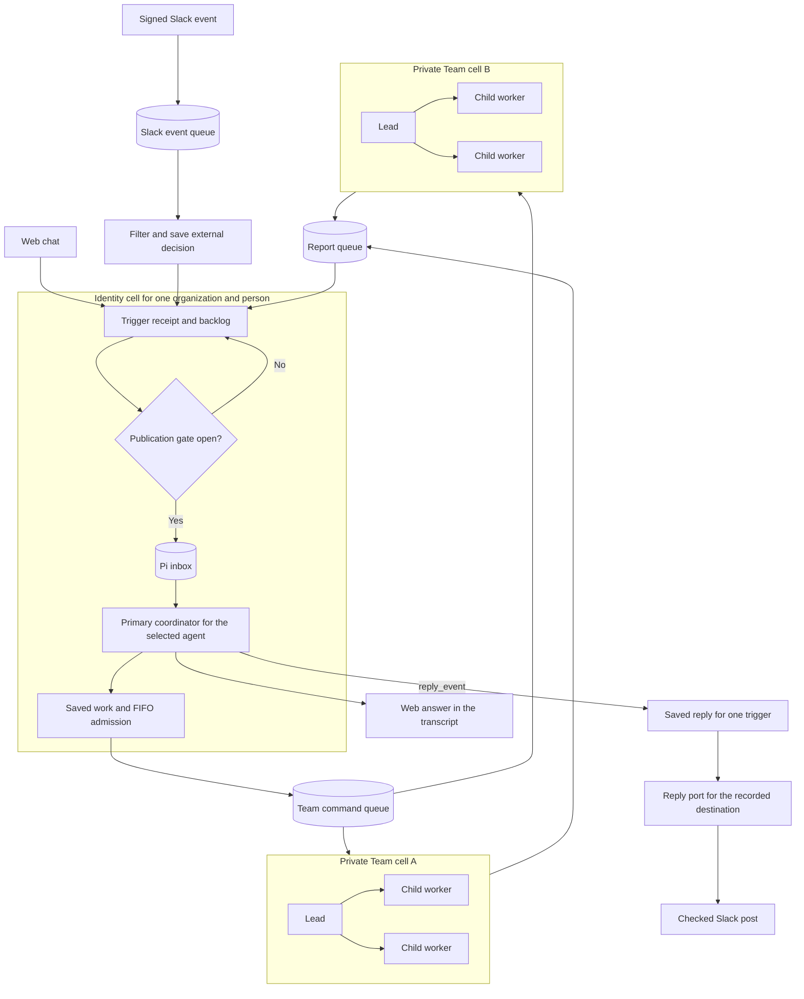
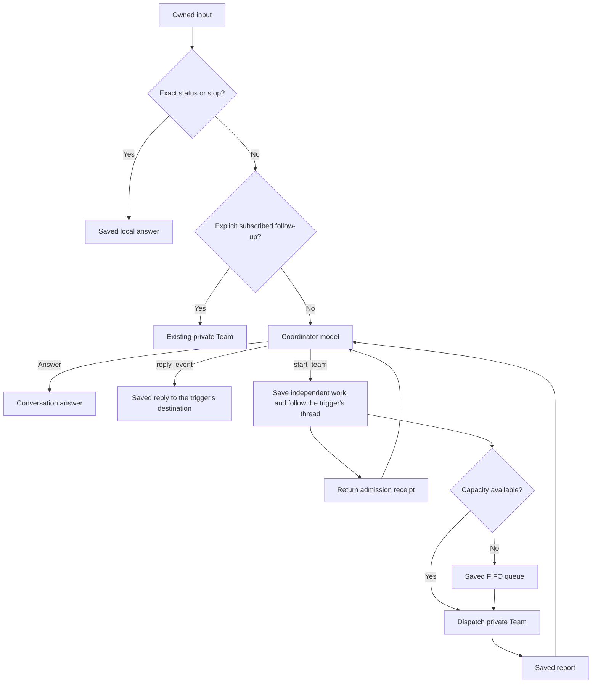

# Persistent coordinator and private teams

Each person has one primary conversation for each agent. Web messages and filtered Slack events use that conversation. The coordinator handles the conversation and uses tools to create independent work.

A Team is a separate cell. Its lead is a private Pi conversation inside that cell. Each worker is a Pi child conversation that one `delegate_worker` call creates and owns. They are not separate Durable Objects or public chats. The identity cell holds the person's agent conversations and shared admission limits. Native conversation IDs are local to a cell. Use the cell name and native ID together when debugging.

Always on means durable state and event-driven wake-up. No model loop runs while the agent is idle. Pi tasks, existing queues, and lifecycle alarms resume accepted work.

## How a trigger reaches the coordinator

Every channel turns its input into a trigger. A trigger names the conversation, the owner, its origin, the text, and where a reply may go. Web triggers have no reply destination; the transcript is the reply. A Slack trigger records the thread it came from. A timer copies the destination of the trigger that scheduled it. A Team report copies the destination of the trigger that started its work.

Admission saves a receipt and adds the trigger to a short backlog in the same commit. The receipt dedups by trigger ID and payload digest. A drain then hands each backlogged trigger to Pi with the trigger ID as its request ID, so a repeated submit after a crash finds the existing submission and places nothing twice. The drain runs after admission, on restore, and from the coordination wake. A conversation holds at most 64 waiting triggers across the backlog and Pi's inbox.

Pi's inbox is the queue. Triggers that arrive while a turn runs wait as follow-ups. When the turn ends, Pi places all of them into the next turn together, one user message per trigger. A burst of three messages costs one model turn, and all three settle with the same answer.

The publication gate sits before Pi's inbox. When a newer definition is published, the drain stops handing triggers to Pi. Inputs already in Pi finish under the definition they were placed under. Once Pi is idle with no live run, queued input, pending approval, or admission lease, the new definition is configured in one commit. The drain then places the waiting triggers under it. A later publication replaces a refresh that is still waiting, so held inputs run under the latest definition.

## Replies

A reply to an external channel is an explicit model decision. The coordinator calls `reply_event` with a trigger ID and text. The tool reads the trigger's receipt, so a reply can only go to the destination that trigger recorded. A web trigger has none, and the tool says the transcript is the reply. Each trigger takes one reply. Repeating the same call returns the saved reply, and different text for the same trigger is rejected.

The tool checks current access before it saves the reply. A denial saves a blocked reply that is never posted. Otherwise the reply outbox posts it through the reply port for the destination kind. Slack is the only port today.

If a turn ends while a Slack trigger it placed has no reply, the coordinator receives one nudge as a durable follow-up input. The nudge joins any other waiting inputs in the next turn. It is hidden from the web transcript. A nudge turn keeps the human cause of the trigger it nudges. After that one nudge, an unreplied trigger stays unreplied, and the Inspector shows it.

## What one input does

Ordinary text reaches the coordinator. It does not automatically update whichever Team is active. The model can answer directly, start another task, ask for clarification, or use an explicit Team tool. Work started from a Slack thread follows that thread, so later messages in it reach the Team without a tool call; `unsubscribe_work` stops that. A report gives the coordinator a result to explain. It cannot authorize another Team or a future instruction by itself. When a turn mixes a report with a person's message, the person's message is the cause.

## Roles and tools

| Role | Tools |
| --- | --- |
| Coordinator | Start, inspect, message, stop, and recall work; explicit subscriptions; replies to external channels; authorized reminders; UI rendering. |
| Lead | The agent's enabled tools and delegate_worker, with several calls in one turn running in parallel; return an unrelated subscribed event once. |
| Worker | A child conversation of one delegate_worker call; the agent's enabled tools; no further delegation or scheduling. |

Roles derive from the agent's pinned definition. The lead and workers run the agent's model, enabled tools, and grants, with a system overlay in front of the agent's instructions. The coordinator does not run task connector tools. Each Team saves the agent pin at admission. Current permissions still apply before execution and content transfer.

A tool that needs approval saves a pending approval in the Team cell and waits. All roles of one Team share that cell's approval store. In the same commit the Team saves one request for the coordinator, which travels on the report queue to `/team-approval`. The coordinator checks the source and the work admission, saves a mirror of the approval, and admits an internal event that names the work and the tool. The event copies the reply destination of the trigger that started the work, so a Slack-started Team can say in its thread that a decision waits. The person decides with Allow or Deny in web chat. The coordinator relays the decision to the Team cell with a signed request and shows the state the Team returns. A Team that already stopped returns its final state, and the tool never runs. The coordinator cannot decide an approval, and its own tools stay coordination-only. A mirrored approval never enters the coordinator's own approval store, so it never holds the publication gate. A report or a terminal notice for the work cancels its pending mirrors in the same commit. An approval expires at the work deadline at the latest.

A `delegate_worker` call creates its child, submits the question under the request ID `worker:<task ID>`, waits for the answer, and imports the child's content dependencies into the lead. The call's saved child record lets a restart reuse the same child and submission.

Publishing a coordinator definition stages a complete profile. Existing native work drains first. Provider, instructions, tools, skills, and permission callbacks then change together in the same conversation. New triggers wait durably in the backlog during this boundary.

## Two receipt boundaries

| Boundary | Purpose |
| --- | --- |
| External Slack decision | One provider event saves its exact owner, callback digest, and frozen bot targets. |
| Trigger receipt | Each target primary admits that trigger once and records its reply destination. Where the trigger is (backlog, queued, placed, done) is read from Pi, not stored. |

A duplicate with matching content reuses the saved decision. Changed content conflicts. Each target has an independent receipt. A Slack reply carries only the text the coordinator passed to `reply_event`. Web answers do not become Slack replies.

A Slack post first saves an unknown outcome and synchronizes storage. Confirmed success saves its timestamp. A rate limit can retry. An uncertain post never sends again automatically. Every attempt checks the original Slack link, source, and complete content access.

## Limits and recovery

Each Team runs under budgets saved at admission. `maxWorkers` bounds children running at once; a call beyond it returns a tool error that tells the lead to wait for running workers. `maxTurns` bounds model calls shared by the lead and every child, and also the number of children a Team can create. `timeoutMs` sets the absolute deadline. An agent can publish these budgets in its `team.limits` section. Each unset field uses the installation default from `coordination`. `maxTeams` stays installation-only.

Two Teams can be active and sixteen can wait for one person across their agents. Queue time counts toward the absolute deadline. Cancelling queued work creates no Team cell. A failed source status can still hold a reservation when delivery is uncertain. The slot returns only after terminal acknowledgement or its deadline.

Pi stores transcripts, tasks, receipts, and compacted context in SQLite. The native request byte cap can trigger Pi's existing compaction task. Full entries remain retained; the active chat view shows its current summary and tail. Recovery still needs a selectable cut and a summary that fits the request cap.

Interrupted model requests can repeat and incur another charge. Request reservations are not monetary spend. Large artifacts belong in external storage, with bounded text and references in coordinator context.

The development Inspector reads source-owned metadata and selected private details on demand. It shows saved models, role status, safe tool fields, retries, reservations, tokens, and results. It excludes credentials, system instructions, provider reasoning, and raw task payloads. Read access is required even in local mode. Inspection admits no new work. A cold active cell can resume already accepted execution during normal recovery. Terminal startup drains saved role tasks before it opens details, without loading a role provider. Repeated sealed reads keep usage and result IDs unchanged.

## MVP boundaries

Slack support covers linked direct messages and their threads. Coordinator inputs run in durable order, and a burst that arrives during a turn runs in the next turn together. Private Teams run concurrently. The hierarchy is one lead and its child workers, at most `maxWorkers` running at once. A Team tool that needs approval waits for a decision in web chat. Endpoint execution daemons and a separate semantic-progress Watchdog remain future work.
