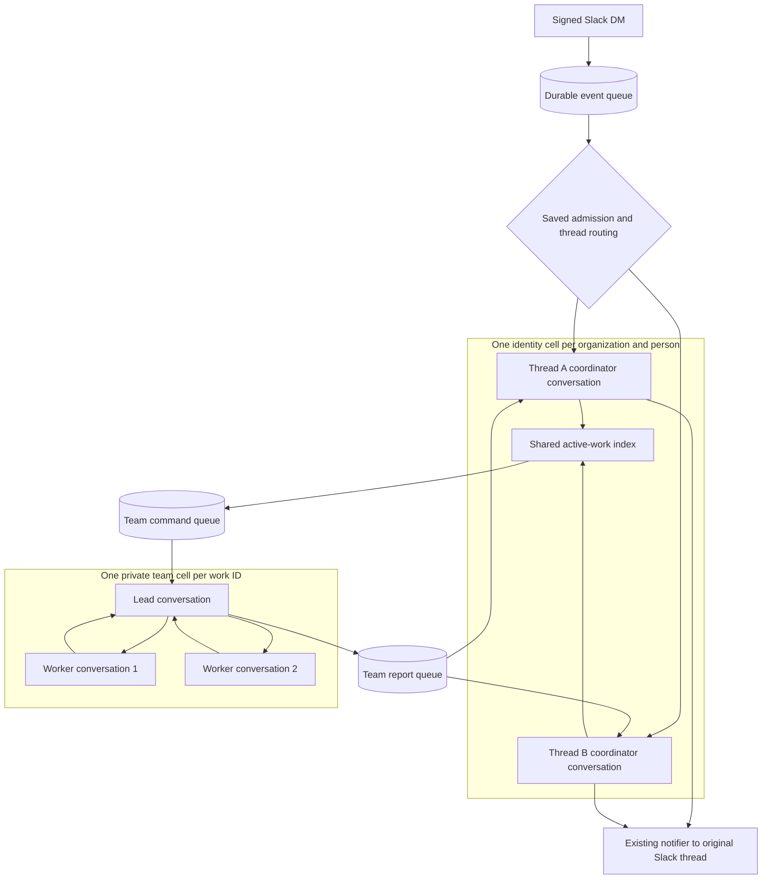
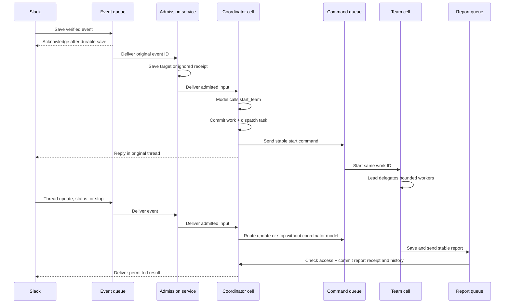

# Slack coordinator cells

A coordinator is an agent conversation with tools to start and control teams. It can use a small model while the team lead uses a larger model and workers use smaller models.

## Where execution lives



The boxes describe cell placement. A conversation inside a box is a native Pi conversation, not another Durable Object. Workers share the team's cell and request budget. Their private conversations do not create public conversation rows.

The identity cell retains separate Slack thread histories. Only its active-work index is shared across threads. This keeps replies in the correct thread while enforcing one person's total team limit.

“Always on” means events can wake saved work. The coordinator does not run a continuous model loop. Pi stores conversations, tasks, and receipts in SQLite. Lifecycle wakes resume pending work after the process restarts.

## One request from arrival to result



The event consumer saves the routing decision before delivery to the identity cell. That decision stays fixed on retries. The identity cell then deduplicates the original input. Team commands and reports have their own stable IDs. These are separate boundaries because a crash can happen between any two sends.

The source commits a report and its imported content dependencies together. The result enters canonical history without another coordinator model call. The existing notifier sends it to the saved Slack thread.

## The code that selects a team cell

The command consumer in [team-events.ts](../../apps/server/src/team-events.ts) uses the saved work key:

```ts
const stub = env.TEAM.get(env.TEAM.idFromName(workCellName(command.work.key)));
```

[work.ts](../../packages/contracts/src/work.ts) defines that name:

```ts
JSON.stringify([
  "team-v1",
  key.organizationId,
  key.ownerPrincipalId,
  key.workId,
]);
```

The namespace loads the same private `TeamAgent` for that name. The application does not construct a new object for every delivery. A retried start reaches the same cell and receives the saved command receipt.

Inside that cell, [team-workers.ts](../../packages/runtime/src/team-workers.ts) exposes `delegate_worker({ text })` to the lead. Pi creates and resumes the worker conversations. Each worker slot is bound to its owning tool task, so replay reuses the same conversation.

## Configuration and controls

| Role | Model selection | Internal team tools |
| --- | --- | --- |
| Coordinator | Agent selected by Slack `channels.json` | `start_team`, `get_work`, `message_team`, `stop_work` |
| Lead | Published `coordination.leadAgentId` | `delegate_worker` |
| Worker | Published `coordination.workerAgentId` | No delegation or scheduling |

Use the [coordination profile](../reference/runtime-configuration.md#coordination) to set role IDs and limits. Team connector tools are read-only. Workers need explicit grants for the source and tool dependencies they receive. Each handoff checks the receiving role and the person's current access.

While work is active, ordinary thread replies become team inputs. Exact lowercase `status` and `stop` messages bypass the coordinator model. These controls and passive results stay in the canonical conversation history.

## Limits and tradeoffs

| Bound | Effect |
| --- | --- |
| Two active teams per identity | A third thread cannot start more work until a slot is free. |
| Two workers per team | The lead can delegate at most two distinct worker tasks. |
| Eight shared model request reservations | Lead, workers, retries, and compaction consume the same budget. |
| Ten-minute absolute deadline | A restart does not extend work. |
| Cancellation receipt or deadline | A cancelled or uncertain team keeps its slot until the target settles or the deadline expires. |

The profile can lower these limits. Saved histories and receipts remain in SQLite after the bounded active index is pruned. This avoids loading all retained work into the active index, but retained storage still grows.

Separate team cells isolate team execution from the conversation. They require durable command and result transport. A cell is not a large-memory compute host; keep tool payloads bounded and use external storage for large artifacts.

A process crash can repeat an in-flight model request. A provider charge can therefore repeat. Stable application IDs prevent duplicate logical admission, but they do not provide exactly-once external execution. Slack posts with an unknown outcome retain the existing conservative delivery policy.

See [Slack operations](../operations/slack.md#inspect-and-replay-failed-events) for queue inspection and bounded replay.
