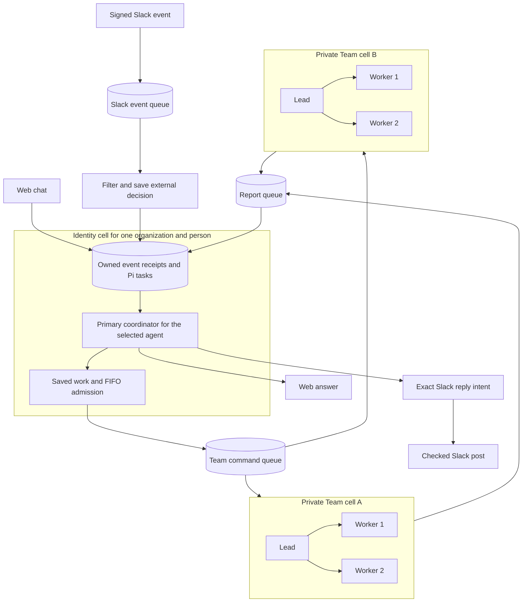
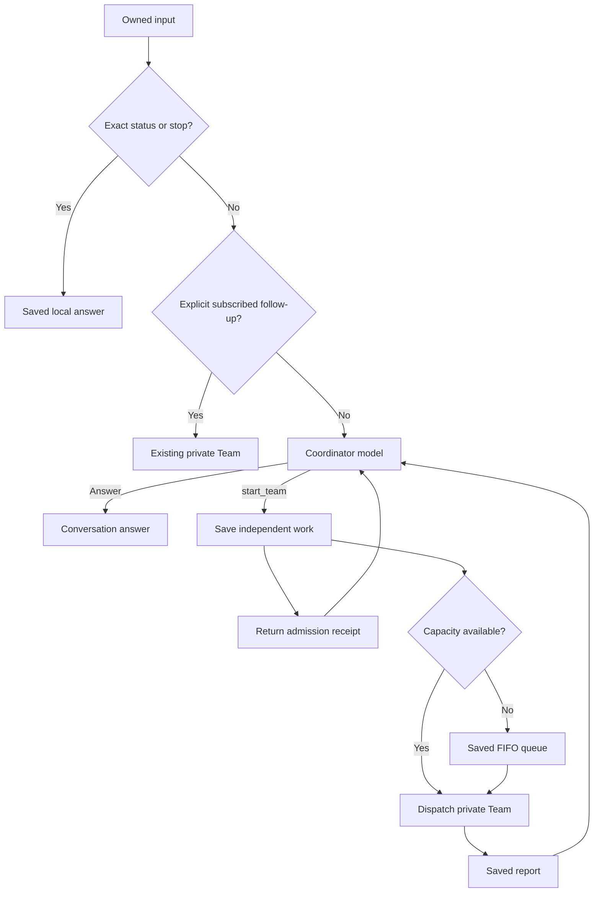

# Persistent coordinator and private teams

Each person has one primary conversation for each agent. Web messages and filtered Slack events use that conversation. The coordinator handles the conversation and uses tools to create independent work.

A Team is a separate cell. Its lead and workers are private Pi conversations inside that cell. They are not separate Durable Objects or public chats. The identity cell holds the person's agent conversations and shared admission limits. Native conversation IDs are local to a cell. Use the cell name and native ID together when debugging.

Always on means durable state and event-driven wake-up. No model loop runs while the agent is idle. Pi tasks, existing queues, and lifecycle alarms resume accepted work.

## What one input does

Ordinary text reaches the coordinator. It does not automatically update whichever Team is active. The model can answer directly, start another task, ask for clarification, or use an explicit Team tool. A report gives the coordinator a result to explain. It cannot authorize another Team or a future instruction by itself.

## Roles and tools

| Role | Tools |
| --- | --- |
| Coordinator | Start, inspect, message, stop, and recall work; explicit subscriptions; authorized reminders; UI rendering. |
| Lead | Read tools and delegate_worker; return an unrelated subscribed event once. |
| Worker | Permitted read tools; no further delegation or scheduling. |

Roles derive from the agent's pinned definition. The lead and workers run the agent's model, enabled tools, and grants, with a system overlay in front of the agent's instructions. The coordinator does not run task connector tools. Each Team saves the agent pin at admission. Current permissions still apply before execution and content transfer.

Publishing a coordinator definition stages a complete profile. Existing native work drains first. Provider, instructions, tools, skills, and permission callbacks then change together in the same conversation. New events can wait durably during this boundary.

## Two receipt boundaries

| Boundary | Purpose |
| --- | --- |
| External Slack decision | One provider event saves its exact owner, callback digest, and frozen bot targets. |
| Owned BotEvent | Each target primary admits that event once and associates it with its exact native submission and answer. |

A duplicate with matching content reuses the saved decision. Changed content conflicts. Each target has an independent receipt. Replies use the event's exact settled answer, never the most recent assistant message. Web answers do not become Slack replies.

A Slack post first saves an unknown outcome and synchronizes storage. Confirmed success saves its timestamp. A rate limit can retry. An uncertain post never sends again automatically. Every attempt checks the original Slack link, source, and complete content access.

## Limits and recovery

Two Teams can be active and sixteen can wait for one person across their agents. Queue time counts toward the absolute deadline. Cancelling queued work creates no Team cell. A failed source status can still hold a reservation when delivery is uncertain. The slot returns only after terminal acknowledgement or its deadline.

Pi stores transcripts, tasks, receipts, and compacted context in SQLite. The native request byte cap can trigger Pi's existing compaction task. Full entries remain retained; the active chat view shows its current summary and tail. Recovery still needs a selectable cut and a summary that fits the request cap.

Interrupted model requests can repeat and incur another charge. Request reservations are not monetary spend. Large artifacts belong in external storage, with bounded text and references in coordinator context.

The development Inspector reads source-owned metadata and selected private details on demand. It shows saved models, role status, safe tool fields, retries, reservations, tokens, and results. It excludes credentials, system instructions, provider reasoning, and raw task payloads. Read access is required even in local mode. Inspection admits no new work. A cold active cell can resume already accepted execution during normal recovery. Terminal startup drains saved role tasks before it opens details, without loading a role provider. Repeated sealed reads keep usage and result IDs unchanged.

## MVP boundaries

Slack support covers linked direct messages and their threads. Coordinator inputs run in durable order; private Teams run concurrently. The hierarchy is bounded to one lead and two workers. Team tools are read-only. Burst inference batching, endpoint execution daemons, and a separate semantic-progress Watchdog remain future work.
