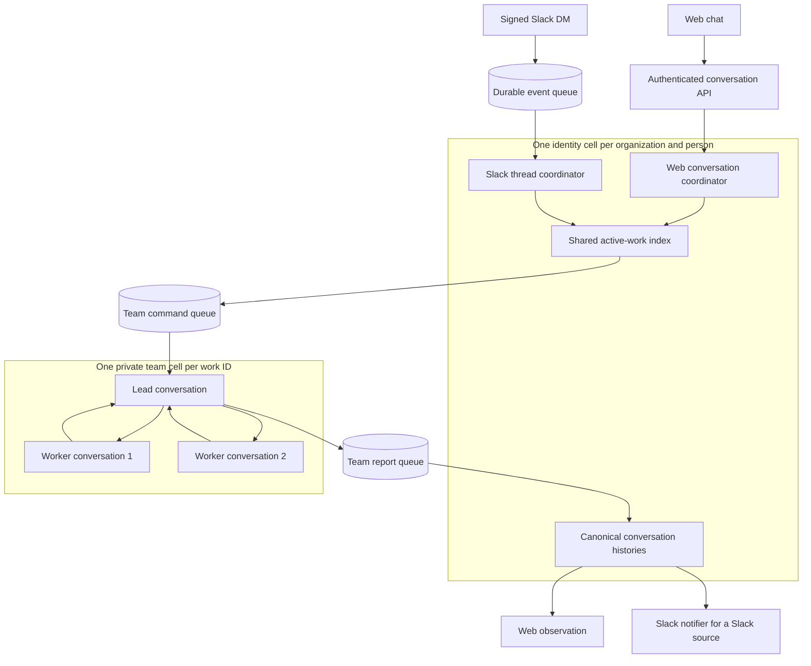
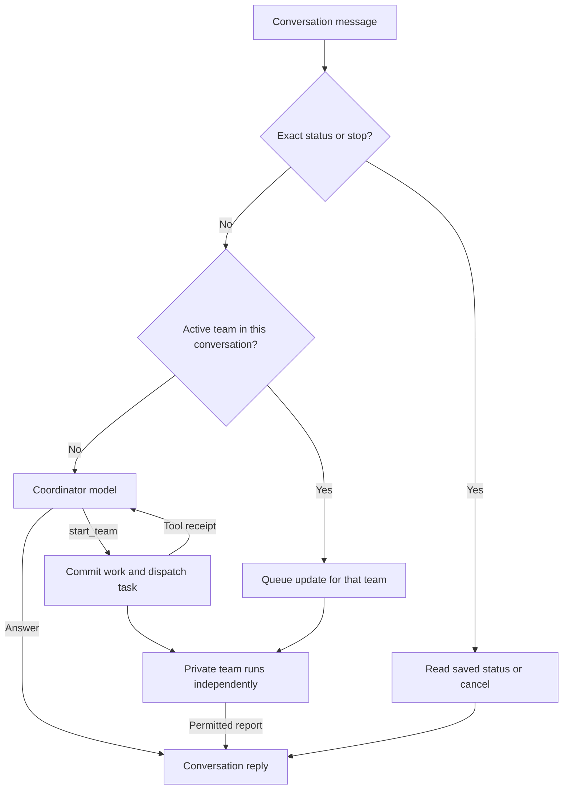

# Conversation coordinator and teams

A conversation can start in web chat or a Slack DM. Its selected agent is the coordinator. The coordinator can answer directly or use tools to start a separate team. Each role uses its own published agent definition, model, instructions, and grants.

## Where execution lives



A conversation inside a box is a native Pi conversation, not another Durable Object. Workers share their team's cell and model request budget. Private roles do not create public conversation rows.

Each conversation keeps its own history and work pointer. The identity cell shares the active-work index across web and Slack. One person cannot bypass the team limit by using another entry point or selecting another agent.

Events and Lifecycle wakes resume saved Pi tasks. The coordinator does not need a continuous model loop while idle.

## What one prompt does



A prompt does not automatically create a team. Instructions tell the coordinator when to use `start_team`. The tool returns after durable admission. The coordinator can acknowledge the request while the team continues independently.

The lead can answer directly or call `delegate_worker` for at most two worker tasks. Workers cannot create more workers or teams. This is a bounded hierarchy.

## Tools and model selection

| Role | Selected by | Coordination tools |
| --- | --- | --- |
| Web coordinator | Agent selected in the conversation | `start_team`, `get_work`, `message_team`, `stop_work` |
| Slack coordinator | `channels.json` → `slack.agentId` | The same four tools |
| Lead | `coordination.leadAgentId` | `delegate_worker` |
| Worker | `coordination.workerAgentId` | No delegation or scheduling |

The [runtime profile](../reference/runtime-configuration.md#coordination) enables this feature. Without it, ordinary chat remains available and team tools are absent. The UI has no separate role picker. Publish the role agents, then configure their IDs. Coordinator and worker definitions can select the same cheap model while the lead selects a stronger model.

The existing web `subagent` tool is a separate foreground capability. Its parent waits for the result, and the child uses the parent's model and configuration. Independent teams use private team cells and the separately published role definitions.

## Background state in web chat

The conversation shows its current background work state after the coordinator finishes its acknowledgement. The composer stays available. **Stop background work** targets the displayed work. The existing foreground **Stop** controls foreground generation.

The exact lowercase messages `status` and `stop`, and inputs to active work, route through code without a coordinator model call. A team report enters canonical history without another coordinator generation. Existing web observation supplies the result automatically and reconstructs it after reload.

## Source binding and recovery

The command consumer in [team-events.ts](../../apps/server/src/team-events.ts) selects one stable private cell:

```ts
const stub = env.TEAM.get(env.TEAM.idFromName(workCellName(command.work.key)));
```

The name contains `team-v1`, organization ID, owner principal ID, and work ID. A retried command reaches the same cell and saved receipt.

New work carries version 2 and the canonical source conversation address. The trusted conversation row owns its entry type and Slack destination. Old Slack work retains its exact saved envelope so pending tasks, command digests, and reports remain replayable. The runtime does not rewrite retained work to the new format.

Pi saves transcripts, tasks, work intent, and receipts in SQLite. Queues transport commands and reports. After a restart, role providers and tools are restored before execution resumes. Stable event, input, work, command, and report IDs prevent duplicate logical admission.

## Permissions, limits, and tradeoffs

Every generated handoff carries its source and tool dependencies. The receiving role needs its own grants, and the person's current access must still permit the transfer. Teams have read-only connector tools. Results pass source authority and content checks before they enter the public conversation or Slack reply.

| Default and hard ceiling | Scope |
| --- | --- |
| Two active teams | One organization and person, across all conversations and entry points |
| Two workers | Total distinct worker tasks per team |
| Eight model request reservations | Shared by the lead and workers, including retries and compaction |
| Ten-minute deadline | Absolute time from work admission |

The profile can lower these limits. Cancellation keeps its slot until the target acknowledges a terminal result or the deadline expires. Source history and receipts remain in SQLite after the bounded active index is pruned, so retained storage still grows.

Separate team cells isolate their execution from the conversation. They also require durable command and result transport. Use external storage for large artifacts and keep payloads bounded.

An interrupted provider request can repeat and incur another charge. A model request reservation can also be consumed before later authorization denies dispatch. These bounds are not a monetary spend ceiling. Slack keeps its conservative handling of posts with an unknown delivery outcome.
