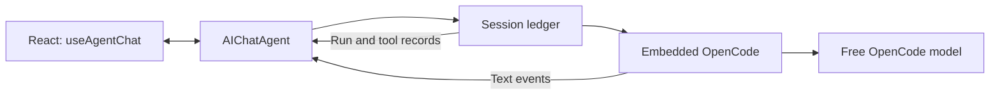

# Cloudflare chat primitives

The implementation is complete when the browser uses `useAgentChat`, receives OpenCode text before model completion, resumes after disconnect without another paid request, and retains conversation access checks, approvals, cancellation, accounting, and historical messages.

## Work sequence

1. Read Poteto Mode principles and trace runtime, authorization, and presentation.
2. Compare direct `AIChatAgent` inheritance with a separate chat Durable Object.
3. Use direct inheritance. Keep the session ledger authoritative for execution. Keep SDK messages authoritative for chat presentation.
4. Replace buffered provider transport with a bounded stream. Settle authoritative usage before EOF.
5. Add authenticated SDK routing and guard SDK handlers before they process incoming messages or replay history.
6. Translate OpenCode text events and ledger items into typed UI message parts.
7. Replace browser polling with SDK hooks.
8. Check types and behavioral tests. Deploy locally and verify tokens, reconnect, and history in the browser.

## Throughput checkpoint

Runtime transport, authenticated routing, and React presentation are independent implementation seams. Three workers own those files. The coordinator owns session integration and verification. The narrow adapter uses typed OpenCode events and AI SDK UI message streams. No browser stream parser is needed.

## Design constraints

- The SDK constructor handles protocol messages before ordinary subclass hooks. Authorization must wrap those handlers after `super()`.
- Incoming client transcripts are untrusted. Retain server history and admit only a validated user message.
- SDK reconnect replay does not permit another model dispatch. Run identity and accounting remain in the ledger.
- Streaming text is provisional. Completion is shown only after authoritative usage is settled.
- The existing Durable Object binding and SQLite identity stay in place.

## Ownership

`useAgentChat` owns the browser message state and stream protocol. `AIChatAgent` owns message persistence, stream buffering, and replay. OpenCode still owns the model and tool loop. The session ledger owns admission, approval, cancellation, and accounting.

The adapter validates incoming messages and emits typed data parts for domain controls. The provider adapter still checks content access and settles usage. These checks remain application code because the chat SDK cannot define the company policy.

Direct inheritance avoids a second Durable Object and a second execution identity. The cost is shared SQLite storage. The guarded OpenCode patch must exclude the exact tables that the Agents and chat SDKs create.

## Verification

The decision trail is [chat-primitives-decisions.tsv](chat-primitives-decisions.tsv). The [unit output](evidence/chat-primitives/unit-tests.txt) records 77 passing tests. The [channel output](evidence/chat-primitives/channel-tests.txt) records 37 passing tests.

The browser produced a real free-model answer. Disconnect, reconnect, and reload retained one user, one assistant, and one run. The [history counts](evidence/chat-primitives/browser-history.json) and [screenshot](evidence/chat-primitives/completed-reconnect.jpg) record that result. [Legacy history](evidence/chat-primitives/legacy-history.json) retained three earlier user messages and two earlier answers.

The default free model now has an 8,192-token allowance and a 1-MiB response bound. At the previous 2,048-token limit, a real response used the entire allowance for reasoning and produced no answer. The [bounded receipt summary](evidence/chat-primitives/empty-model-receipt.txt) records that failure. The larger allowance permits longer reasoning; it does not guarantee shorter model latency.

The [native runtime output](evidence/chat-primitives/native-runtime.txt) separates the earlier behavior checks from the final three passing recovery reruns. Approval waiting state, a recorded idempotent result, and an uncertain non-idempotent effect all survive process termination without a second effect.

The [final native chat output](evidence/chat-primitives/native-chat-final.txt) proves early text, active replay, completed-history recovery, one user, one assistant, one run, one usage event, and one settled zero-cost reservation. First text arrived at 18,106 ms and completion at 19,411 ms. Sign-out deleted the session and closed the existing socket with `4401`. The [separate policy-close output](evidence/chat-primitives/native-policy-close-final.txt) proves `4403` closure for an unsupported command.

The local runtime throws synchronously on `close(1008)`. Both access guards now use application close codes `4401` and `4403`. Temporary diagnostic frames were removed before the passing checks.

Final browser inspection also found a history-loading loop. The SDK returns a new `setMessages` wrapper on each render. Using that wrapper as an effect dependency caused a fetch, a state update, and another fetch. `useEffectEvent` now calls the current setter without making its identity a loading dependency. The [idle sample](evidence/chat-primitives/browser-idle.json) records 426 snapshot requests and 417 history requests in 30 seconds before the fix. After the fix, the connected chat made zero snapshot or history requests over 122 seconds, with no overload refusals.

The [final build](evidence/chat-primitives/final-build.txt) passed all 11 tasks. The [final checks](evidence/chat-primitives/final-checks.json) passed runtime, server, and web type checks, scoped lint and formatting, and the whitespace check. The native chat output above verifies real free-model delivery with fixtures disabled. Final reconnect retained the completed answer and enabled the message input.

An independent review by `gpt-5.6-sol` found no remaining material source issue. The decision trail records its evidence corrections.
