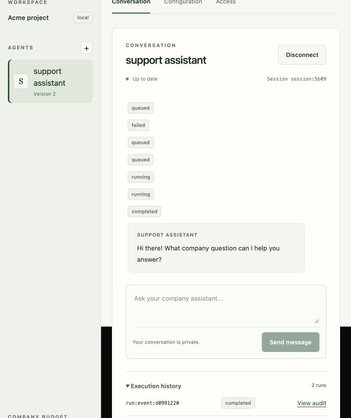

# Local OpenCode model acceptance

Session 7 was fast-forward merged into `main` at `ebaed39`. The obsolete experiment was removed in `a3fa970`. Required provider, lockfile, and dependency patch now belong to `tests/runtime`. Both native test stacks use that context. All 41 original evidence files remain under `docs/implementation/evidence/session-0`. JSON formatting was normalized; recorded values are unchanged. Historical experiment code remains available in Git at `ebaed39`.

The model implementation is committed at `e4692b9`. The local `cerebro` Compose stack was rebuilt and started from this commit with its existing volumes preserved. API readiness returned `{ "ok": true }`, the web origin returned HTTP 200, and a fixture session route returned HTTP 404.

Default local deployment now uses `opencode/space-bunny-free`. [OpenCode lists this model as free](https://opencode.ai/docs/en/zen/). The native SDK uses its genuine default identity and session headers with the public provider key. No client headers were forged. No paid fallback exists. The default catalog contains only the model that passed live acceptance.

The default configuration has no fixture source or tool. Local mode uses real PostgreSQL, MinIO, authorization, durable sessions, audit, and zero-cost usage records. Its generated installation token is persistent and required for initial ownership. Local transport permits loopback HTTP and PostgreSQL without production TLS. Production transport requirements are unchanged.

## Design and review

Two shapes were compared. Retaining fixture mode with a free-model selector scored 14/25. An explicit `local | fixture | production` mode scored 23/25. These are design judgments, not measured performance. The independent reviewer used the inherited parent model. The explicit mode prevents fixture routes, grants, notices, and approval controls from appearing in a real-provider installation.

Independent review found one missing local Slack output guard. It now rejects queued replies without an authorized output projection in every non-fixture mode. A regression test verifies no physical delivery and a failed reply state. Remaining local-mode changes passed review.

Model the Domain selected one explicit mode union. Boundary Discipline applied trusted setup, provider, and dependency checks outside fixture mode. Laziness Protocol kept the existing SDK provider and moved required test assets without a new test platform. Separate Before Serializing Shared State gave cleanup and provider review disjoint file ownership. Sequence Work into Verifiable Units kept cleanup in a separate checked commit. Test Behavior, Not Implementation required the literal model answer and database receipt. Prove It Works required native API execution, actual provider access, and restore checks.

## Verification

| Check | Result |
| --- | --- |
| Full integration, explicit fixture mode | 29 passed, zero failures or skips |
| Relocated runtime suite | 13 passed |
| Relocated policy runtime suite | 1 passed |
| Channels, including local Slack guard | 26 passed |
| Contracts | 35 passed |
| Types, forced without cache | 13 tasks passed |
| Build, forced without cache | 11 tasks passed |
| Final Space Bunny live acceptance | 1 passed, zero failures or skips |
| Changed-file lint and normal commit hooks | Passed |

The live check started an isolated Compose project with no fixture service. It checked readiness, disabled fixture routes, denial of untrusted installation setup, token-authorized ownership, the actual model catalog, and absence of test sources and tools. It created an agent and conversation through the public product API. The native SDK returned `CEREBRO_OPENCODE_LIVE_OK`. PostgreSQL contained exactly one settled `usd-micro` reservation with zero incurred charge. The successful test cleaned only its own containers and volumes.

The final live check used project `cerebro-opencode-39ede21b` and took 96,824 ms, including image build, stack startup, model execution, and cleanup. This is not provider latency or a capacity measurement. An earlier Space Bunny check also passed in `cerebro-opencode-17541df5`.

An initial test failed before model dispatch because its test helper read the wrong agent response field. The helper was corrected. Big Pickle was then tested through the genuine native SDK. Its persisted SDK event said `Model response has no bounded authoritative usage.` It produced no accepted assistant output. The zero-unit reservation remained held as an unknown outcome. The saved status does not establish a provider HTTP error. Big Pickle is excluded from the default catalog. Its retained diagnostic volumes are not used by the local deployment.

Host logs are `/tmp/cerebro-opencode-{integration,runtime,policy-runtime,channels,contracts,types,build}.log` and `/tmp/cerebro-opencode-live-final.log`. The rerunnable live check is [opencode.test.ts](../../tests/live/opencode.test.ts), invoked with `pnpm test:opencode`. It contacts the real free provider and remains separate from deterministic integration checks.

Live acceptance now qualifies this one model path. Publicly trusted Worker PostgreSQL TLS, external MCP, enterprise identity, and actual Slack remain subject to the Session 7 qualification limits. See [operations](../operations/pilot.md) for local setup and existing-agent model changes.

## Existing agent conversation repair

The browser conversation failed because the saved support assistant still used `fixture-model` and `fixture-read`. The run moved from queued to failed in 41 ms, before any model request or usage reservation. The configuration selector displayed the first available model while its React state retained the unavailable fixture ID. Its hidden tool selection also retained `fixture-read`. Publication rejected those values with `Select configured models and connectors.`

`agentEditorValues` now compares saved selections with the current catalog. It preserves valid selections, replaces an unavailable model with the first current choice, and removes unavailable tools and sources from the editable draft. A visible notice names the obsolete IDs and requires publication. An empty model catalog disables publication. The helper does not modify saved definitions.

The actual browser published support assistant version 2 with `opencode/space-bunny-free`, no enabled tools, and no grants. The next `hi there` message in the current failed conversation returned `Hi there! What company question can I help you answer?`. Run `run:event:d09912201c17c9b78cf02d7de1d9fb1f8034ebf238ea72339a132e3b20dda427` completed. Its model reservation settled with maximum and incurred values of zero `usd-micro`. Version 1 and the earlier failed run remain available in history. Each new run resolves the current agent version.

The editor regression first reported `8 pass` and `3 fail`. After the repair, it reported `11 pass` and `0 fail`. All 29 channel and UI tests passed. Scoped Ultracite, web type checks, and the rebuilt web image passed. Independent review found no actionable defect. The normal publish API, expected-version check, and operation identity remain unchanged.

Two designs were compared. Catalog normalization required fewer form rules and matched the requested free-model transition. Explicit unavailable options preserved stale selections but required separate removal controls and validation. Both require publication before saved values change. The review used the configured inherited model and does not establish cross-model agreement.

Fix Root Causes excluded provider transport through the failed run and usage records. Model the Domain kept catalog selection rules in one helper. Boundary Discipline retained the server publication checks. Laziness Protocol kept the repair within the existing editor. Test Behavior, Not Implementation required literal draft results and input preservation. Prove It Works required a visible browser reply and its settled receipt.

