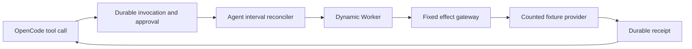

# Session 0 runtime receipt

The pinned Agent/OpenCode schema conflict is fixed by a guarded dependency patch. The continuation adds an approval broker, real SDK denial checks, a reconnect check, and controlled process-failure probes. The final selected evidence has 41 passing criteria and two unrun criteria. Gate 0 remains incomplete. A real model provider and successful Worker PostgreSQL over publicly trusted TLS are still unconfigured. Session 1 remains blocked. Product files are unchanged.

The latest criterion results are in the continuation section below. Earlier evidence remains as a record of the original failure and patch.

## Initial blocker and applied fix

`agents@0.24.0` creates `cf_agents_*` and `cf_agent_tool_runs` tables in its base constructor. `@opencode-ai/sdk@0.0.0-dev-18697` initializes its database afterward. Its unpatched migrator rejects nonempty databases without an OpenCode `session` or `session_v2` table.

A fresh Agent object returned HTTP 500 with `Database is not empty and has no session table`. The same OpenCode package initialized successfully in a separate Durable Object containing only runtime tables. No Cerebro table existed before the failing call. Moving Cerebro ledger creation after OpenCode did not resolve the conflict.

[The fresh-project result](../../experiments/celld-slice/evidence/06-fresh-project.json) records the actual table names and both responses. The control proves initialization only. It does not prove the model loop, recovery, or the required composition.

The relevant pinned package code is `@opencode-ai/core/dist/chunks/file-mutation-vp77fm2w.js`. Its migration census includes every table except SQLite and underscore-prefixed runtime tables. `agents/dist/src-BNU3ZiJM.js` calls `_ensureSchema()` from the base constructor. `@opencode-ai/server/dist/workerd.js` supplies the same `DurableObjectStorage` to OpenCode. This release exposes no separate database or schema namespace option.

The applied patch excludes twelve exact table names from the initial census. Ten are the Agent tables observed in evidence 06. Two are `cerebro_session` and `cerebro_operation`. It accepts only the pinned package version and exact original or patched source hash. It changes only that SQL query. Existing OpenCode migration branches remain byte-identical.

Unknown tables, prefix lookalikes, and a partial OpenCode schema without a session table remain rejected. Real Agent and Cerebro tables now coexist with OpenCode. A pre-existing Cerebro operation row is preserved. [The earlier patched fresh-project evidence](../../experiments/celld-slice/evidence/13-patched-fresh-project.json) records 19 passing probes, no failing probes, and 22 unrun entries.

[Migration restart evidence](../../experiments/celld-slice/evidence/11-migration-restart.json) covers current migration records, execution of the last real upstream migration from its genuine prefix, and legacy name-marker import. Data survives. Existing marker completion times remain unchanged for current and pending cases. Legacy marker import uses the current schema; it does not prove every historical schema upgrade.

## Tested environment

- Branch `codex/celld-feasibility`.
- Plan and base commit `5d886125646a69b34ed74a74f4d84bea7572d8b8`.
- Initial failing experiment commit `24c4e2032d86d97b2141c38f104815064eda5f25`.
- Patched implementation commit `c233b99afab54083c96e056280d03cc1820b2c4f`.
- Deterministic recovery and lifecycle continuation commit `540463377f376cba039364d518ace7f7bbde1d0f`.
- Host macOS 26.6.2 on ARM64. Docker Engine 29.4.0 runs Linux ARM64 in OrbStack.
- The Docker VM exposes 14 CPUs and 12,599,529,472 bytes of memory.
- celld 0.6.0, source commit `bad4649d01f0db84cdc9093527e72e64ca7a14bf`.
- MinIO source tag `RELEASE.2025-09-07T16-13-09Z`, commit `07c3a429bfed433e49018cb0f78a52145d4bedeb`, built with Go 1.24.7.
- PostgreSQL 17.9 and Node 24.14.0.
- Patched runs set `CELLD_V8_HEAP_LIMIT_MB=256`.
- Agents 0.24.0, OpenCode SDK 0.0.0-dev-18697, Hono 4.13.10, Better Auth 1.7.6, Drizzle 0.45.3, and Postgres.js 3.4.9.

[The Dockerfile](../../experiments/celld-slice/Dockerfile) pins image digests and the MinIO archive checksum. [The npm lockfile](../../experiments/celld-slice/package-lock.json) pins transitive dependencies. No root dependency file changed.

The official MinIO image pulls failed from Docker Hub and Quay. The official binary URL returned HTTP 410. Building the official pinned source allowed the requested MinIO topology to run. The experiment provisions separate MinIO services and volumes for runtime storage and application artifacts. Only runtime storage was exercised. The Worker has no artifact binding or object read/write probe yet.

## Additional runtime settings

At celld's default 128 MiB per-isolate heap limit, loading OpenCode caused SQL result materialization to fail. [The exact error](../../experiments/celld-slice/evidence/08-heap-limit.txt) identifies that limit. Cold probes passed with the supported 256 MiB setting. A later run after concurrent load still failed. The continuation below records that regression and the SDK lifecycle correction. The heap setting alone is insufficient. It does not prove compatibility with Cloudflare's default memory limit.

The deterministic fixture now declares a 32,768-token context. Its original 8,192-token context was smaller than OpenCode's default 20,000-token compaction reserve. The loop then attempted compaction after the first tool call and received no summary from the simple fixture. Changing the fixture limit allowed the intended one-tool loop to finish. Compaction behavior remains unqualified.

## Observed results

| Check | Result | Evidence or limit |
| --- | --- | --- |
| Native celld deployment and Hono ingress | Pass | `celld deploy` built and published the Worker to local MinIO. `/health` returned 200. |
| Worker PostgreSQL transport | Pass | Postgres.js selected its `workerd` export and used `cloudflare:sockets`. No database proxy was added. |
| Drizzle commit and rollback | Pass | The check container queried PostgreSQL independently. Only the committed marker existed. |
| Repeated requests after idle | Pass | Three requests separated by 1.5 seconds returned the committed row. Each request owns and closes its connection. |
| Default Better Auth signup | Fail | celld does not implement the native `scrypt` used by the default Workers export. [Unpatched result](../../experiments/celld-slice/evidence/01-unpatched-api.json). |
| Better Auth with the recorded patch | Pass | Signup, sign-in, session read, sign-out, stale-cookie denial, and invalid credentials. [Patched result](../../experiments/celld-slice/evidence/02-patched-api.json). |
| Origin rejection and CORS response | Pass | Untrusted signup returned 403. The preflight returned 204, allowed POST and Content-Type, and returned the exact origin and credentials header. This is HTTP protocol coverage, not a browser run. |
| Database and auth persistence | Pass | Existing auth cookie and committed row survived restart of celld, PostgreSQL, and both MinIO services. The rolled-back row remained absent. [Restart result](../../experiments/celld-slice/evidence/05-restart.json). |
| Base Agent construction | Pass | A fresh DO contained the real SDK tables before any Cerebro table. |
| OpenCode on empty application storage | Pass | The control returned a healthy embedded runtime. |
| Agent plus OpenCode | Pass with patch | The real Agent initializes OpenCode and preserves its session ID between requests. |
| Dynamic Worker egress | Pass | Direct fetch to a reachable fixture was denied. The supplied gateway binding returned fixed JSON with status 200. Its handler did not make an outbound request. |
| Drizzle Durable SQLite with the composed SDKs | Pass | Cerebro tables and a completed operation created before OpenCode initialization survive its bootstrap. |
| Deterministic model loop and conversation isolation | Pass | One fixture tool completes and the exact final reply returns. A second conversation has a distinct session ID and no messages. This is not cross-company authorization coverage. |
| Existing session after ordinary restart | Pass | Session ID, messages, and completed operation survive. Retry returns the stored result without new messages. [Session restart evidence](../../experiments/celld-slice/evidence/12-session-restart.json). |
| HTTP reconnect | Pass | Client abort during a held effect, independent completion, then retrieval of the same operation, session, and receipt. This does not test SSE cursors. |
| Real model provider | Not run | No provider configuration was supplied. |
| Broker, approval, and replay | Pass | The controlled effect runs only after durable approval. Duplicate approval and completed-operation retry reuse the result. Cross-operation approval is rejected. |
| Durable wake-up and failure boundaries | See continuation | The host runner records each SIGKILL boundary separately and observes the fixture before querying the Session. |
| Private CA | Unsupported in tested configuration | Node verifies the local CA and hostname. celld rejects the same database certificate with `unknown-issuer`, including when Postgres.js receives the CA. |
| Publicly trusted PostgreSQL TLS | Not run | No suitable PostgreSQL endpoint was configured. The private CA failure is not a positive TLS result. |
| Credentialed browser requests | Pass | Actual browser requests cross from port 18765 to 18768 with `credentials: include`. Sign-out is followed by 401. |
| One-session and ten-session measurements | See continuation | Separate latency, container memory, and PostgreSQL connection samples are recorded. |

The unmodified OpenCode permission service stores pending approvals in memory. The recovery fixture stores approval in Cerebro's Durable SQLite ledger. OpenCode registers plugins after a prompt activates a location. The fixture uses static deny-all permissions, removes other tools, and rejects unexpected tool names before execution. Some initial model requests advertise no tools; later requests advertise only `fixture_effect`. No claim is made that every cold request sees a ready plugin.

The initial fresh Compose project started with empty volumes and reproduced the unpatched composition failure. Evidence files 01 through 04 retain historical `incomplete` gate labels from an earlier report script. Their individual failing results remain valid. Evidence 06 uses the current `fail` gate rule. The restart and clean deployment checks were driven by separate host commands; their entries in the main check registry remain `not-run`.

## Guarded dependency patches

[`scripts/patch-dependencies.mjs`](../../experiments/celld-slice/scripts/patch-dependencies.mjs) changes only the `workerd` password export in `@better-auth/utils@0.4.2`. It selects that same package's JavaScript implementation. The native Node export stays unchanged.

The patch checks the package name, exact version, and expected export map. It is idempotent and rejects unexpected input. Native and JavaScript implementations cross-verified hashes in an isolated Node check. The deployed Worker passed the real cookie flow after the patch. This proves the patched configuration only.

The same script now applies the OpenCode census patch. `rtk proxy node experiments/celld-slice/scripts/check-patches.mjs` verifies idempotence, exact table names, rejection of changed versions and original or patched source, and preservation of all other migration code. Both patches remain local compatibility patches; no upstream release or production qualification is claimed.

## Reproduce

Run from this worktree root.

```sh
rtk proxy docker compose -p cerebro-slice -f experiments/celld-slice/compose.yaml up --build -d --wait
rtk proxy docker compose -p cerebro-slice -f experiments/celld-slice/compose.yaml run --rm check
```

Startup is expected to succeed. The check is expected to exit 1 with an `incomplete` gate while unproved criteria remain. It writes detailed JSON to the ignored `experiments/celld-slice/results` directory. The main command runs 25 deterministic checks. Separate host commands own process failures and measurements. Browser and provider results have separate evidence files.

[The experiment README](../../experiments/celld-slice/README.md) includes the separate restart commands. The check service has no Docker socket. Host commands own service restarts. No Worker imports process-control APIs.

All credentials in this experiment are public fixture values. Ingress binds to `127.0.0.1:18765`. This is a local compatibility experiment, not a production deployment.

## Work allocation and principles

One owner controlled deployment, dependencies, and the evidence. Read-only source inspection and design comparison ran in parallel. Delegates edited separate API, session, tool, and patch files. The first run stopped at the composition dependency. The user then authorized the narrow OpenCode patch. The user then requested continuation of the remaining Session 0 criteria.

Type System Discipline kept request bodies unknown until validated and kept runtime storage APIs typed. Model the Domain shaped the report's explicit pass, fail, and not-run states. Prove It Works required real Worker requests and the empty-storage control before recording the incompatibility. The design chose one Compose project with staged probes and a required final combined check.

Do not start Session 1 until the required checks have evidence and the TLS deployment constraint is resolved.

## Independent review

A read-only review by GPT-6 Sol confirmed the reproduced composition blocker. It used a different model variant within the same family. Review fixes added complete preflight assertions, clarified the untested artifact storage and gateway limits, and replaced raw Session errors and main-check response dumps with bounded messages. Only the exact known schema conflict is retained. The fresh-project result was rerun after these fixes.

[The initial validation record](../../experiments/celld-slice/evidence/07-validation.md) contains exact commands and exits. Scoped Ultracite formatting and lint checks and the container TypeScript check passed. The repository-wide pre-commit formatter was bypassed to keep all changes inside the Session 0 paths.

The experiment services were stopped after verification. Named volumes and local results were retained. Real-provider credential redaction remains unqualified; the fixtures use no private provider credentials.

A second read-only review found no actionable defects in the OpenCode patch or migration assertions. It confirmed the exact-name allowlist and unchanged migration branches. It also required the receipt to distinguish legacy marker import from historical schema upgrades, and object re-creation from the host restart commands.

[The patch validation record](../../experiments/celld-slice/evidence/14-patch-validation.md) contains the final commands, exits, image ID, and restart provenance. It includes a new-volume startup, container TypeScript and patch checks, and the scoped Ultracite check.

## Continuation design and evidence

The recovery fixture uses one operation and one effect slot per `RecoverySession` DO. It still extends the actual Agents SDK and runs the actual OpenCode loop. A separate counted fixture provider supplies deterministic model responses and remote effects.



The application invocation ID is the operation ID plus the effect slot. SDK call IDs identify attempts. Approval binds the invocation, argument digest, policy version, and tool version. The reconciler commits executing intent before dispatch. It commits the receipt before reporting completion.

A provider retry with an idempotency key can return the original receipt. An interrupted non-idempotent dispatch becomes `unknown-outcome`; it is not sent again. This is a controlled recovery contract, not an exactly-once guarantee for arbitrary external providers.

The wrapper has `globalOutbound: null` and one gateway binding. The gateway fixes the destination and validates the effect request. It adds the public fixture secret outside the wrapper. The secret-absence assertion scans the raw model request before schema parsing and the exact serialized model response. It requires observed tool arguments and results and stores only presence flags. Returned operation data is checked separately. It does not qualify real credential redaction or arbitrary untrusted wrapper code.

Shell, web fetch, code execution, and an unregistered MCP tool were requested through the real SDK. Their exact denial errors are checked. A fixture effect count alone is not accepted as denial evidence. The fixture exposes no other registered tools.

The first 120-second idempotent-recovery observation failed. The independent provider later recorded a new-instance wake after 182.56 seconds, followed by completion without a new Session request. celld defaults to a [60-second waker scan](https://github.com/denoland/celld/blob/bad4649d01f0db84cdc9093527e72e64ca7a14bf/crates/celld/main.rs#L4689) and a [lease of three scan intervals](https://github.com/denoland/celld/blob/bad4649d01f0db84cdc9093527e72e64ca7a14bf/crates/celld/dead_node_gc.rs#L100-L105). A restarted process receives a new node ID. This source behavior is consistent with the delay. The test now observes for 300 seconds. No scheduler patch or shorter lease was applied.

The reconnect probe uses `GET /result?wait=true` as a bounded observer. Closing that request does not cancel the operation. It proves HTTP disconnect and reconnect to persisted run state. It does not prove an SSE protocol or cursor replay.

### Remaining deployment decisions

A publicly trusted database certificate is the smallest deployment option consistent with the observed trust-store limit. That option still needs a successful Worker PostgreSQL test. Private CA support would require a reviewed transport or runtime change. Certificate verification was never disabled.

A real non-production model provider remains untested because no configuration was supplied. All recorded model latency and effects are fixture results. Missing credentials do not turn the gate into a pass.

### Recorded checks

[The selected status summary](../../experiments/celld-slice/evidence/28-session-zero-status.json) combines the main command with the separate host and browser reports. Every merged criterion names its evidence artifact. The summary command does not execute tests.

| Check group | Result | Evidence |
| --- | --- | --- |
| Main API, database, auth, SDK, broker, denial, and reconnect checks | 25 pass, 0 fail | [Main result](../../experiments/celld-slice/evidence/15-final-main.json) |
| Broker approval, replay, receipt, and secret boundaries | Pass | [Broker result](../../experiments/celld-slice/evidence/16-broker.json) |
| Forbidden tool requests through OpenCode | 4 pass | [Denial result](../../experiments/celld-slice/evidence/17-tool-denial.json) |
| HTTP disconnect during execution | Pass | [Reconnect result](../../experiments/celld-slice/evidence/18-reconnect.json) |
| Credentialed browser flow | Pass | [Browser result](../../experiments/celld-slice/evidence/19-browser.json), [screenshot](../../experiments/celld-slice/evidence/19-browser.png) |
| Private CA behavior | Limitation reproduced | [TLS result](../../experiments/celld-slice/evidence/20-private-ca.json) |
| Five process-kill boundaries | 5 pass | [Crash result](../../experiments/celld-slice/evidence/21-recovery.json) |
| PostgreSQL and MinIO outage recovery | 2 pass | [Outage result](../../experiments/celld-slice/evidence/22-outages.json) |
| One and ten concurrent sessions | Pass | [Latency and connections](../../experiments/celld-slice/evidence/23-baseline.json), [container memory](../../experiments/celld-slice/evidence/24-baseline-memory.json) |
| Auth, database, and SDK state after ordinary restart | Pass | [Restart result](../../experiments/celld-slice/evidence/25-restart.json) |
| Fixed-version repeated load and resource release | Pass | [Lifecycle result](../../experiments/celld-slice/evidence/32-lifecycle.json) |
| Real model provider | Not run | No configuration supplied |
| Successful Worker PostgreSQL over trusted TLS | Not run | No suitable database endpoint configured |

The crash runner measured 64.854 seconds for the before-model case, 11.522 seconds for approval persistence, 185.986 seconds for idempotent effect recovery, 186.333 seconds for non-idempotent uncertainty, and 10.777 seconds for a lost completed response. These are whole-case durations. The idempotent provider received two requests and counted one effect. The non-idempotent provider received one request and counted one effect.

[The earlier deadline failure](../../experiments/celld-slice/evidence/26-recovery-deadline-failure.json) remains preserved. Its successful-case duration fields were computed before awaiting the case and are invalid. The final runner computes duration afterward. Its recorded failed 120-second observation remains valid.

[Earlier validation provenance](../../experiments/celld-slice/evidence/27-validation.json) records the fresh-volume startup and earlier image identities. [Final provenance](../../experiments/celld-slice/evidence/33-final-validation.json) records the reviewed Worker version `0b226a2f994ccfa9` and verifies its source against the running image. The five crash checks were repeated after the lifecycle fixes. [The earlier crash run](../../experiments/celld-slice/evidence/34-recovery-before-lifecycle.json) is retained. Cached dependency and MinIO layers were reused; no uncached build is claimed.

[Final migration restart evidence](../../experiments/celld-slice/evidence/39-final-migration-restart.json) also passes for current records, the pending real migration, and legacy marker import. The first ordinary startup attempted to start celld before MinIO was ready and failed bucket validation. [That failure and resolution](../../experiments/celld-slice/evidence/38-startup-order-failure.json) are recorded. Restart commands now wait for storage readiness before starting celld.

The required dependency patch set remains two guarded changes. Better Auth uses its package's JavaScript password implementation for workerd. OpenCode excludes the twelve exact foreign table names from its initial census. The tested runtime also uses a 256 MiB heap limit, 10-second idle eviction, and a 16-cell resident limit. Completed OpenCode runtimes are explicitly closed. The final lifecycle check passes. Session 1 still requires the open provider and TLS checks.

### Earlier load measurement

In [the earlier baseline](../../experiments/celld-slice/evidence/36-baseline-before-lifecycle.json), one deterministic session completed in 542 ms after ordinary restart. Ten concurrent isolated sessions completed in 2,116–2,513 ms each, with a median of 2,411 ms. Each returned one tool result and the exact final answer.

[Earlier memory samples](../../experiments/celld-slice/evidence/37-memory-before-lifecycle.json) reported whole-container peaks of 740.4 MiB for celld, 27.68 MiB for PostgreSQL, and 58.08 MiB for the provider fixture. Each service had 28 samples. These are not per-session memory values and can miss short peaks.

PostgreSQL samples contained only the observer connection and zero workload connections. The measured OpenCode fixture loop uses Durable SQLite. This does not measure the PostgreSQL cost of an authenticated product request or establish production capacity.

### Repeated-load regression and lifecycle correction

The earlier one-session and ten-session baseline did not prove repeated use. A later main run failed eight checks with the isolate heap-limit error. [The failed run](../../experiments/celld-slice/evidence/29-post-load-failure.json) is preserved.

Idle eviction and a resident limit alone did not fix the problem. Cells disappeared, but SDK requests kept retiring isolates alive. [The census](../../experiments/celld-slice/evidence/30-heap-census.json) records that growth. [A passing functional run](../../experiments/celld-slice/evidence/31-capacity-only-check.json) therefore did not qualify that configuration.

The experiment now closes OpenCode clients after ordinary requests and terminal recovery states. Pending approval and execution retain their client. Ordinary requests serialize client ownership. Initialization and storage-sync failures also close an allocated client. Durable session IDs, messages, approvals, and receipts stay in SQLite. This adds initialization cost to each new ordinary request.

The fixed-version lifecycle runner repeats the main check and the one-session/ten-session baseline twice. It asserts that the container start time, image, Worker version, and deployment generation do not change. It then observes request and retiring-isolate counters for up to 120 seconds. This catches the observed regression; it does not prove a long-running production memory bound.

Independent review also corrected three evidence gaps. The recovery route must match the operation ID, preventing approval and effect identity reuse across object routes. The pre-model crash check reads the independent fixture journal after SIGKILL and before restart. The browser check requires logout and a 401 between signup and sign-in.

Attack the Premise changed the memory investigation from another heap increase to a census of live cells, retiring isolates, and requests. Prove It Works requires a stable deployment during the final drain observation.

### Final repeated-load measurement

Each of the two fixed-version rounds passed all 25 deterministic main checks and both baseline phases. The second round measured 436 ms for one session. Ten concurrent sessions took 2,434–2,888 ms each, with a median of 2,597 ms. Each result had one tool call and the expected final answer.

The second-round sampled container peaks were 847.9 MiB for celld, 24.38 MiB for PostgreSQL, and 43.43 MiB for the fixture, with 28 samples per service. PostgreSQL again showed the observer and no workload connections. The earlier numbers above remain historical measurements. The selected baseline files now refer to this final repeated run.

[Exact continuation commands](../../experiments/celld-slice/evidence/35-continuation-validation.md) cover build, type checks, dependency patches, crash boundaries, service outages, restart order, browser checks, and lifecycle observation.

The final census reached zero cells, requests, turns, retiring isolates, and cell-isolate heap after 77.984 seconds of idle observation. The container ID, start time, image, deployment version, and generation stayed fixed. [The lifecycle result](../../experiments/celld-slice/evidence/32-lifecycle.json) preserves both rounds and every census sample. It supersedes the observed heap regression for this workload and observation window.

A final independent review found no remaining concrete issues. It matched the selected artifact hashes, Worker source hashes, version and container identity across the lifecycle samples, reported measurements, and local evidence links. Services are stopped. Named volumes and ignored raw results remain available for follow-up.
