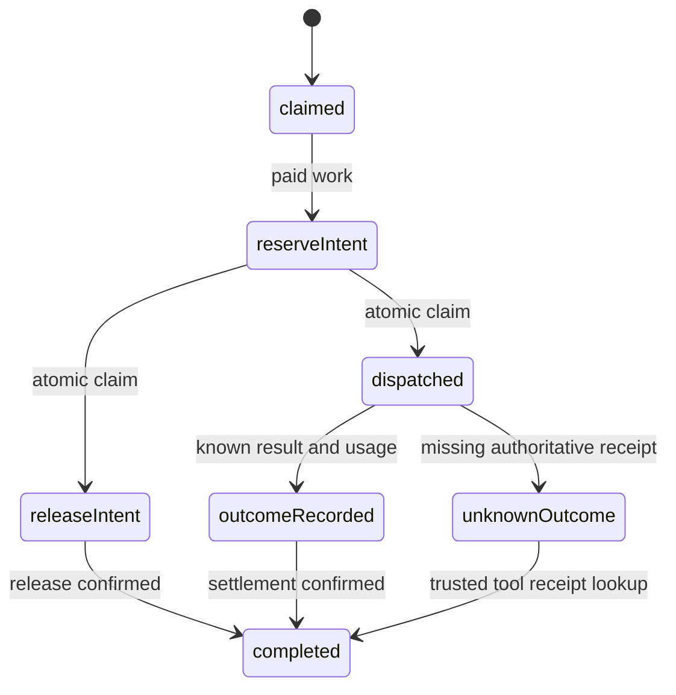

# Session 4: tools, budgets, and decisions

Date: 2026-09-29. Branch: `codex/tools-commercial-policy`. Base and prerequisite contracts: `c2b7ed1`. Worktree: `/Users/jhonsfran/.codex/worktrees/tools-commercial-policy/cerebro`.

## Delivered behavior

The OpenCode plugin replaces the advertised tool set with registry tools and rejects unregistered calls before execution. The broker normalizes arguments, checks their digest, current authorization, entitlements, and approval. The dynamic wrapper has `globalOutbound: null` and one gateway binding. A signed envelope binds its audience, full call, capability, policy version, deadline, and registry fingerprint.

The trusted gateway checks the signature and current tool and connector grants. It holds credentials, uses a fixed registry destination, propagates the operation ID, bounds streamed bytes before parsing, validates output, and redacts configured secrets. MCP access pins stateless protocol `2026-07-28`, with required per-request metadata and HTTP headers. It reads bounded JSON or SSE tool results, cancels at the final response, and validates standard MCP result content. It uses only read-only `tools/call`, text content, and optional structured output. Legacy initialization protocols, custom header annotations, and server-initiated requests are unsupported. Write registration requires explicit fixture mode, a fixture host, and approval. Real external writes remain outside the pilot.

The PostgreSQL budget authority locks the shared company account and writes the reservation and operation receipt in one transaction. Two sessions cannot reserve the same available capacity. Operation IDs bind command kind, digest, and full input. Settlement spends incurred units and restores unused capacity; release restores unused reservations. Network calls occur outside database transactions.

Paid work checks authorization and entitlements before reservation and before provider dispatch. Its runtime-owned journal records reservation intent, dispatch, known outcome with usage, and completion. Dispatch and unused release compete through an atomic transition. Retry reconciles the saved reservation, release, or settlement command. It cannot run the provider twice. An unknown paid outcome retains its full maximum. Recovery settles known usage even after revocation and checks current access before returning the saved output.

Jev proposes only `run`, `clarify`, or `defer`. The durable request includes the address, context, input digest, allowed choices, and pinned model. The accepted result and usage survive reopen. Hard policy checks run after each proposal, including replay. The event dispatcher routes approval, cancellation, revocation, and maintenance to deterministic handlers with durable replay; those events cannot invoke Jev.

## Runtime contract and recovery

`OperationJournal<Value>` is an additive contract for the session runtime. It provides immutable intent claims and atomic transitions. The tests use SQLite, including the actual DO SQLite API on celld. Session 2 is absent from this prerequisite branch, so production session-ledger composition remains Session 7 work. The fixture journal is not a production session implementation.

Tool broker and gateway journals use separate namespaces. Completed replay returns copied receipts after current permission checks. The same ID with changed input conflicts. Unknown fixture writes use receipt lookup; there is no blind redispatch. Unknown Jev calls remain held because its documented API has no idempotency or result-lookup method.

## Dependencies and provider mapping

| Component | Pinned version | Check |
| --- | --- | --- |
| celld | `0.6.0` | Actual local runtime |
| Agents SDK | `0.24.0` | Actual DO fixture |
| OpenCode SDK and plugin | `0.0.0-dev-18697` | Actual plugin execution and forced bypass attempts |
| Unprice SDK | `@unprice/api@0.3.1` | Installed SDK with local HTTP transport |
| Jev SDK | `@typesafe-ai/sdk@0.6.0` | Installed SDK with local HTTP transport |
| PostgreSQL | `17.9-bookworm`, pinned digest | Atomic shared-budget tests and clean migrations |

The SDK methods were checked against package declarations and primary documentation. No external credentials were used.

| Budget operation | Unprice method | Durable interpretation |
| --- | --- | --- |
| Reserve | `runs.start` | Save original payload and idempotency key; retry that same start after an unknown response. |
| Inspect balance | `wallet.balance` | Convert the configured currency ledger scale into exact domain units. |
| Inspect reservation | `runs.get` | Check the recorded run ID and authoritative funding or terminal state. |
| Settle incurred usage | `runs.settle`, then `runs.end` | Save the verified meter payload and settlement receipt before ending; retry without a second charge. End with `failed` for known failed work. |
| Release unused capacity | `runs.end` with `canceled` | Reconcile the terminal receipt with `runs.get`. |
| Check entitlement | `access.check` | Read-only check; it does not reserve money. |
| Export usage | `usage.record` | Stable export identity; reject re-export of the billable event already sent through settlement. |

Customer IDs, currency, unit conversion, meter identity, and meter property mapping require explicit configuration. Reservation intent pins the monetary mapping. Mapping drift cannot change a charge during recovery. Retain the old verified mapping and its meter version until every saved reservation is settled or released. A changed mapping fails closed and can block both operations; restore the matching configuration to recover the hold. A settlement must be accepted and fully funded before the adapter reports success. SDK retries are disabled; the adapter owns recovery.

Sources: [MCP versioning](https://modelcontextprotocol.io/specification/2026-07-28/basic/versioning), [MCP Streamable HTTP](https://modelcontextprotocol.io/specification/2026-07-28/basic/transports/streamable-http), [Unprice OpenAPI](https://docs.unprice.dev/openapi.json), [Unprice SDK](https://docs.unprice.dev/libraries/ts/sdk/overview), [Jev SDK source v0.6.0](https://github.com/typesafe-ai/typesafe-sdk-js/blob/v0.6.0/src/client.ts), [Jev API](https://docs.typesafe.ai/api), and [Jev model limits and pricing](https://docs.typesafe.ai/models).

## Cost bounds

Amounts use nonnegative safe integer domain units. Monetary conversion must be an exact configured integer. PostgreSQL constraints protect nonnegative capacity and conservation. A reservation holds the full maximum before paid work starts.

The Jev adapter accepts only verified pricing for `jev-1.13.0`: USD 0.042 per million input tokens and zero output cost. It bounds the summary to 16,384 bytes and reserves for 65,536 input tokens. Rounded upward to USD cents, the maximum is one cent. Returned usage and actual model must match the verified envelope. Missing configuration fails closed. This bound depends on the provider limits and price that the operator verifies before enabling the adapter.

Known failed work is charged for its authoritative incurred usage. Missing or invalid usage keeps the full hold. This conservative rule can reduce available capacity until trusted evidence resolves the outcome.

## Verification

The final source passed these checks before the implementation commits. Source hashes confirm that the commit hooks did not change the tested tools, policy, or fixture files. Implementation head is `42406ec`. Contracts prerequisite is `c2b7ed1`.

| Check | Result |
| --- | --- |
| `pnpm test:policy` | 63/63, no skips; runner creates fresh PostgreSQL and applies all committed migrations |
| `pnpm test:policy:runtime` | 1/1, no skips; actual celld and OpenCode, 37.53 seconds |
| `pnpm test:contracts` | 35/35, no skips |
| `pnpm check-types` | 10/10 workspace tasks |
| `pnpm build` | 9/9 workspace tasks |
| Scoped `pnpm exec ultracite check` | 63 Session 4 and database files pass |
| `pnpm install --frozen-lockfile --offline` | All 12 workspace projects pass |
| `git diff --check` | Pass |
| `pnpm check` | Fails on existing formatting and lint issues outside Session 4; 35 lint failure files are unchanged from `c2b7ed1` |

Host coverage includes shared-budget races, changed-input conflict, lost reserve/release/settlement replies, current authorization on replay, failed-work billing, mutable caller input, Jev bounds, deterministic control events, and 36 tool-boundary tests. Five journal tests prove atomic claims and reopen behavior. The actual runtime fixture tests the restricted Worker and installed OpenCode plugin; it is separate from the host suite.

Final command logs remain local under `/tmp/cerebro-s4-final-*.log`. The repository lint attribution is `/tmp/cerebro-s4-repo-attribution.txt`. The append-only decision trail is `/tmp/cerebro-s4-decisions.tsv`. The initial formatting failure and overwritten test file were corrected before final verification. All original decision assertions were restored and independently checked.

## Review and design decisions

Two independent designs were compared before coding. The selected design kept a small broker and signed capability API. It added durable claim tokens and explicit remote accounting phases from the alternative. Separate owners changed tools, policy, and runtime fixtures; one coordinator changed contracts, dependencies, and PostgreSQL migrations.

A read-only correctness review found reservation/release races, mutable monetary mapping, saved-result access after revocation, and stale persistence deadlines. Regression checks cover the accepted fixes. A separate comment review checks suppressions and public contract comments. Design, code, and comment reviewers used the configured inherited model. A separate `gpt-5.6-sol` reviewer audited the decision trail against this run transcript. Its flags required final verification after all edits, a recorded MCP protocol choice, exact commit evidence, and the mapping-drift recovery limit.

Model the Domain produced explicit durable phases. Boundary Discipline placed JSON, SDK receipt, and capability validation at the entry points. Separate Before Serializing kept file ownership separate and shared budget mutation atomic. Sequence Work into Verifiable Units produced separate storage, tools, and policy commits. Test Behavior, Not Implementation required independent provider effect counts and literal budget balances. Prove It Works required actual PostgreSQL and celld evidence.

The blocking work was contract and SDK grounding. Tools, policy, and runtime fixtures then had separate file owners. The coordinator owned dependencies and migration generation. This avoided concurrent edits to shared files. Final verification joined the three workstreams.

The signed envelope adds verification at the gateway and keeps credentials there. Durable dispatch claims prevent duplicate effects, but an unknown provider outcome can retain capacity. Pinned MCP and monetary mappings limit interoperability and require explicit configuration changes. These are accepted tradeoffs for the pilot.

## Integration limits

The local results qualify these Session 4 adapters and fixtures. They do not qualify the integrated company pilot. Session 7 must connect the production session runtime, current identity policy, connector repository, model paid-work gate, and event handlers in the deployment graph. The new journal must be implemented by the production session ledger with the same atomic transition semantics.

Live Unprice, Jev, model-provider, and external MCP checks are unrun. A configured pilot integration requires its own live check. The inherited Gate 0 publicly trusted Worker PostgreSQL TLS result is still missing; Session 3 skipped that check under the user's instruction. This session does not close it.

No external deployment or PR merge was performed. The repository has no git remote. Delivery is an attached local worktree on `codex/tools-commercial-policy`.

| Commit | Unit |
| --- | --- |
| `c0bc9e6` | Journal contract, connector schema, atomic usage persistence, migration, and pinned dependencies |
| `08403aa` | Broker, restricted dynamic Worker, signed MCP gateway, OpenCode plugin, and runtime proof |
| `42406ec` | Paid-work recovery, local budget, Unprice, Jev, decisions, and policy regressions |

The next documentation commit records this receipt and marks the Session 4 implementation checklist. Those checkboxes describe the verified adapters and fixtures; production composition and live-provider acceptance remain incomplete.

## Parent merge verification, 2026-09-30

The merge combines parent `6cdc5e0` with Session 4 `5066f83`. It was prepared in the isolated worktree on `codex/session-4-integration` because the parent checkout had an active Session 5 merge. The tools and policy implementation is unchanged from the verified Session 4 source.

The resolution retains both memory and policy test runners and both database schema sets. Parent dependency versions and build-script decisions are preserved. Session 4 SDK entries are added to the parent lockfile. The combined lockfile passes the normal frozen offline install.

Parent migrations `0000` through `0003` and their snapshots are unchanged. Session 4 migration `0002_nasty_magik.sql` is replaced by `0004_wise_captain_midlands.sql`. The regenerated snapshot retains every parent and Session 4 table definition. No deployed database was changed. The policy test runner now uses the parent's pinned `pgvector/pgvector:0.8.2-pg17-bookworm` image because the shared migration chain requires the vector extension. Memory schema imports use explicit `.ts` paths for the native Node policy runner.

| Combined check | Result |
| --- | --- |
| Policy and all committed migrations on fresh pgvector PostgreSQL | 63/63, no skips |
| Parent memory on PostgreSQL and MinIO | 23/23 |
| Actual celld and pinned OpenCode tools fixture | 1/1, no skips |
| Contracts | 35/35, no skips |
| Workspace types | 12/12 tasks |
| Workspace build | 10/10 tasks |
| Scoped lint and format | 68 files pass |
| Frozen offline dependency install | Pass |
| Staged whitespace check | Pass |

Evidence remains local in `/tmp/cerebro-s4-merge-{policy,memory,runtime,workspace,lint}.log`. Production paid-work journal composition and live-provider acceptance remain Session 7 work. The inherited TLS and repository-wide lint limits still apply.
