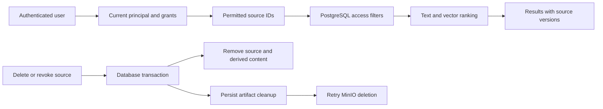

# Session 5 memory handoff

## Scope and base

The branch is `codex/memory`. The tested implementation head is `045586dee27c447d2717e62a15b4345614fa1028`. The base is `c2b7ed1708b08a364f97652de5f0db363a67410d`. The latest inherited contract commit is `86f31896ebcbf5f3dc8eb9d670d58562370fccff`. The work owns memory storage, retrieval, source lifecycle, artifacts, and the memory API.

Session 1 provides the memory and artifact ports. Session 3 provides current identity snapshots and authorization. This session does not close Gate 0 or qualify the integrated pilot.

## Design

PostgreSQL owns source metadata, content, embeddings, dependencies, operation receipts, and artifact deletion tasks. MinIO owns document bytes. A source has one current version and an active, revoked, or deleted state.

Retrieval uses a current identity snapshot through the existing authorization policy. PostgreSQL receives permitted source IDs and applies access, version, retention, and dependency restrictions before selecting content and ranking results. This avoids a second implementation of the SCIM and delegation rules.

The design comparison selected one snapshot per operation over a separate authorization database read for every source. The tradeoff is metadata enumeration before retrieval. The selected design also uses explicit dependency edges and a durable artifact deletion queue.

| Choice | Reason | Cost |
| --- | --- | --- |
| Reuse one current identity snapshot per access check | Keep SCIM and delegation rules in the existing policy | Enumerate company metadata before each query |
| Filter content and rank in one PostgreSQL statement | Denied records cannot occupy the result limit | Exact vector search scans the permitted corpus |
| Keep dependency edges and terminal source tombstones | Prevent stale derived content and late publication | A deleted source ID cannot be reused |
| Commit deletion tasks with content changes | Recover failed MinIO deletion | Physical deletion can lag logical deletion |

## Schema and lifecycle

`memory_source` holds the company, owner, visibility, current version, generation, provenance URI, observation time, creation and update times, and optional retention expiry. Records and artifacts inherit the source owner and retention state through a composite company/source foreign key. Expiry excludes content from reads. Physical expiry removal needs an explicit lifecycle call; this slice does not schedule a retention purge.

`memory_record` separates source chunks, conversation summaries, and remembered facts. Each row stores content, exact provenance, record visibility, an embedding model and dimension count, a pgvector value, an English full-text document, and the exact summary dependency IDs. A GIN index serves full-text search. Semantic search uses cosine distance. Hybrid search adds full-text rank to cosine similarity. There is no approximate vector index in this slice.

`memory_dependency` stores source-level edges with dependency versions. The graph provides conservative invalidation. If several summaries share a source, a change to any dependency invalidates that source and all of its records. Their returned dependency lists remain specific to each record.

`memory_artifact` holds canonical provenance, visibility, content fingerprints, and immutable MinIO keys. Original document bytes and explicit artifacts use MinIO. Object keys are random IDs independent of company and source identifiers. Client-supplied artifact references cannot override stored access metadata.

`memory_operation` stores argument fingerprints, actor bindings, and receipts with IDs and removal counts. It retains no remembered text. Retries must match the company, actor, delegation, operation kind, caller digest, and actual arguments. Canonical JSON fingerprints ignore object-key order.

`memory_artifact_delete` stores pending object keys, retry attempts, and the last failure. Logical deletion removes records, vectors, and artifact metadata in one PostgreSQL transaction. The same transaction marks the source and transitive derived sources as deleted or revoked and enqueues physical deletion. A retry through `createArtifactStore(...).cleanup(options)` survives adapter restart. Trusted server composition must schedule that call after process restart.

Ingestion requires the expected current generation. A repeated source ID/version accepts identical content and metadata. A changed fingerprint with the same version conflicts. Version replacement removes old chunks, embeddings, originals, and dependent memory. Source mutations use an advisory lock per company. This favors correctness over concurrent ingestion throughput.

Uploads have no distributed transaction with PostgreSQL. A cleanup entry precedes the MinIO upload. Successful publication removes it. A failed publication leaves the entry eligible after 24 hours. Network upload occurs inside the database transaction and holds the company mutation lock until its bounded request completes.

A remembered fact must quote current source chunk content, match exact active provenance, and pass current source read and write policy. A summary remains a separate record kind. Arbitrary model text cannot pass the fact policy merely by supplying a citation.

## API and providers

`createMemoryRouter(factory)` accepts memory, artifact, and identity services from trusted server composition. It resolves the principal from the authenticated user and company, then checks any delegation against current identity data. Input cannot choose the actor.

The registered default router returns `SERVICE_UNAVAILABLE`. Session 7 must supply `createMemoryStore`, `createArtifactStore`, the PostgreSQL repository, the identity repository, S3 storage, and the configured embedding provider. This session verifies the API with injected real PostgreSQL and MinIO adapters. It does not claim a deployed memory route.

`createHttpEmbeddings` accepts an endpoint, API key, model, and dimensions. It validates response count, indices, model, and finite nonzero vectors. Deadlines cover response bodies as well as headers. `createDeterministicFixtureEmbeddings` is explicitly synthetic. Full-text reads do not require a working embedding provider; an empty permitted corpus causes no embedding request.

## Verification record

The final verification used Node 22.22.3, Bun 1.4.0, and pnpm 11.9.0. The isolated database reports PostgreSQL 17.10 and pgvector 0.8.2. MinIO uses the pinned source build already defined by the deployment Dockerfile.

| Command | Result |
| --- | --- |
| `rtk proxy pnpm test:memory` | 23 passed across five files; real PostgreSQL and MinIO |
| `rtk proxy pnpm test:contracts` | 35 passed |
| `rtk proxy pnpm test:identity` | 18 passed |
| `rtk proxy pnpm test:boot` | 2 passed; fresh deployment, readiness, auth, sessions, artifacts, and restart persistence |
| `rtk proxy pnpm check-types` | Passed all nine configured tasks |
| `rtk proxy pnpm build` | Passed all eight configured tasks |
| `rtk proxy pnpm --filter @cerebro/db db:generate` | No schema changes; 27 tables |
| Scoped `rtk proxy pnpm exec ultracite check` | Passed all 25 touched source and test files |
| `rtk proxy pnpm check` | Failed on 90 existing format issues and 225 lint errors in unchanged files |

The full lint failures are in existing UI, web, API context, server build configuration, skill files, and experiment evidence. No session 5 source or test file appears in the failure list. Builds retain the existing web bundle-size warning. The work does not claim a green repository-wide lint gate.

The memory suite proves company isolation, current grants, SCIM removal and deactivation, represented-principal delegation, private and grant visibility, expiry, source revocation, exact provenance, argument-bound retries, version replacement, transitive deletion, real MinIO cleanup retry, forged artifact metadata rejection, and cancellation with an unknown effect outcome. It also proves exact dependency lists for two summaries that share a source and storage of originals and artifacts for opaque source IDs that contain path characters.

The fixed full-text question set returns the expected top citation for both questions, 2 of 2. The questions ask who approves travel reimbursement and how many weeks parental leave lasts. Semantic and hybrid queries run on real pgvector with synthetic vectors. That check proves query mechanics, not semantic quality. HTTP protocol fixtures test the configurable provider separately.

The last summary-read failure was reproduced as PostgreSQL error `42P10`: `ORDER BY 0` was interpreted as a column position. An explicit integer cast fixed it. The complete fresh-service suite then passed.

The memory test runner uses a unique Compose project, random credentials, and dynamically allocated local ports. It removes only its own test services and volumes.

The final rerun exposed a PostgreSQL readiness race before migration. The pinned image starts a socket-only server during initialization, then stops it before the final TCP server starts. Both Compose health checks now use `pg_isready -h 127.0.0.1` so readiness matches the application's TCP connection.

The deployment image is pinned to `pgvector/pgvector:0.8.2-pg17-bookworm@sha256:feb68f4f15446397d8cac7f4fe48fe4586de83160d1fc48b46283312d1a33966`. Migration `0002` installs the vector extension and memory tables. Migration `0003` adds exact record dependency IDs. Production migration credentials must be permitted to install the extension, or an administrator must install it first.

## Review and handoff

Two read-only design candidates and an independent judge preceded implementation. One implementation owner edited the coupled memory, database, and API code. The coordinator reviewed the source, corrected the final SQL regression, and ran the independent checks. The additional comment reviewer could not start because the agent thread limit was reached; the coordinator completed that scan. The final provider fixture uses separate servers for invalid responses, so its shared response state and two comment lines were removed. No source comments or suppressions remain in the scoped code.

The repository has no Git remote. The Opening a PR playbook cannot create a remote review. The local commits and this receipt are the review artifacts.

## External checks

A real embedding provider evaluation remains unrun until a provider is configured. Deterministic vector fixtures test adapter behavior and isolation. They do not establish semantic retrieval quality.

The [pgvector 0.8.2 documentation](https://github.com/pgvector/pgvector/tree/v0.8.2) describes the PostgreSQL extension and distance operators. The [Drizzle guide](https://orm.drizzle.team/docs/guides/vector-similarity-search) describes vector columns. The [OpenAI embedding API](https://developers.openai.com/api/reference/resources/embeddings/methods/create) defines the configurable HTTP provider format.

## Parent integration

The merge combines parent `main` at `245deb36ecd72c6810dd7cbb2530b58812ee0149` with session 5 at `22b6af52bb2e4d5e169b672c8f457b8fa9a14b29`. The parent already contains session 2. The only Git conflict was in the lockfile. Its resolution preserves the parent's package versions and adds the memory importer and API workspace link, 25 added lines.

The combined tree passes 23 memory tests, 35 contract tests, 18 identity tests, all 10 type-check tasks, all eight build tasks, and the scoped Ultracite check. Both fresh Compose boot checks also pass, including auth, sessions, artifacts, and restart persistence.

The first deployment build failed with `ERR_PNPM_IGNORED_BUILDS` because the parent's runtime dependencies add five undeclared scripts. `pnpm-workspace.yaml` now explicitly denies scripts for `@parcel/watcher`, `core-js-pure`, `protobufjs`, `tree-sitter-bash`, and `tree-sitter-powershell`. The existing four allowed packages stay unchanged. Normal frozen offline installation passes. The [pnpm build policy implementation](https://github.com/pnpm/pnpm/blob/main/pnpm11/building/commands/src/policy/approveBuilds.ts) records denied packages as `allowBuilds: false`.
