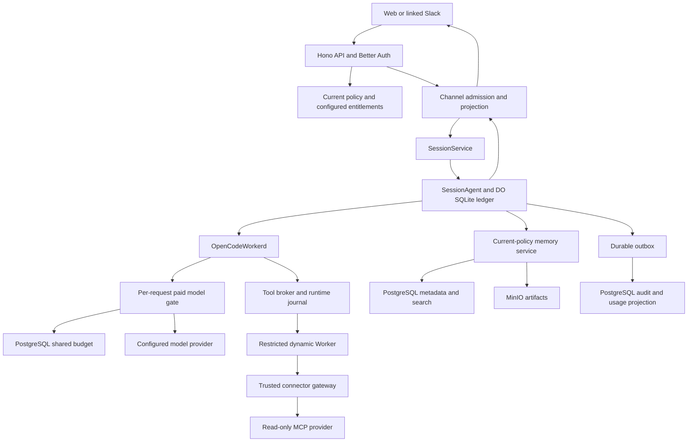

# Session 7 architecture grounding

Synthesis of `/tmp/cerebro-s7-ports-ground.md` and `/tmp/cerebro-s7-runtime-ground.md`. Source checks used the requested worktree `/Users/jhonsfran/.codex/worktrees/pilot-integration/cerebro`. No product source changed.

## Overview

The subsystem adapters exist, but the deployed product still runs Session 6's PostgreSQL response fixture. Session 7 must connect the product API to Session 2's durable SDK runtime and Session 4's broker/accounting machinery. The runtime itself still has fixed fixture model/tool behavior. Binding it alone will not complete integration.

Keep one owner for each state. PostgreSQL owns identity, configuration, shared budget and memory metadata. SessionAgent's DO SQLite owns each conversation's execution, SDK state and replay ledger. MinIO owns documents and artifacts. The trusted gateway owns connector credentials and provider receipts. Channel rows are UI and delivery projections, not the execution authority.

The diagram shows the required graph. Several arrows are not deployed today.

## Key concepts

**Run.** A trusted execution context, immutable agent version, prompt, durable model request identities, bounded cost and final output/usage receipt.

**Tool attempt.** Normalized input plus SDK session/message/call identifiers, durable logical operation ID, digest and tool version. The operation ID survives retries. A deliberate second call remains distinct even when its arguments match.

**Operation journal.** Atomic claim-token transitions from claim to reservation intent, dispatch, known outcome and completion. Release intent competes with dispatch. Unknown outcome preserves the dispatched identity and capacity hold. The only complete implementation is currently a test fixture. Product runtime needs its own migrated SQLite implementation.

**Current policy.** A fresh identity/grant/delegation read. A stored active principal flag or old approval cannot grant permission after revocation. Agent grants must also restrict the pinned agent's execution scope.

## How it works

The API authenticates the user and derives the principal. Channels persist a stable admission envelope. `createSessionService` checks current policy and `session.execute` entitlement, loads the agent definition and forwards to the DO selected by company, agent and conversation. This path already exists but is not supplied to ChannelOptions.

SessionAgent admits the envelope into its durable ledger, schedules recovery and owns the OpenCode model loop. Its existing replay, SDK call binding and outbox behavior should remain. Generalize its fixed fixture prompt/tool/result rules. A valid final assistant response can complete a run without a tool effect. Read-only tools need a dispatch path that does not wait for approval. Keep the controlled write fixture's durable approval path.

Install `createOpenCodeToolPlugin` with a registry limited to the pinned agent's enabled tools. Its attempt resolver must bind the real runtime operation identity. The broker uses a production journal and DynamicToolExecutor. The restricted wrapper receives only a gateway capability and has no ambient network. The trusted gateway rechecks policy, connector access and any approval, resolves credentials and executes the fixed provider target.

Gate every model HTTP request, including continuation requests and retries. Installed OpenCode plugin types expose `http.request` and `http.response`. Installed core source confirms the order of request hook, outbound handler and response hook. The request hook can deny before outbound work. The response hook can buffer a bounded response, save usage/result, settle once and replace the SDK response. This increases first-output latency. It gives a durable receipt before the SDK consumes output.

If the outbound handler throws, the response hook does not run. Keep that request dispatched with its maximum held and require reconciliation. Request hooks cannot directly return a cached response instead of calling the handler. Do not claim that a thrown request hook replays HTTP output. A model gateway is needed if that replay behavior is required. Completed SDK messages can still be reused.

Memory services use current identity, PostgreSQL access-filtered search and MinIO. Persist source provenance with generated output. Recheck source access on cached transcript reads, citations and queued Slack delivery. Existing channel code checks agent permission per returned item, but not source dependencies.

Execution outbox writes retain stable event IDs. PostgreSQL audit projection deduplicates by eventId. Channel stream projection populates UI records separately. The stream contract currently has only run, output and approval; citations and tool records need additive cases. Include unknown-outcome in terminal projection handling.

## Where things live

| Area | Main files |
| --- | --- |
| Composition | `apps/server/src/{index,channel-services,env.server}.ts`, `deploy/bootstrap.mjs` |
| Runtime | `packages/runtime/src/{session-agent,session-service,ledger,opencode-adapter,pinned-agent,tool-call-identity}.ts` |
| Current identity | `packages/authorization/src/policy.ts`, `packages/db/src/repositories/identity.ts` |
| Tool boundary | `packages/tools/src/{broker,dynamic-worker,mcp-gateway,opencode-plugin,registry}.ts` |
| Budget and paid work | `packages/policy/src/{local-budget,authorization-gate,unprice-adapter,jev-adapter,decision-router}.ts` |
| Memory | `packages/memory/src/{index,artifact-store,object-storage,embeddings}.ts`, `packages/api/src/routers/memory.ts` |
| Presentation | `packages/channels/src/{service,projection,drain,types}.ts` |
| Projection/export | `packages/db/src/repositories/audit.ts`, `packages/api/src/routers/identity.ts` |
| Proven native bindings | `tests/runtime/wrangler.jsonc`, `tests/policy/runtime/bootstrap.mjs` |

## Invariants

- Current permission applies before model start/resume, tool dispatch, approval, cached output and Slack delivery.
- The pinned agent scope and current principal scope both limit execution.
- Intent is durable before external dispatch. Provider result and usage are durable before accounting completion or publication.
- One journal owns each dispatch claim. Broker and gateway journals have separate scopes; neither may blindly redispatch an unknown effect.
- Shared budget reservation occurs atomically in PostgreSQL. A session DO never owns a company balance.
- Stable event/operation IDs produce one logical effect and one settlement/projection. Changed input under the same ID conflicts.
- Production rejects fixture providers, fixture writes, missing trusted capabilities and unrestricted policies.

## Missing links and evidence limits

Deploy SessionAgent, loader and trusted named entrypoints. Inject real sessions and budget into ChannelOptions. Configure current policy and deny-by-default entitlements. Add migrated runtime journals, general model configuration, paid HTTP hooks and broker integration. Preserve agent grants in pinned configuration.

Supply a real catalog for agent publication. Supply source/audit readers and actual company-scoped exports. Bind `createMemoryRouter(factory)` through trusted server composition; its current exported default is unavailable. Schedule channel recovery in production and artifact cleanup after restart. Extend readiness beyond auth construction and SELECT 1. Add redacted structured logs and trace/run/operation correlation.

One reconciliation correction matters. `projectAuditEvent` currently ignores every duplicate eventId, including changed payloads. It preserves the first row but does not reject changed replay. The stronger changed-replay check in the runtime findings is a proposed invariant, not existing behavior. Also, audit outbox and UI stream projection are separate paths. They need not be combined into one sink.

Use deterministic providers in fixture mode through the real orchestration, policy, budget, storage and gateway paths. Native acceptance must prove replay counts, source/principal revocation, approval after restart, concurrent reservations, crash windows and restoration into fresh volumes. Existing boot tests only prove auth, SessionFixture and raw artifact persistence.

Publicly trusted Worker PostgreSQL TLS and configured live providers remain separate qualifications. The Session 3 waiver does not prove production TLS. Unconfigured optional providers are not applicable. Configured providers require live results before readiness is claimed.
