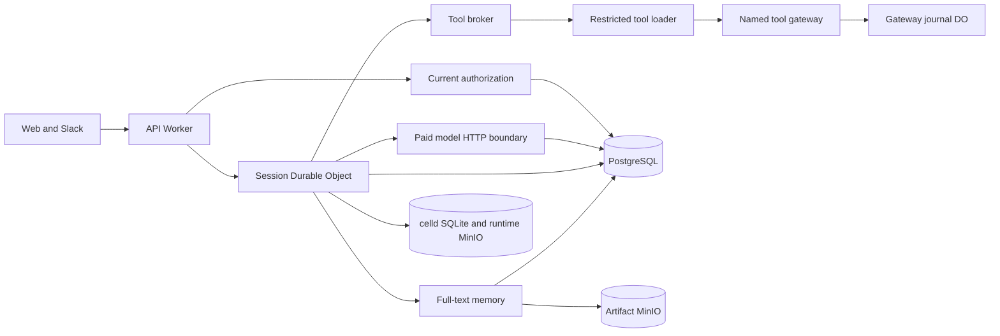

# Session 7 integration receipt

Implementation and local fixture acceptance are complete. External production qualification remains incomplete.

After delivery, Session 7 was merged into `main`. [The local-model follow-up](local-models.md) records experiment retirement and live OpenCode acceptance. The remaining receipt describes the original delivery.

Base is `62aadee`. Work is on `codex/pilot-integration`. Backup is committed at `205f3a7`; runtime, product, and acceptance code are committed at `dce5c02`. The main checkout is unchanged. There is no Git remote.

Native images were built from the source changes before the code commit. The full acceptance run passed before the final fixture-only approval wording change. Its affected native restart test passed afterward. Production code did not change in that follow-up.

## User and maintainer changes

A permitted web conversation uses the deployed SDK, current company policy, full-text PostgreSQL memory, original MinIO artifacts, and the registered MCP gateway. It records paid model usage before it exposes a model response. Source and tool revocation also apply to cached history. The editor grants the resources selected for an agent. A denied conversation clears private cached content and displays a permission-change message.

The production configuration requires real HTTPS model and read-only MCP targets. It rejects fixture, insecure, conflicting, and unsupported configurations before Worker publication. Public signup cannot claim installation ownership. Current explicit grants control bounded, company-scoped audit and usage exports.

The maintainer gets a reproducible native acceptance suite, a seven-volume backup command, a fresh-project application restore test, and [the operations guide](../operations/pilot.md). The composition supports local PostgreSQL budget authority and full-text retrieval. Semantic retrieval, Unprice, and Jev fail configuration validation until their production adapters are supplied.

## Runtime authority

The session owns execution and replay state. PostgreSQL owns current company policy, shared capacity, usage, and audit projections. The gateway owns durable tool dispatch receipts. These stores do not share a transaction. Stable operation IDs and durable receipts prevent blind retries. A lost model receipt retains its maximum reservation. A lost non-idempotent tool receipt retains an uncertain journal entry.

The loader has no ambient outbound network path. It can call only the named gateway. The gateway validates a signed, bounded capability and current permission before dispatch. Model HTTP hooks verify the configured origin, path, model, input size, output bound, deadline, and price before paid admission. They settle authoritative token usage before returning the buffered response to the SDK.

## Verification

The unchanged base passed 35 contract, 63 policy, 23 memory, 16 channel, 12 runtime, and 18 identity tests. Types and build passed. Whole-repository lint already failed on unrelated source and skill files.

| Final check                  | Result                                  |
| ---------------------------- | --------------------------------------- |
| `pnpm test:integration`      | 28 passed, zero failures and skips      |
| `pnpm test:runtime`          | 13 passed                               |
| `pnpm test:contracts`        | 35 passed                               |
| `pnpm test:policy`           | 63 passed                               |
| `pnpm test:memory`           | 24 passed                               |
| `pnpm test:channels`         | 25 passed                               |
| `pnpm test:identity`         | 18 passed                               |
| `pnpm check-types --force`   | 13 tasks passed without cache           |
| `pnpm build --force`         | 11 tasks passed without cache           |
| Changed-file Ultracite check | Passed                                  |
| `pnpm check`                 | Existing failures outside changed files |
| Frozen offline install       | Passed                                  |

The scoped check and normal commit hooks passed. Whole-repository lint names no Session 7 changed file. Full build warnings concern existing bundled dependencies and Turbo output declarations. They did not fail the build. Detailed host logs remain in `/tmp/cerebro-s7-final-*.log`. [Saved results](evidence/session-7/results.json) preserve counts, measurements, resource samples, image IDs, and browser assertions without credentials.

Root independently restored the application into a fresh Compose project. It verified seven volumes, eight PostgreSQL table fingerprints, the prior auth cookie, exact conversation state, original source bytes, and replay of the first event. Three delayed samples verified unchanged transcript, SQL records, and provider counters across asynchronous reconciliation. API rehearsal used fresh ports. The web image retained its recorded API origin, so this result does not prove browser routing to the restored API.

The native sequence verifies real SDK calls, actual PostgreSQL and MinIO memory, two model calls and one read-only MCP execution for the first answer, exact 24-unit accounting, company-scoped exports, event replay, audit replay and conflict, restricted loader egress, approval across SIGKILL, timed approval ownership, queued cancellation, shared-budget contention, and unknown model and tool receipts without a second effect. Current source, tool, and principal revocation deny cached content and follow-up work.

Browser acceptance created `UI Support`, published explicit read/execute tool grants and the refund source grant, opened an empty conversation, and asked the refund question. It displayed the 14-day policy and reference code `CEREBRO-REAL-MEMORY-731`. Source detail returned version 1 and the original stored bytes. Audit displayed two usage records. Disconnect and resume retained the same session and one answer. The actual approval example button produced a request and one successful controlled effect. A revoked source grant removed private cached content and displayed the permission-change alert. Restoring that test grant restored the source view.

See [configuration](evidence/session-7/admin.jpg), [citation](evidence/session-7/citation.jpg), [usage](evidence/session-7/usage.jpg), [approval](evidence/session-7/approval.jpg), [completed effect](evidence/session-7/approval-complete.jpg), and [revoked access](evidence/session-7/denied.jpg). The retained review UI is [the local test workspace](http://localhost:57381/dashboard).

## Tradeoffs and qualification limits

The runtime buffers each model response until it has an authoritative usage receipt. This prevents response delivery before accounting. It adds response latency and does not provide early token streaming. Automatic SDK compaction is disabled and the session has an explicit title. This prevents unaccounted auxiliary calls. A conversation that exceeds the complete request bound must start a new conversation.

Source detail serves the current source version. The browser refuses mismatched bytes for an older citation. A new run retrieves the updated source.

A known paid receipt can repair accounting without another provider call. If the SDK did not consume that receipt before a crash, the run stops for reconciliation. The pinned HTTP hook cannot inject a cached response into the SDK. Unknown operations are not automatically retried or released.

The OpenCode SQLite census patch is hash-guarded for the pinned release. A dependency upgrade must prove journal survival against the actual SDK. Full-text records have nullable vector metadata, so rollback requires the recorded complete snapshot and images. An older binary must not run against migrated data.

The tested model and MCP were local protocol fixtures. They prove application integration with real celld, PostgreSQL, SDK, and MinIO stores. Live model and MCP results remain incomplete because no external provider was configured for this run. Entra, Unprice, Jev, and Slack are not applicable to this fixture installation. Channel tests cover Slack authorization and replay, but no real workspace was used. Publicly trusted Worker-to-PostgreSQL TLS remains unverified. No production deployment was performed.

## Review and decisions

Two designs were compared. Revised design A scored 22/25 and design B scored 18/25. Direct composition retained one API Worker, the session DO, and a separate gateway journal DO. It removed an extra ingress protocol and a third state owner. The candidate B author judged both designs and disclosed that constraint. Agent settings inherited the parent model, so this was not a review across model families.

Independent reviews found and resolved historical source dependency loss, cached-content revocation gaps, a missing usage projection after a crash, and accounting admission errors that could leave a promise unresolved. Deployed tests found auxiliary SDK compaction calls. Lifecycle review found approval timeout ownership, cancellation of the wrong queued run, recovery dispatch of terminal work, and teardown that could replace an active client owner. Root found a source-version mismatch in citation reads, a denied-view loading loop, and a new conversation that could not be read before its first message. Authorized first reads now initialize only the durable address. Empty projections become idle only when no pending or accepted event exists. Tool projection now records its stream, audit event, and dedup marker atomically. It also reuses legacy persisted tool cursors. Operations review corrected restored web routing, external database isolation, and the distinction between uncertain model reservations and uncertain tool journals. Browser review also aligned the provider fixture with the displayed approval example. All confirmed review defects were fixed and checked.

Read principles changed specific choices. Model the Domain assigned durable state to its owning store. Foundational Thinking fixed shared data shapes before composition. Separate Before Serializing Shared State assigned disjoint files and test projects to owners. Laziness Protocol removed the extra ingress protocol. Boundary Discipline put validation at configuration, export, source-read, and restore boundaries. Make Operations Idempotent made replay reuse durable receipts and cursors. Test Behavior, Not Implementation required literal database values and provider effect counts. Sequence Work into Verifiable Units kept backup in a separately checked commit. Prove It Works required native API, browser, SIGKILL, and restore evidence.

See [the decision log](session-7-decisions.tsv), [the design comparison](session-7-design.md), [the grounding record](session-7-grounding.md), and [the work record](session-7-work.md).

## Test host and workload

macOS 26.6.2 (25G83), 14 CPUs, and 24 GiB host memory. Docker 29.4.0 runs on aarch64 with 14 CPUs and 12,599,529,472 bytes of VM memory. The local OpenAI-compatible fixture uses a 16,384-byte request bound, 2,048 output tokens, a 65,536-byte response bound, a 30-second deadline, and fixed one-unit token prices. Initial capacity is 1,000,000 pilot units. The first cited answer uses two model calls, one read-only MCP call, and 24 units.

The concurrent test uses two sessions and capacity for one maximum model request. One session completes and one fails admission. The fixture provider holds the admitted request until both sessions contend. Other existing development containers remain active on this host. These are acceptance measurements, not capacity or provider performance claims.

## Measurements

| Measurement | Full final acceptance | Earlier focused load check |
| --- | --- | --- |
| First HTTP admission receipt | 105 ms | 91 ms |
| First visible model output observation | 7,287 ms | 2,892 ms |
| Answer completion | 7,287 ms | 2,892 ms |
| Read-only MCP provider duration | 3 ms | 1 ms |
| Approval recovery after SIGKILL | 15,028 ms | Not measured |
| Two-session contention through completion | 4,684 ms | 8,699 ms |
| Resource sampling included in contention duration | 2,633 ms | 2,716 ms |
| PostgreSQL connections during contention, including probe | 3 | 1 |
| Seven-volume backup, restore, and application checks | 97,216 ms | Not measured |

Both runs used this host and the same fixture limits and prices. Background load and prior session history differed, so these observations do not isolate a performance change. Output polling uses a 400 ms interval plus request duration. First visible output is a buffered completed response, not the first provider token. The contention duration includes resource sampling before the fixture request is released.

| Container        | Memory during final two-session contention |
| ---------------- | ------------------------------------------ |
| celld            | 547.7 MiB                                  |
| Fixture provider | 18.66 MiB                                  |
| Artifact MinIO   | 143.9 MiB                                  |
| Runtime MinIO    | 316.9 MiB                                  |
| PostgreSQL       | 34.31 MiB                                  |
| Web              | 204.8 MiB                                  |

These Docker samples are not peak measurements. The default 256 MiB V8 heap, 16 resident cells, and 10-second idle eviction are configured limits. No production capacity is established.
