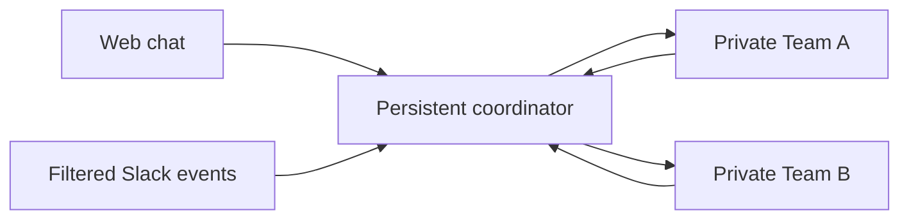

# Run a persistent coordinator and private teams

Open one persistent conversation with a cheaper coordinator. A stronger lead runs independent work with cheaper workers. Results return to the same conversation. Web chat works before Slack is configured.



The identity cell stores the coordinator and admission records. Each Team has its own cell. Its lead and workers are private Pi conversations inside that cell. Always on means saved state and event-driven wake-up. An idle agent makes no model requests.

## Configure the models and role agents

1. Configure the model endpoint and key, then start Cerebro. See [Start Cerebro](../../README.md#start-cerebro). For a separate local test installation, use the recipe below.
2. Add both model definitions to the installation's `runtime.json.models`. Both must support tool calls. Keep the existing storage and secret fields. See the [model reference](../reference/runtime-configuration.md#models).
3. Apply the runtime change with bootstrap and restart celld. Refresh the web app so both models appear in the editor.
4. Create and save three agents in the web editor:

   | Agent | Model | Instructions for the first test |
   | --- | --- | --- |
   | Coordinator | Cheap | For a request to start a team, call `start_team` with the complete goal. Acknowledge that work is running. |
   | Lead | Stronger | Split the task into two bounded questions. Call `delegate_worker` once for each, then combine the answers. |
   | Worker | Cheap | Answer the assigned question. Do not delegate. |

5. Record the lead and worker agent IDs. Agent save responses contain `agentId`; use the browser Network tab if the editor does not display it.
6. Add this property inside the existing runtime JSON object, then apply bootstrap and restart celld again:

   ```json
   "coordination": {
     "leadAgentId": "<PUBLISHED_LEAD_AGENT_ID>",
     "workerAgentId": "<PUBLISHED_WORKER_AGENT_ID>",
     "maxTeams": 2,
     "maxWorkers": 2,
     "maxTurns": 8,
     "timeoutMs": 600000
   }
   ```

The coordinator is the agent you select for the web conversation. The profile selects the lead and worker definitions. Coordinator and worker definitions can select the same model. Each worker has a separate private conversation. The first test needs no external tools or company sources. Add explicit grants to each role before it handles company content.

## Send and control a team request

Select the coordinator agent and open its conversation. Reopening the same agent returns to the same primary chat. Send:

> Start a team. Compare SQLite and PostgreSQL for a local task tracker. Ask one worker to assess each option, then give me a recommendation and its tradeoff.

Require the coordinator's acknowledgement, a background-work status, and a later result in the same conversation. The composer remains available while the team runs. Reload that conversation and require the saved result to remain.

While work is active, send exact lowercase `status` to read saved work state without a model call. Exact `stop` returns the work IDs to choose from. Ask the coordinator to stop one work ID. The foreground **Stop** button stops the current coordinator turn and leaves private Teams running.

Ordinary new text reaches the coordinator. It can answer, start independent work, or message an existing work ID. State the target when you add a requirement. For example, send "For storage work <work ID>, add a two-device offline conflict requirement." Automatic routing applies only to an explicit saved subscription.

Two Teams can run for one person across their agents. Sixteen more can wait in a saved FIFO queue. The absolute deadline includes queue time. Cancelling a queued item creates no Team cell.

In a local installation, the development Inspector opens inside the chat. Select a work item to inspect its lead, workers, saved models, safe tool activity, retry state, reservations, tokens, and result. Details load on demand. Completed work remains available after reload. Inspection checks current read access and admits no new model work. A cold active cell can resume an already accepted request during normal recovery. Repeated reads of a sealed Team add no model requests. Configured zero prices make monetary cost unavailable. Request reservations and provider token usage are separate values.

A published coordinator definition applies at a safe turn boundary in the same chat. Existing Teams retain the role definitions saved at admission. Historical roots and forks show closed ordinary admission and a way to open primary. Their history, accepted operations, and saved timers remain retained.

If command delivery is uncertain, work can show **Failed** while cancellation is still available. Stop sends a durable cancellation request. Current permissions and the deadline still apply.

A model can answer directly instead of starting a team. Check the actual `start_team` activity and provider request logs when you test model selection. Use the Inspector to check the saved private role state. Full provider reasoning, system instructions, credentials, and raw tool arguments are excluded.

## Use a separate local configuration

The default local starter generates one model configuration on each start. To maintain multiple models and the coordination profile, use a private host directory and an explicit Compose override. This recipe creates a separate project and data volumes.

Run these commands from the repository root after you configure the model key in `.env`:

```sh
export CEREBRO_TEAM_SECRETS_DIR="$HOME/.config/cerebro/teams-test/secrets"
export CEREBRO_DEPLOY_MODE=local
export CEREBRO_DATABASE_URL=
export CEREBRO_API_PORT=18766
export CEREBRO_WEB_PORT=3002
export CEREBRO_PUBLIC_API_URL=http://127.0.0.1:18766
export CEREBRO_PUBLIC_WEB_URL=http://127.0.0.1:3002
rtk proxy mkdir -p "$CEREBRO_TEAM_SECRETS_DIR"
rtk proxy chmod 700 "$HOME/.config/cerebro/teams-test" "$CEREBRO_TEAM_SECRETS_DIR"
```

Save this as `$HOME/.config/cerebro/teams-test/compose.yaml`:

```yaml
services:
  secrets-init:
    volumes:
      - ${CEREBRO_TEAM_SECRETS_DIR:?Set CEREBRO_TEAM_SECRETS_DIR}:/run/cerebro-secrets
  bootstrap:
    volumes:
      - ${CEREBRO_TEAM_SECRETS_DIR:?Set CEREBRO_TEAM_SECRETS_DIR}:/run/cerebro-secrets:ro
```

Start the separate installation. The first start generates its full runtime file and storage secrets:

```sh
rtk proxy docker compose -p cerebro-teams -f compose.yaml -f "$HOME/.config/cerebro/teams-test/compose.yaml" up --build -d --wait
```

Read this installation's setup token, then open `http://127.0.0.1:3002`, sign up with a test account, and claim the workspace:

```sh
rtk proxy docker compose -p cerebro-teams -f compose.yaml -f "$HOME/.config/cerebro/teams-test/compose.yaml" run --rm --no-deps bootstrap node --input-type=module -e 'import {readFile} from "node:fs/promises";process.stdout.write(await readFile("/run/cerebro-secrets/bootstrap-token","utf8"))'
```

Edit `$CEREBRO_TEAM_SECRETS_DIR/runtime.json` to configure the models and profile. For a stronger model on the same provider, copy the generated model object and change its `model` and `id`. Its ID must remain `<provider>/<model>`. Use separate endpoint and credential values if the second model needs them.

After the first start, add this environment property to `secrets-init` in the override, alongside its volumes:

```yaml
environment:
  CEREBRO_MODEL: ""
```

An unset or empty host variable is insufficient because the base Compose file supplies a default. Keep this override on future starts. Use the Compose commands in this recipe; `pnpm start` selects only the base file.

After each runtime edit, wait for bootstrap to finish before restarting celld:

```sh
rtk proxy docker compose -p cerebro-teams -f compose.yaml -f "$HOME/.config/cerebro/teams-test/compose.yaml" run --rm --no-deps bootstrap
rtk proxy docker compose -p cerebro-teams -f compose.yaml -f "$HOME/.config/cerebro/teams-test/compose.yaml" restart celld
```

`up --wait bootstrap` can report the one-shot service running before its deployment finishes. The synchronous `run` above waits for the process exit.

To stop this test installation and retain its data:

```sh
rtk proxy docker compose -p cerebro-teams -f compose.yaml -f "$HOME/.config/cerebro/teams-test/compose.yaml" stop
```

The [coordinator diagram](../architecture/slack-coordinator.md) explains source routing and recovery. The [runtime reference](../reference/runtime-configuration.md#coordination) defines limits. Slack can be added later through its [channel setup](slack.md).
