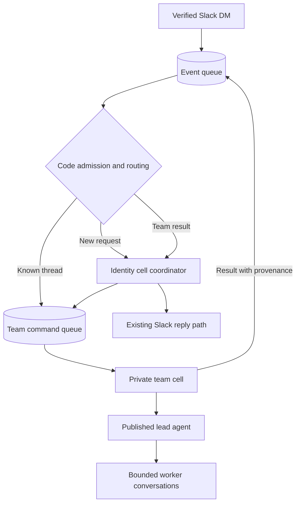

# Slack coordinator MVP implementation plan

## Goal and completion check

A signed Slack DM is saved before acknowledgement. A persistent coordinator can start a separate team cell, continue the conversation, accept thread updates and stop commands, and deliver a permitted result. Recovery must finish work after a real celld interruption without a UI request waking it.

Each implementation chunk gets focused behavior checks, type and lint checks, an independent thermo-nuclear review, accepted fixes, and a separate commit. No production deployment or live Slack message is part of verification.

## Scope

- Slack DMs only. Reuse current account linking, source checks, and uncertain reply handling.
- One coordination owner per organization and user, with the same coordinator persona in the existing per-thread conversations. Preserve product conversation identities, history, reads, and replies.
- One private TeamAgent cell per saved business work ID. Maximum two active teams per identity and two worker conversations per team initially.
- Administrator-selected published agent definitions for the coordinator, lead, and worker. Each role retains its published model and current grants.
- Read-only team tools. Only the coordinator publishes the final result. Existing public approval actions do not address private team stores.
- Queue transport, Pi execution, and Lifecycle wake. Keep the pinned celld 0.6.1 and Pi 1.3.0 unless real checks require a change.
- Output, turn, deadline, and concurrency limits. Current provider prices are zero, so this MVP does not claim a monetary spend ceiling.

## Architecture decision

Two candidates were compared. Reusing SessionAgent requires internal work to pass through public-conversation binding and request assumptions. A standalone TeamAgent has a smaller private-work interface, but it must reuse the canonical guarded runtime.

Choose the standalone TeamAgent. Extract the existing cohesive conversation resource factory. Share server composition with an explicit distinction between source-conversation ownership and the role agent's execution address. Do not create fake public conversation rows, copy the authorization implementation, or override a pinned agent model.

The independent architecture judge confirmed this choice. Graft the other candidate's immutable routing decisions, absorbing cancellation, and stable command/report identities. Reports must carry bounded content dependencies into the receiving scope so result admission and disclosure enforce current access.

The initial proposal used one global coordinator conversation. Source inspection showed that public history and Slack notification are thread-scoped. Keep those existing coordinator contexts and share only the identity-wide work ledger and limits. A global root would require a new durable transcript projection and reply framework. The independent judge recommended the per-thread design for this MVP.

## Required invariants

1. A successful webhook acknowledgement follows a durable queue commit. URL verification remains immediate after signature validation.
2. Resolve current actor authority from trusted source records. Do not persist an expiring execution context or secret in queue messages.
3. Keep the provider event ID and an immutable routing target. Pi input deduplication is scoped to a conversation.
4. Save work and its background dispatch task together. Send the command before committing dispatch completion. Failed sends have a persisted bounded retry phase.
5. The same work ID addresses the same team. Conflicting immutable start specifications are rejected.
6. Cancellation is stored in the target team before abort. A delayed start cannot revive cancelled work. Model and tool dispatch also check cancellation and deadline.
7. Restore every role provider, task definition, and tool selection before Pi resumes.
8. Current published agent permissions and principal ownership are checked at physical model and tool boundaries.
9. Carry source and tool dependencies on every model-generated handoff, including the initial team goal. Check the receiving role's grants and current principal access before admission. Persist the dependencies in the receiving scope and recheck before model use, reads, and Slack disclosure.
10. A stable report ID prevents duplicate result admission. External Slack writes retain their existing uncertain-delivery semantics.

## Delivery chunks

- [x] **1. Shared runtime and contracts.** Extract guarded conversation resources without changing behavior. Add schema-derived work, role, command, receipt, report, and profile contracts. Verify contracts, configuration, existing provider behavior, types, and lint.
- [x] **2. Durable Slack intake.** Add queue-before-acknowledgement, deterministic filtering, linked-user resolution, original event identity, and dead-letter handling. Verify rejected inputs make zero model calls and queue failures do not receive successful acknowledgements. Save immutable routing or ignored decisions before delivery. The dead-letter queue retains failures until the operations path in chunk 6.
- [x] **3. Coordinator work.** Add the shared work and thread index, identity-wide admission slots, and coordinator start/status/input/stop tools backed by durable dispatch tasks. Verify replay reuses work and chat stays responsive in each existing Slack conversation. The active index and command backlog are bounded. Independent admission leases close the wake/commit gap. Goal and input commands retain their original dependency snapshots. All ten new Pi tests and the full 108-case runtime suite passed, plus six dependency checks. Independent thermo and comment reviews passed.
- [x] **4. Team runtime and role composition.** Add TeamAgent, private command validation, published role pins, guarded lead and worker providers, worker limits, deadline, and cancellation. Verify model traces, isolation, revocation, and restored registration. All 13 native team cases passed, including receipt-gap SIGKILL and background event lifetime. Final checks passed 126 runtime tests, 6 dependency tests, 115 channel tests, 2 native application checks, 13 type tasks, and lint. Thermo review found and verified fixes for oversized provenance outcomes and authorization after the durable model reservation. Final thermo and comment reviews passed.
- [x] **5. Thread updates and results.** Connect subscriptions, stable reports and provenance transfer, current Slack delivery, and explicit control routing. Verify duplicate and reordered delivery, cancelled work, and denied result disclosure. Native imported provenance, passive entries and receipts commit together. Controls and updates work while the coordinator is busy or its model is disabled. The full runtime passed 135 tests plus 6 dependency tests before the final authorization and transaction-order corrections. Those corrections then passed 22 focused tests and 2 native result/control tests. Channels, contracts, types, and lint passed. Independent thermo and comment reviews passed.
- [x] **6. Full-stack recovery and operations.** Add bounded native queue inspection and redrive, deterministic external fixtures, and the visual [cell and code guide](../architecture/slack-coordinator.md). Final checks passed 137 runtime tests plus 6 dependency tests, 117 channel tests, 33 contract tests, 19 fixture/operator tests, 13 type tasks, and lint. The fresh native application stack passed all 7 checks with no skips. They cover signed Slack intake, separate role models, original-thread delivery, logical deduplication, the shared team cap, direct controls, SIGKILL recovery before a reader, event dead-letter replay, and blocked report disclosure followed by authorized replay. Independent thermo and comment reviews passed. The accepted credential-redaction finding was fixed and independently reprobed. Test stacks were removed.

## Final evidence and operating scope

The native application run uses the real application code, celld 0.6.1, and MinIO queues with local-mode fake HTTP model, connector, and Slack endpoints. It does not establish production TLS configuration or live-provider answer quality. No production installation or live Slack workspace was changed.

Fresh evidence is in `artifacts/slice-1/32cf14ea06c743cdfe1bc963cd91c111d03583ab/cerebro-s1-channels-native-938e69f6/`. Its runner records the dirty source tree as `32cf14e:sha256:8cba7456dae779591d5201d1e48f43f8593ec4523f2f9a66e42898b62ae44fe6`. A later documentation-only correction explains how local startup preserves a custom runtime profile. Execution and test files did not change.

Recovery recorded five team model attempts. One lead request was interrupted; the other four completed before the first conversation read. Event and report redrive each moved one message, then zero on repeat. Stable logical IDs do not promise exactly-once physical provider execution.

The decision trail is [slack-coordinator-mvp-decisions.tsv](slack-coordinator-mvp-decisions.tsv). Local review reports and complete test output are under `/private/tmp/slack-coordinator-mvp/`.

## Throughput checkpoint

- Blocking gates run first. Baseline checks and a pinned-runtime queue proof passed before implementation.
- Independent architecture and verification investigations ran in parallel. Source changes have one owner.
- Shared source writes are serialized by chunk. Reviewers are read-only. Team and identity state have separate stores.
- Six chunks are the smallest safe decomposition because contracts, hosting, and transport share invariants. Each chunk is committed only after its own review and verification.

## Baseline evidence

Base commit: `81409e384ec39129e09fccbad04156679187ff8c`.

- Contracts: 27 passed.
- Channels: 103 passed in a disposable PostgreSQL container.
- Type checks: 13 tasks passed.
- Lint and format check: 516 files passed.
- A real celld 0.6.1 queue consumer persisted a message in a named SQLite object. The disposable container was removed.

Local baseline artifacts are under `/private/tmp/slack-mvp-baseline/`. The decision log accompanies this plan.
