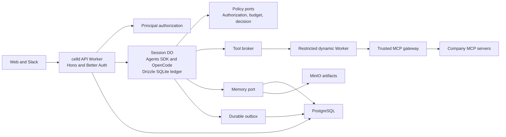

# Cerebro architecture decisions

These decisions define the pilot described in the [delivery plan](2026-09-28-cerebro-delivery.md). Runtime compatibility remains unproven until session 0 passes.

## Runtime ownership

The API runs as a normal celld Worker. Node.js compatibility supports dependencies only to the extent that celld implements their required APIs. It does not turn the Worker into a Node process. [celld compatibility](https://celld.dev/docs/cloudflare-compat/)

The Agents SDK base `Agent` provides the actor integration. OpenCodeWorkerd owns the model and tool loop. Cerebro controls event admission, durable application state, authorization, approvals, and budgets. The first experiment must establish the exact integration points. The [celld OpenCode example](https://github.com/denoland/celld/tree/main/examples/opencode) is the starting point.

Alchemy is outside the initial deployment path. Native celld deployment and Docker Compose are enough for the proposed local topology. The Alchemy integration can be reconsidered independently after [PR 1127](https://github.com/alchemy-run/alchemy/pull/1127) and its self-hosted deployment behavior are suitable.

## Agent, session, and run identities

An agent is a versioned configuration in PostgreSQL. It contains instructions, model configuration, enabled tools, and grants.

A session is one conversation with one agent in one company. Its identity includes `organizationId`, `agentId`, and `conversationId`. Its DO owns the conversation state and ledger. One run processes a user request or an explicit scheduled event inside that session.

This model permits concurrent conversations without one agent DO becoming a shared queue. Shared memory, agent configuration, and budgets need separate shared authorities. A company-wide budget cannot be enforced by independent counters in session DOs.

The per-agent audit view aggregates session events in PostgreSQL. It is eventually consistent. The session ledger is authoritative for execution and replay.

Facet-based sessions are deferred. They introduce parent lifetime and storage coupling that the pilot does not need. The compatibility spike uses ordinary DOs and avoids reliance on unsupported class-binding forms. [celld facets](https://celld.dev/docs/services/durable-object-facets/)

## State ownership

| State | Authoritative store | Access |
| --- | --- | --- |
| Users, organizations, principals, grants, and provider bindings | PostgreSQL | Better Auth and authorization adapters |
| Agent definitions and configuration versions | PostgreSQL | Agent repository |
| Conversation events, runs, invocations, approvals, and pending decisions | Session DO SQLite | Session runtime |
| SDK and OpenCode private state | Their supported storage adapters | The owning library |
| Searchable source chunks, summaries, provenance, and memory ACLs | PostgreSQL with full-text search and pgvector | Memory adapter |
| Source files and large artifacts | MinIO application storage | Artifact adapter |
| Runtime durability data | celld's configured storage | celld |
| Audit and usage projections | PostgreSQL | Idempotent outbox consumer |
| Shared reservations and settlement | Budget authority | Local adapter or Unprice adapter |

Drizzle models PostgreSQL and Cerebro's DO SQLite tables separately. There is no cross-database transaction. Application state changes and their outbox records share the local DO transaction. Remote projections use stable event IDs.

PostgreSQL is the selected main database. A PostgREST service is not part of this design. D1 and SurrealDB are not required for the pilot.

## Identity and authorization contracts

A principal has an internal ID, a company ID, and a kind of human, service, or agent. Execution context identifies the actor, the represented principal when delegated, and the delegation record.

Provider accounts map to internal principals. User input never supplies an authoritative principal or company context. OIDC issuer and subject establish provider identity. Administrator configuration binds that identity provider to the company.

Authorization evaluates a principal, action, resource, and context. Role names map to grants in the adapter. Core execution does not depend on Better Auth, Entra claim names, or a fixed set of role strings.

Delegated execution is limited by both the actor's authority and the represented principal's current grants. Scheduled work uses an explicit service delegation. It does not inherit the last conversational user's identity.

Better Auth SSO covers enterprise login. SCIM covers provisioning and deactivation. Deactivation must also block application authorization and revoke delegations. Provider synchronization is asynchronous, so its observed delay belongs in the pilot report. [Better Auth SSO](https://better-auth.com/docs/plugins/sso), [Better Auth SCIM](https://better-auth.com/docs/plugins/scim)

Better Auth Agent Auth is deferred. The internal principal and delegation model does not require an additional agent login protocol for the first pilot.

## Execution contracts

The event envelope carries `eventId`, `organizationId`, `agentId`, `sessionId`, event type, schema version, timestamp, trusted execution context, and payload. External event adapters validate the envelope before admission.

Each invocation has a stable logical operation ID, normalized argument digest, tool version, principal context, state, and optional provider receipt. The operation ID identifies intent. The argument digest detects inconsistent retries. Identical arguments can belong to two intentional operations.

Invocation states distinguish requested, waiting for approval, running, succeeded, failed, cancelled, and unknown outcome. A successful invocation can return its stored result after a current access check. A running invocation attaches to the existing work. An unknown outcome requires provider lookup or explicit reconciliation.

The ledger is the local idempotency authority. Exactly-once remote effects require cooperation from the remote system. A crash between a provider effect and a local result commit cannot be resolved by the ledger alone.

Approval records bind the exact tool version, arguments, policy version, approver, and expiry. An approval cannot override a later grant removal or authorize changed arguments.

## Policy ports

| Port | Required behavior |
| --- | --- |
| `AuthorizationPolicy` | Allow or deny an action under current grants and delegation |
| `EntitlementPolicy` | Check whether the company can use the agent, model, or capability |
| `BudgetAuthority` | Reserve, inspect, settle, and release shared capacity with stable operation IDs |
| `DecisionMaker` | Propose an allowed next action from a bounded event context |
| `ToolExecutor` | Execute a declared tool under a scoped capability, deadline, and operation ID |
| `MemoryStore` | Retrieve, remember, and forget with scope, provenance, and current access checks |
| `ArtifactStore` | Put, read, and delete scoped artifacts without exposing storage credentials |
| `SessionService` | Submit, inspect, stream, approve, and cancel session work |
| `AgentRepository` | Read and publish versioned agent definitions under company scope |

These are domain contracts, not claimed SDK method names. Session 1 defines their TypeScript signatures and typed failure results. Implementations import the contracts. The contracts do not import celld, Better Auth, Jev, or Unprice.

Admission follows this order. Validate identity, authorize, check entitlements, reserve the bounded cost, obtain any needed decision, apply deterministic policy, then execute. Model context and output limits bound reservations. Settlement records incurred usage even when a run fails or is cancelled.

Jev receives a bounded event and allowed choices. It proposes run, clarify, or defer. The runtime records the accepted proposal and reuses it on replay. Jev does not process every ledger event and cannot grant authority. [TypeSafe documentation](https://docs.typesafe.ai/)

Unprice remains behind entitlement and budget ports. Its adapter owns customer IDs, feature identifiers, remote reservations, and usage mapping. A provider failure differs from a policy denial. Production must not silently allow spending when the authority is unavailable. [Unprice documentation](https://docs.unprice.dev/llms.txt)

## Tool and memory boundaries

Every enabled model tool passes through the broker and a restricted dynamic Worker wrapper. The trusted MCP gateway supplies credentials and enforces destination access. Remote MCP execution occurs outside that wrapper's isolate. A dynamic Worker does not sandbox arbitrary code inside a remote MCP server. [celld dynamic Workers](https://celld.dev/docs/services/dynamic-workers/)

Memory is a set of distinct records, not a single conversation transcript. The DO stores working state. PostgreSQL stores reusable facts and source chunks. MinIO stores files. Search applies current access restrictions before returning content to the model.

Shared memory carries source version, visibility, provenance, and deletion state. Derived summaries retain their source dependencies. Source revocation must prevent later retrieval of both the source and affected derived content.

The pilot uses PostgreSQL to avoid an extra database service. A dedicated memory database remains an option if measured retrieval or relationship requirements exceed this design.

## Verification boundary

Local fixture mode must start without external accounts. It exercises real celld, PostgreSQL, MinIO, auth, SDK integration, and failure recovery with deterministic external responses.

Full pilot verification also needs non-production model, MCP, Entra, Unprice, Jev, and Slack configuration. A fixture result proves the local integration behavior. It does not prove provider interoperability or answer quality.

No implementation prototype ran while this plan was written. Session 0 is the explicit compatibility gate. Sessions 2 through 6 become parallel only after session 1 fixes the contracts and file ownership.
