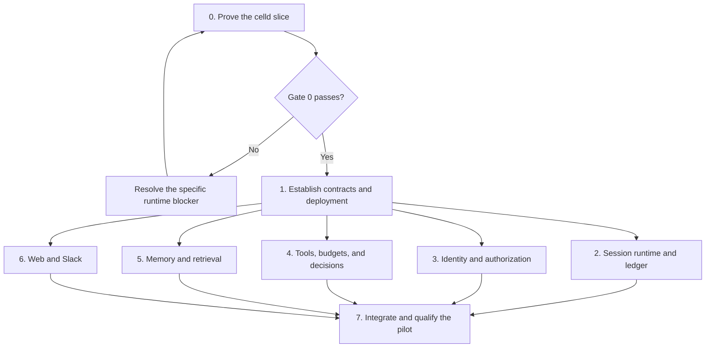

# Cerebro implementation plan

> **For agentic workers:** Use the `executing-plans` skill to execute one assigned session at a time. Use `subagent-driven-development` only when that session delegates work. These are the local equivalents of the `superpowers:` skill names. Check a box only when its evidence exists.

**Goal:** Deliver a self-hosted company assistant with web chat and durable execution. Enable Slack direct messages, controlled MCP access, and enterprise identity only when configured.

**Architecture:** Run the Hono API and Better Auth in a normal celld Worker. Use one session Durable Object per company, agent, and conversation. Keep shared data in PostgreSQL and artifacts in MinIO.

**Tech stack:** celld, Cloudflare Agents SDK, OpenCodeWorkerd, Hono, Better Auth, PostgreSQL, Drizzle, MinIO, TanStack Start, and Docker Compose. Integrate Jev and Unprice through ports.

---

## How to read this

This is a delivery plan for separate chats and worktrees. It does not start implementation, create worktrees, or authorize a production deployment.

Each numbered session has one owner, one branch, and one reviewable outcome. One box is one unit of work and names the evidence needed to finish it. New paths below are proposed files, not existing APIs.

Start with [session 0](2026-09-28-cerebro-celld-slice.md). Use the [architecture decisions](2026-09-28-cerebro-architecture.md) in every session. Write implementation details against the versions that session 0 proves. Do not invent SDK methods before that test.

## Run the work in this order



Sessions 2 through 6 can develop against contract fixtures after session 1. Their isolated checks do not prove the integrated system. Session 7 must test their real adapters together.

**Session 3 gate note, 2026-09-29.** The user directed session 3 to continue without the publicly trusted Worker PostgreSQL TLS check. Its status is **skipped for session 3**, not passed. Gate 0 still lacks that result. A real model provider run applies when that provider is configured. This exception does not qualify a production deployment.

Start with three implementation chats at once. Run sessions 2, 3, and 4 first because they contain the main correctness risks. Start 5 and 6 when slots become free. Keep a coordinator chat for contracts, integration, and review.

| Session | Branch | Start condition | Outcome |
| --- | --- | --- | --- |
| 0 | `codex/celld-feasibility` | Plan is available in the base commit | A reproducible runtime verdict |
| 1 | `codex/cerebro-foundation` | Session 0 passes and is integrated | Stable ports and one-command local deployment |
| 2 | `codex/session-runtime` | Session 1 is integrated | Durable session execution and recovery |
| 3 | `codex/enterprise-identity` | Session 1 is integrated | Principal authorization and enterprise identity |
| 4 | `codex/tools-commercial-policy` | Session 1 is integrated | Controlled tools, Unprice, and Jev adapters |
| 5 | `codex/memory` | Session 1 is integrated | Access-controlled retrieval and memory |
| 6 | `codex/web-slack` | Session 1 is integrated | Admin setup and two conversation channels |
| 7 | `codex/pilot-integration` | Sessions 2 through 6 pass their contracts | A tested company pilot |

## Prepare each session

- [ ] Commit the approved plan before creating dependent worktrees. Record the commit in the coordinator's handoff.
- [ ] Inspect attached worktrees before creating another. Use the Codex managed worktree tools when execution begins.
- [ ] Create each worktree from the recorded, integrated prerequisite commit. Do not start every branch from today's initial commit.
- [ ] Give each chat its own branch and worktree. Never run two implementation chats in the same checkout.
- [ ] Set a distinct Compose project name, host port allocation, database, and MinIO volumes for each worktree. Do not share mutable test services.
- [ ] Record the branch, base SHA, assigned files, commands, results, and remaining blockers in `docs/implementation/session-N.md`.
- [ ] Review one session's diff before integrating it. Rebase later work onto the integrated contracts before final verification.

Use this prompt to start each implementation chat. Replace the session number with the assigned number and provide the recorded base SHA in the chat.

```text
Implement session N from docs/superpowers/plans/2026-09-28-cerebro-delivery.md.
Read its linked architecture decisions and the repository AGENTS.md.
Use only this chat's assigned worktree and branch.
Inspect the prerequisite receipt before editing.
Stay within the assigned files. Send shared-contract and dependency requests
to the coordinator instead of changing shared files in parallel.
Run the specified behavior checks and record commands, versions, and results
in docs/implementation/session-N.md. Separate real integration results from
fixture results. Finish with the commit SHA, evidence, and remaining blockers.
Do not deploy externally or merge a pull request as part of this session.
```

## Keep shared edits under one owner

The coordinator owns these files after session 1:

- `package.json`, `pnpm-workspace.yaml`, `pnpm-lock.yaml`, and `turbo.json`.
- `compose.yaml`, deployment scripts, and shared test configuration.
- `packages/contracts/**` and contract fixture definitions.
- `packages/db/drizzle.config.ts` and the PostgreSQL migration sequence.
- `apps/server/src/index.ts`, `apps/server/cloudflare-env.d.ts`, and Worker deployment bindings.
- `packages/api/src/routers/index.ts` and the final service composition.

Subsystem owners can edit their package manifests. They report new dependencies to the coordinator, who updates the catalog and lockfile before frozen-lockfile validation. Do not commit competing lockfile resolutions.

Each subsystem owns separate PostgreSQL schema modules. The coordinator generates migrations in integration order. Do not generate overlapping migration snapshots in parallel branches. Session 2 owns the separate DO SQLite migration sequence.

## Prove the runtime before product work, session 0

**Depends on.** No implementation session.

**Files.** Own `experiments/celld-slice/**` and `docs/implementation/session-0.md`. Make dependency edits only if the isolated experiment needs them. Keep product code unchanged.

- [ ] Execute the [minimal slice plan](2026-09-28-cerebro-celld-slice.md) in order.
- [ ] Publish a pass or fail for each criterion, with exact dependency versions and reproducible commands.
- [ ] If a criterion fails, identify the unsupported API or failure window. Fix that blocker or present a scoped alternative before session 1 starts.

**Exit condition.** The actual celld runtime passes the API, database, auth, agent loop, tool control, and recovery checks. An import-only test or a direct DO mock is insufficient.

## Establish contracts and deployment, session 1

**Depends on.** Session 0 passes.

**Files.** Own the shared files listed above. Modify `packages/db/src/index.ts`, `packages/db/src/config.ts`, `packages/db/src/schema/auth.ts`, `packages/db/src/relations.ts`, `packages/auth/src/index.ts`, `apps/server/src/env.server.ts`, `apps/server/src/services.ts`, and the affected package manifests. Create `packages/contracts/src/{identity,events,session,tools,memory,policy}.ts`, `packages/contracts/src/testing/fixtures.ts`, `packages/db/src/schema/core.ts`, `deploy/{Dockerfile,bootstrap.mjs}`, `tests/contracts/contracts.test.ts`, and `tests/integration/boot.test.ts`.

- [ ] Port the proven celld configuration into the application. Keep Hono and Better Auth in the API Worker.
- [ ] Replace the D1 database adapter with the PostgreSQL adapter that passed session 0. Use a separate SQLite adapter inside DOs.
- [ ] Define the event envelope, principal context, session commands, tool invocation, approval, memory query, and policy results described in the architecture document.
- [ ] Define ports for `SessionService`, `AuthorizationPolicy`, `AgentRepository`, `ToolExecutor`, `MemoryStore`, `ArtifactStore`, `EntitlementPolicy`, `BudgetAuthority`, and `DecisionMaker`. Define errors, cancellation, deadlines, and idempotency semantics with each port.
- [ ] Add contract fixtures for an allowed user, a denied user, an expired delegation, a duplicate event, a tool with an unknown outcome, and a depleted budget.
- [ ] Establish PostgreSQL schema ownership, DO migration ownership, and a transaction boundary for each repository operation.
- [ ] Add Compose services for celld, PostgreSQL, MinIO, the web application, and idempotent initialization. Build and publish Workers through native celld deployment.
- [ ] Make `docker compose up --build` start the local fixture mode from a fresh checkout with Docker as the host prerequisite. Persist databases and MinIO state across ordinary restarts.
- [ ] Support separate production configuration. Generate local secrets in local volumes, require production secrets, and keep credentials out of Worker source and logs.
- [ ] Verify the current TanStack Start build on celld. If SSR cannot run there, record the exact failure and use a web container in Compose. The API remains a celld Worker.
- [ ] Remove Alchemy runtime and type imports, obsolete D1 configuration, and `packages/infra` after migrating their callers. Replace the root deploy script with native celld deployment. Do not retain two active deployment paths.
- [ ] Add root scripts `test:contracts`, `test:boot`, and the later session test entry points. Mark fixture adapters explicitly and reject them in production mode.

**Verify.** Run `rtk proxy pnpm check-types`, `rtk proxy pnpm check`, `rtk proxy pnpm build`, `rtk proxy pnpm test:contracts`, and `rtk proxy pnpm test:boot`. A fresh boot reaches readiness. A second boot preserves a created user and session. No Alchemy account, D1 binding, or external model key is required for fixture mode.

**Handoff.** Record the contract commit and exact Compose commands in `docs/implementation/session-1.md`. Start parallel sessions only from this integrated commit.

## Implement session execution and the ledger, session 2

**Depends on.** Session 1. Use fixture policy and tool adapters until session 7.

**Files.** Own `packages/runtime/**`, `packages/db/src/schema/audit.ts`, `packages/db/src/repositories/audit.ts`, and `tests/runtime/**`. Create `packages/runtime/src/{session-agent,session-service,event-handler,ledger,recovery,outbox,opencode-adapter}.ts` and `packages/runtime/src/storage/{schema,migrate}.ts`.

- [ ] Derive the session DO identity from company ID, agent ID, and conversation ID. Pin the agent configuration version at run creation.
- [ ] Extend the Agents SDK base `Agent` and embed the proven OpenCodeWorkerd integration. Keep one owner for the model loop.
- [ ] Persist inbox deduplication, runs, tool invocations, approval requests, decisions, and outbox events with Drizzle SQLite.
- [ ] Claim each event and tool invocation transactionally. Persist intent before external work. Persist results before publishing completion.
- [ ] Implement queued, running, waiting-for-approval, completed, failed, and cancelled run states. Treat unknown external tool outcomes as a distinct reconciliation state.
- [ ] Resume pending work after restart through a durable wake-up mechanism proved on celld. Persist cancellation and approval events before acknowledging them.
- [ ] Return the existing authorized result for a completed operation ID. Reject the same operation ID with a different argument digest.
- [ ] Preserve logical invocation IDs through model and tool retries. Keep an intentional second call distinct even when its arguments match.
- [ ] Export audit and usage events to PostgreSQL through an outbox. Deduplicate projection writes by event ID. Keep the DO ledger authoritative for its session.
- [ ] Keep Cerebro migrations separate from SDK and OpenCode tables. Exercise upgrades with existing session data.

**Verify.** Add `tests/runtime/recovery.test.ts` and `tests/runtime/isolation.test.ts`. Run `rtk proxy pnpm test:runtime` against celld. Prove duplicate delivery, approval replay, cancellation after restart, stream reconnect, outbox retry, and separation between two companies. Kill the process after a remote effect but before its result is stored. An idempotent provider returns the same result. A non-idempotent provider enters reconciliation and receives no blind retry.

**Handoff.** Record durable wake-up behavior and recovery evidence in `docs/implementation/session-2.md`.

## Implement identity and authorization, session 3

**Depends on.** Session 1. Use session contract fixtures until session 7.

**Files.** Own `packages/auth/**`, `packages/authorization/**`, `packages/db/src/schema/{auth,identity}.ts`, `packages/db/src/repositories/identity.ts`, `packages/api/src/routers/identity.ts`, and `tests/identity/**`.

- [x] Map Better Auth users to stable internal principals. Keep provider identities separate from principal IDs.
- [x] Implement company membership, agent grants, connector grants, and explicit service delegation. Derive principal context on the server.
- [x] Implement an authorization policy over principal, action, resource, and context. Keep role names outside core execution logic.
- [x] Add Entra ID OIDC through Better Auth SSO. Validate issuer and subject. Restrict tenant and organization binding through administrator configuration.
- [x] Add SCIM provisioning and deactivation with explicit group-to-role mappings. Verify plugin behavior at the chosen Better Auth version.
- [ ] Block disabled principals, revoke their sessions and delegations, and prevent resumed work from using removed permissions.
- [ ] Recheck current authorization before sensitive reads, tool calls, approvals, and resumed execution. Do not rely on the membership snapshot from conversation creation.
- [x] Define a Slack account-link flow that proves both identities. Never grant access by matching an unverified email address.
- [x] Expose organization-scoped audit and usage export authorization. SSO claims do not grant budget increases.

**Session 3 status, 2026-09-29.** Local OIDC, SCIM, PostgreSQL, and authorization checks pass. The real Entra round trip remains unrun and applies only when Entra is configured. The disabled-principal and current-permission rules need integration at enabled resumed execution and other sensitive runtime call sites in session 7; those two checklist items remain open. TLS is skipped for session 3 under the Gate 0 note above.

**Verify.** Add `tests/identity/authorization.test.ts`, `tests/identity/oidc.test.ts`, and `tests/identity/scim.test.ts`. Run `rtk proxy pnpm test:identity`. Verify tenant mismatch, insufficient grants, deactivation during a paused run, expired delegation, group removal, and prevention of cross-company exports. Use a local OIDC and SCIM fixture first. Record a real Entra tenant round trip separately before claiming Entra compatibility.

**Handoff.** Document claim mapping, provisioning behavior, and the revocation delay in `docs/implementation/session-3.md`. Keep SAML outside this pilot.

## Implement tools, budgets, and decisions, session 4

**Depends on.** Session 1. Integrate with the proven OpenCode hook through the runtime contract.

**Files.** Own `packages/tools/**`, `packages/policy/**`, `packages/db/src/schema/{connectors,usage}.ts`, `packages/db/src/repositories/{connectors,usage}.ts`, and `tests/policy/**`. Create `packages/tools/src/{broker,dynamic-worker,mcp-gateway,registry}.ts` and `packages/policy/src/{authorization-gate,local-budget,unprice-adapter,jev-adapter,decision-router}.ts`.

- [ ] Send every enabled OpenCode tool call through the broker. Disable built-in capabilities that can bypass the broker.
- [ ] Run tool wrappers in dynamic Workers with no ambient network access. Give each wrapper only the required service capability and deadline.
- [ ] Keep connector credentials in the trusted gateway. Validate tool schemas, normalize arguments, cap output size, and propagate operation IDs to providers.
- [ ] Implement a read-only MCP connector and a controlled write fixture. Keep real external writes outside this pilot.
- [ ] Enforce authorization and entitlements before paid work. Reserve a bounded amount before Jev or model work, including work that ends in failure.
- [ ] Implement a local budget authority with atomic reservations across sessions. Concurrent sessions must not each spend the same remaining balance.
- [ ] Implement Unprice mapping behind the ports. Verify current SDK methods before mapping reserve, inspect, settle, release, and usage export. Do not treat a read-only access check as a reservation.
- [ ] Make reservation retries stable. Reconcile timeouts with an unknown remote outcome. Settle incurred usage and release unused capacity without double accounting.
- [ ] Implement Jev as a decision proposal for run, clarify, or defer. Record input digest, allowed choices, model version, output, and usage in the session ledger through the runtime contract.
- [ ] Keep cancellation, approval, revocation, and ledger maintenance deterministic. Reuse accepted decisions on replay. Require hard policy checks after every proposed action.
- [ ] Bind approval to tool version, normalized argument digest, principal, policy version, and expiry. A stale approval cannot authorize a changed request.

**Verify.** Add `tests/policy/tool-boundary.test.ts`, `tests/policy/budget-concurrency.test.ts`, and `tests/policy/decision.test.ts`. Run `rtk proxy pnpm test:policy`. Prove denied egress, denied connector access, no tool bypass, two sessions competing for one reservation, timeout reconciliation, rejected stale approval, and a Jev proposal that cannot override a denial. Exercise local fixtures without credentials. Verify external adapters separately with non-production configuration.

**Handoff.** Record SDK method mappings, enforced cost bounds, and fixture versus provider results in `docs/implementation/session-4.md`.

## Implement memory and retrieval, session 5

**Depends on.** Session 1. Use the authorization contract from session 1.

**Files.** Own `packages/memory/**`, `packages/db/src/schema/memory.ts`, `packages/db/src/repositories/memory.ts`, `packages/api/src/routers/memory.ts`, and `tests/memory/**`. Create `packages/memory/src/{ingest,retrieve,remember,forget,artifact-store}.ts`.

- [x] Store source identity, version, company, visibility, owner, timestamps, and retention state with every memory item.
- [x] Separate conversation summaries from shared knowledge and explicit remembered facts. Keep source documents and large artifacts in MinIO.
- [x] Add PostgreSQL full-text retrieval. Add pgvector for semantic retrieval without introducing another database service.
- [x] Apply access restrictions in the retrieval query before returning content. Resolve current grants and source revocations on every read.
- [x] Make ingestion repeatable by source ID and version. Remove obsolete chunks when a source version changes.
- [x] Return citations with source and version. Never promote an untrusted model statement to a verified company fact without provenance and an explicit write policy.
- [x] Implement deletion and source revocation across chunks, embeddings, summaries, and artifacts. Invalidate affected derived memory.
- [x] Keep embeddings behind a port. Provide deterministic local fixtures and a configurable real embedding provider.

**Verify.** Add `tests/memory/access.test.ts`, `tests/memory/lifecycle.test.ts`, and `tests/memory/retrieval.test.ts`. Run `rtk proxy pnpm test:memory`. Prove cross-company isolation, different user grants inside one company, revoked-source exclusion, idempotent ingestion, deletion of derived data, and correct citations. Use a small fixed question set to evaluate real retrieval separately from synthetic vector fixtures.

**Handoff.** Record the memory schema, deletion behavior, and retrieval evaluation in `docs/implementation/session-5.md`.

## Implement the product flow, session 6

**Depends on.** Session 1 for development. Sessions 2 through 5 for final acceptance.

**Files.** Own `apps/web/src/**`, `packages/ui/src/**`, `packages/channels/**`, `packages/api/src/routers/{agents,conversations,approvals}.ts`, `packages/db/src/schema/agents.ts`, `packages/db/src/repositories/agents.ts`, and `tests/channels/**`.

- [ ] Add agent creation with a versioned instruction, model choice, connector selection, and grants. Do not add a general workflow editor.
- [ ] Add a conversation page with streamed output, citations, tool status, and a visible approval state.
- [ ] Add agent access management, budget status, and an execution history that links to audit entries.
- [ ] Bind each web conversation to one session ID. Reconnect with the same event IDs and stream cursor.
- [ ] Implement Slack event signature and timestamp verification. Persist deduplication before acknowledging accepted work.
- [ ] Bind Slack direct-message threads to stable session IDs and linked principals. Use a reply outbox and suppress duplicate replies.
- [ ] Handle uncertain Slack delivery without uncontrolled retries. Preserve a receipt for reconciliation when the provider gives no reliable idempotency guarantee.
- [ ] Provide a local Slack fixture route only in development mode. Keep shared-channel answers outside the pilot to avoid disclosure to unverified channel members.

**Verify.** Add `tests/channels/web.test.ts` and `tests/channels/slack.test.ts`. Run `rtk proxy pnpm test:channels`. Drive the actual UI to create an agent, ask a question, follow a citation, disconnect, and resume. Replay a Slack event and assert one accepted user message. Remove a user's grant and confirm that both channels deny the next action.

**Handoff.** Save screenshots of the admin, conversation, and approval flows. Record fixture and actual Slack workspace results separately in `docs/implementation/session-6.md`.

## Integrate and qualify the company pilot, session 7

**Depends on.** Sessions 2 through 6 pass their contracts.

**Files.** Own shared composition and migration files, `tests/integration/**`, `deploy/**`, `README.md`, and `docs/operations/**`. Coordinate subsystem fixes with their owners.

- [ ] Integrate session 2, then session 3, then session 4, then session 5, then session 6. Generate PostgreSQL migrations after each schema addition.
- [ ] Run the affected contracts after each integration. Resolve interface drift before adding the next subsystem.
- [ ] Replace fixture adapters with real adapters in production composition. Assert that no production path can select an allow-all policy or a fake provider.
- [ ] Connect the API Worker, session DO, tool broker, PostgreSQL, and MinIO in the actual celld deployment graph.
- [ ] Implement readiness, redacted structured logs, trace IDs, and audit correlation. Distinguish an authorization denial from a provider outage.
- [ ] Verify company-scoped usage and audit export. Confirm that ledger replay never duplicates exported charges or records.
- [ ] Add backup and restore instructions for PostgreSQL, MinIO, and all celld state required by the pinned release. Restore into fresh volumes and verify sessions and memory.
- [ ] Run the pilot acceptance sequence below. Record external checks that remain blocked by credentials as incomplete, not passed.
- [ ] Document upgrades, migration rollback limits, secret rotation, port configuration, and the tested deployment size in `docs/operations/pilot.md`.

Run these checks through the deployed API and UI:

1. Start a fresh installation with `rtk proxy docker compose up --build -d --wait`.
2. Create an administrator, a support user, an agent, and one read-only MCP connection.
3. Ask a permitted question in the web UI. Verify the cited source and usage record.
4. Ask from a linked Slack direct message. Verify the same authorization rules.
5. Revoke the source grant. Verify that the next retrieval and cached-result read deny access.
6. Replay an event and a completed tool request. Verify one logical execution and one accounting result.
7. Pause for fixture approval, restart celld, then approve. Verify one permitted fixture effect.
8. Exhaust a shared budget from concurrent sessions. Verify that admitted work stays within reserved limits.
9. Kill celld during tool execution. Verify recovery or explicit reconciliation without duplicate non-idempotent effects.
10. Restore backups into a fresh Compose project. Verify auth, conversations, ledger entries, source access, and artifacts.

**Verify.** Run `rtk proxy pnpm test:integration`, `rtk proxy pnpm check-types`, `rtk proxy pnpm check`, and `rtk proxy pnpm build`. Record latency to first response, tool duration, restart recovery time, memory use, and database connections under a stated concurrent-session load. Compare measurements on the same machine and fixture configuration. Do not claim a capacity figure from a successful single-user test.

**Exit condition.** A fresh installation passes the acceptance sequence. Record live results for each model, MCP, Entra, Unprice, Jev, or Slack integration enabled in the pilot. Mark unconfigured integrations as not applicable. A configured integration cannot be marked ready without its live check. The receipt identifies any deployment limit and recovery procedure.

## Keep the pilot scope bounded

Deliver one company per installation, with company IDs enforced in application data and policies. Include agent creation, web chat, cited retrieval, execution history, and budget enforcement. Enable Slack direct messages, one read-only MCP connector, and enterprise identity only when configured.

Defer autonomous bug fixes, repository sandboxes, arbitrary uploaded code, facet-based sessions, shared Slack channels, SAML, a marketplace, a workflow editor, multi-region deployment, and Alchemy integration. The controlled write fixture proves approval and replay behavior without adding real external writes to the pilot.

## Record the throughput checkpoint

The serial work is session 0, session 1, and final integration. Do not increase concurrency before those dependencies are clear. Parallelize independent packages after the contract commit.

At each handoff, record the tested head SHA and contracts SHA. If two owners need the same shared file, the coordinator makes that edit once. If a runtime assumption fails, stop dependent work and revise the relevant contract before more code accumulates.

Session 0 is the first action when execution starts. Its result determines whether the rest of this plan proceeds on celld.
